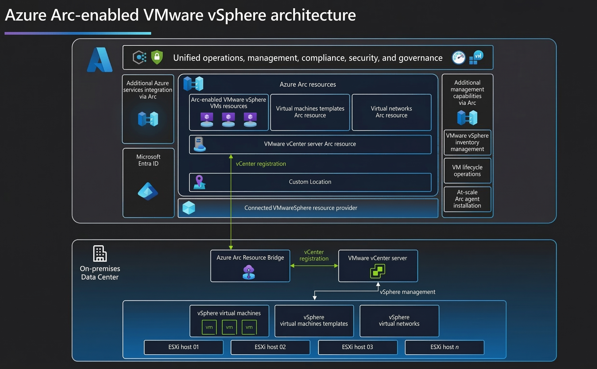

Azure Arc-enabled VMware vSphere is an Azure Arc service that helps you simplify management of hybrid IT estate distributed across VMware vSphere and Azure. It does so by extending the Azure control plane to VMware vSphere infrastructure. The technology enables the use of Azure for VM management and Azure services to enable security, governance, monitoring and patching across VMware vSphere on-premises private clouds, and Azure VMware Solution (AVS) private clouds.

Azure Arc-enabled VMware vSphere allows you to:

- Discover your VMware vSphere estate (VMs, templates, networks, datastores, clusters/hosts/resource pools) and register resources with Azure at scale.
- Perform various virtual machine (VM) operations directly from Azure, such as create, resize, delete, and power cycle operations such as start/stop/restart on VMware VMs consistently with Azure.
- Enable developers and application teams to self-serve VM operations on-demand mediated by Azure role-based access control.
- Govern, protect, configure, and monitor guest operating systems by installing the Azure Connected Machine agent and enabling the Azure services you need.
- Browse your VMware vSphere resources (VMs, templates, networks, and storage) in Azure.
- Use Windows Server management benefits for qualifying licenses and enroll eligible Windows Server and SQL Server workloads in Extended Security Updates (ESUs). Don't assume ESUs are free on AVS: Windows Server and SQL Server terms depend on the version.

To connect your VMware vCenter Server to Azure Arc, you need to deploy the Azure Arc resource bridge in your vSphere environment. Azure Arc resource bridge is a virtual appliance that hosts the components that communicate with your vCenter Server and Azure.

vSphere resources are automatically discovered when you connect a VMware vCenter Server to Azure. After initial discovery, regular synchronization between the vCenter Server and Azure ensures that this inventory data is kept up-to-date.

Choose the management layer for the task. To resize a VM, add a virtual disk, or power cycle the VM, onboard it for **Virtual hardware management only**. The resource bridge sends the operation to vCenter; no agent is required inside the VM. To install a monitoring extension or assess updates inside the guest OS, choose **Arc agent with virtual hardware management**. This also installs the Azure Connected Machine agent.

For on-premises deployments, the support matrix lists vCenter Server version 8. One resource bridge can connect multiple vCenters, but their **combined** inventory must not exceed 9,500 VMs. A managed AVS private cloud uses its own onboarding procedure so Azure can identify the hosting platform correctly.

Discovery makes inventory visible; it doesn't grant management access or install software. Onboard the selected VMs, resource pools, networks, datastores, and templates as Azure resources. You can then give teams permissions on those resources through Azure role-based access control (RBAC).

The difference between Azure Arc-enabled servers and Azure Arc-enabled VMware vSphere is as follows:

- Azure Arc-enabled servers interact on the guest operating system level, with no awareness of the underlying infrastructure fabric and the virtualization platform that it's running on. 
- Azure Arc-enabled VMware vSphere is a superset of Arc-enabled servers that extends management capabilities beyond the guest operating system to the VM itself. This provides lifecycle management and CRUD (Create, Read, Update, and Delete) operations on a VMware vSphere VM. These lifecycle management capabilities are exposed in the Azure portal and look and feel just like a regular Azure VM.
