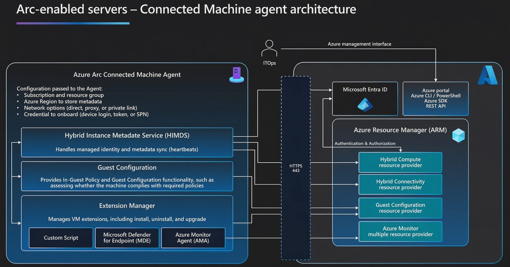

Use the resource bridge and vCenter to manage virtual hardware. Use the Azure Connected Machine agent inside a VM to manage its operating system. A VM can start with either kind of management.

If a VMware VM is **already an Arc-enabled server**, don't install another agent. To add hardware management, the Arc machine and the connected vCenter must be in the same Azure region. With the **Azure Arc VMware Administrator role**, open vCenter's **Virtual machines** inventory, select the machine marked **Action needed** under virtual hardware management, and use **Manage Arc onboarding > Onboard**. Confirm that virtual hardware management becomes **Enabled**. Linking the existing machine preserves its extensions.

## Operate virtual hardware

For these operations, the VM must be onboarded for hardware management, vCenter must be **Connected**, and the resource bridge must be **Running**. Use **Azure Arc VMware VM Contributor** on the VM and the infrastructure permissions needed for any added storage or network. Open the VM from vCenter's **Virtual machines** inventory.

- **Power:** Select **Start**, **Stop**, or **Restart**, then confirm the action. Coordinate service interruption with the workload owner. Track the operation in the Azure **Activity log** and confirm the resulting VM power state.
- **Resize or add hardware:** Use **Settings > Size** to change CPU cores or memory, then **Save**. Place the VM in a **Stopped** state before disk changes. To add a disk, use **Settings > Disks > Add disk**, enter its settings, and select **Add > Apply**. Use **Settings > Networking** for NIC changes. These actions change virtual hardware, not guest partitions or application configuration.
- **Remove management or delete the VM:** **Offboard** removes the Azure representation and keeps the VMware VM. **Delete** also deletes the VM on the vCenter-managed host. Before deletion, obtain the workload owner's approval and back up critical data. Complete any guest cleanup described below before selecting either action.

Before removing guest management, cancel any unneeded SQL ESU subscription and adjust Windows ESU licenses. Removing the agent isn't a substitute for managing those paid enrollments. If the guest agent is installed, complete VMware guest-management cleanup on the target VM before either removal path: uninstall its VM extensions, run `azcmagent disconnect --force-local-only` as administrator or root inside that VM, then uninstall the Connected Machine agent. Uninstalling the agent alone doesn't remove its extensions. The local-only disconnect leaves the Azure resource for the subsequent **Offboard** or **Delete** operation; don't substitute a plain `azcmagent disconnect`, which also deletes the Azure machine resource. Don't run the separate vCenter-wide removal steps when removing just one VM.

## Enable guest management

For portal installation, confirm that vCenter is **Connected**, the bridge is **Running**, and the bridge can reach the ESXi host running the VM. You need the **Azure Arc VMware VM Contributor** role on the target VMs or equivalent installation permissions. Confirm that `Microsoft.HybridCompute`, `Microsoft.GuestConfiguration`, and `Microsoft.HybridConnectivity` are registered in the VMs' destination subscription. If registration is needed, have an identity with subscription-level provider-registration permission perform it; a role on the VM alone doesn't grant that permission.

1. Check that each VM is powered on, runs an OS supported by the Connected Machine agent, and has VMware Tools installed and running. On Linux, confirm that `systemd`, `wget`, and `openssl` are installed; Debian-based systems also require `gnupg`. Install missing prerequisites through the distribution's approved package-management process before onboarding. For portal-assisted installation on Windows, confirm that **Windows PowerShell 5.1** and an OS-compatible, supported **.NET Framework** release meeting the documented **4.6-or-later** minimum are installed in the guest. The management workstation's software doesn't satisfy these guest requirements. Verify that the effective Windows PowerShell execution policy is `RemoteSigned`, `Bypass`, or `Unrestricted`; `AllSigned` isn't supported. If Group Policy restricts **Log on as a service**, arrange for the agent's `NT SERVICE\himds` account to have that right. Resolve enforced-policy conflicts with the policy owner rather than attempting a local bypass. Allow the guest agent's required outbound endpoints; opening connectivity for the bridge doesn't open it for the guest. Installing the agent through the portal requires VMware Tools; out-of-band installation is a separate option.
1. In the connected vCenter's **Virtual machines** inventory, select the target VMs and **Manage Arc onboarding**. Select the destination subscription and resource group if prompted, then **Arc agent with virtual hardware management**.
1. Choose public endpoint, proxy server, or private endpoint for **guest-agent** connectivity. Before selecting private endpoint, configure an Azure Arc private link scope, its private endpoint, network routing, and DNS resolution using an identity authorized to create those resources. Associating the machine requires `Microsoft.HybridCompute/privateLinkScopes/read` on the scope as well as the machine onboarding permissions. The machine and scope must be in the same Azure region. Retain access to endpoints listed as public in the agent network requirements, including Microsoft Entra ID; the Arc private link scope doesn't privatize all agent traffic. The private endpoint option doesn't supply private connectivity for the resource bridge.
1. Supply a Windows account in the local Administrators group or the required Linux root credentials. The wizard also supports SSH key authentication for Linux; if the installation uses `sudo`, it must not prompt for a password. Select VMs together only if they can use the same credentials. Select **Onboard**.
1. Wait for the **Arc agent status** column to show **Enabled**. You can now deploy supported extensions. The credentials used for guest installation aren't retained in Azure.

## Manage the guest and its extensions

The Connected Machine agent provides an identity for the machine and manages guest configuration and extensions. It doesn't collect guest performance logs or provide endpoint protection by itself. An OS supported by Arc isn't automatically supported by every guest service; check each service's OS and extension requirements. Choose the service for the task:

| Task | What to configure |
|---|---|
| Audit guest settings or software changes | Assign Azure Machine Configuration policies for settings. For installed software, services, registry, or file changes, enable Azure Change Tracking and Inventory with its Change Tracking extension (version 2.20.0.0 or later), Azure Monitor Agent, and a data collection rule (DCR) using the Change Tracking schema, associated with the machine and targeting a Log Analytics workspace. Associate only one Change Tracking DCR per machine; additional Change Tracking rules are ignored. Don't add ordinary performance or event-log data sources to that rule, because doing so can break Change Tracking. Azure Monitor Agent alone doesn't configure this service. |
| Monitor guest performance or events | Enable Azure Monitor guest monitoring. For guest logs, deploy Azure Monitor Agent and associate a data collection rule that specifies what to collect and the destination Log Analytics workspace. A log rule isn't a process dependency map. |
| Investigate application dependencies | For new deployments that need process-to-process maps, evaluate a supported monitoring solution that explicitly discovers processes and their network connections on the target guest OS. Guest performance monitoring doesn't provide that map, and Azure Monitor Agent isn't a drop-in mapping replacement. |
| Manage updates and recurring work | Use Azure Update Manager with Arc connectivity and working guest update sources. Confirm that `Microsoft.Compute` is registered in the machine's subscription for Update Manager and automatic extension upgrades; have a subscription-authorized identity register it if needed. Update Manager doesn't require Azure Monitor Agent, Log Analytics, or an Automation account. To run runbooks locally, configure an extension-based Hybrid Runbook Worker, an Automation account and worker group, and the Arc machine's system-assigned managed identity. |
| Run configuration tasks | Use the Custom Script extension to run a post-deployment script, or the Key Vault extension to refresh certificates. |
| Protect the server and correlate events | Configure Defender for Servers for endpoint protection. Connect the relevant data sources to Microsoft Sentinel to correlate security events. |

You can deploy supported extensions through the portal, Azure CLI, Azure PowerShell, or an Azure Resource Manager template. **Azure Connected Machine Resource Administrator** on the Arc machine permits extension deployment, but it also permits deleting the machine resource. Scope the role to the machines the operator manages. For guest-log setup, also confirm permission to create DCRs at the target scope and contributor access to the destination Log Analytics workspace. Create the DCR in the destination workspace's Azure region, then associate it with the Arc machine. The machine doesn't have to share the DCR's resource group. A role assigned only on the VM doesn't grant access to those separate resources. Check each extension's OS support and automatic upgrade options before deployment.

Each extension or service has its own network requirements. A connected Arc agent doesn't prove that monitoring data or endpoint-protection telemetry can reach its service. Where supported, configure Private Link separately for each service, such as Azure Monitor; the Arc private link scope doesn't privatize those connections automatically.

Maintain the Connected Machine agent separately from individual extensions. Azure Advisor recommends updates to outdated agents. Prefer the latest supported agent compatible with the guest OS, and review release notes for required fixes rather than treating the one-year support window as an upgrade schedule. Before a manual Windows upgrade, recheck the effective PowerShell execution policy: `RemoteSigned`, `Bypass`, and `Unrestricted` are supported, but `AllSigned` isn't. Before upgrading or enabling automatic upgrades, check the agent OS support policy: some OS versions have a final compatible agent release that remains supported for 12 months after that release. Plan an OS upgrade before that servicing period ends; don't assume the newest agent supports every previously supported OS. Installing, upgrading, or uninstalling the Connected Machine agent doesn't require a server restart.

For Automatic Agent Upgrade, use agent **1.67 or later** in Azure public cloud. Windows requires the **RemoteSigned** PowerShell execution policy; Linux requires the cron service installed and running. Upgrade older agents through a supported manual or package-management method first. On an existing Arc machine, open **Properties**, select **Agent auto upgrade**, and enable automatic upgrades. Confirm that its status is **Enabled**. This setting doesn't enable automatic upgrades for individual extensions.

**Enabled** confirms the Azure setting, not a completed upgrade. On the VM, run `azcmagent config get automaticupgrade.blocklocally`: `true` blocks automatic upgrades even when the portal setting is enabled. Resolve any intentional block with the server owner rather than overriding it without approval. After the upgrade rollout, also check the installed agent version.

## Enable Defender for Servers and check protection

1. Confirm that the guest is connected as an Arc-enabled server. If the subscription doesn't already have the intended coverage, review the plan features and pricing before changing it. Enabling the subscription plan requires **Security Admin**, **Contributor**, or **Owner** at subscription scope, or equivalent permissions; a VM- or resource-group-scoped role doesn't authorize this change. Enabling every optional plan capability can require Owner.
1. In **Microsoft Defender for Cloud > Environment settings**, select the subscription. On **Defender plans**, turn **Servers** on. The initial default is Plan 2; use **Change plans** to select the intended plan, then **Confirm** and **Save**. This changes coverage at subscription scope, not just for the selected VM. Review the applicable trial and ongoing charges before saving.
1. Open **Defender for Cloud > Inventory** and find the Arc machine. This confirms asset visibility. For endpoint protection, also check that the Defender for Endpoint integration is enabled and that the machine is onboarded and reporting in Defender for Endpoint.

## Prepare Windows Server VMs for Extended Security Updates

For an eligible on-premises Windows Server 2016 VM, you can configure ESUs before extended support ends on **January 12, 2027**. Billing for activated Arc ESU coverage begins **January 13, 2027**. Coverage provides Critical and Important security updates through **January 8, 2030**; it doesn't restore general product support. Windows Server 2016 ESUs are also a paid offering in Azure. Upgrading to a newer, supported Windows Server version avoids the need for ESUs, but first confirm that the applications support the destination OS.

Before enrollment, check whether ESU certificate preparation is required for the agent and assigned license. With the latest Connected Machine agent, separate intermediate-CA installation and access to the public PKI URL aren't required. A license assigned before an agent upgrade can still need the intermediate certificates for up to 15 days while the license refreshes. Where the assigned license still requires the older certificate-based validation, including that transition, allow automatic retrieval or install the required certificates manually in the local computer's Intermediate Certification Authorities store. Don't infer that every agent release older than the latest needs this preparation. This exception doesn't remove the other required network endpoints or make public endpoints private through Arc Private Link.

1. Confirm that the VM runs Windows Server 2016 Standard or Datacenter and is connected through Arc with a current supported Connected Machine agent; the ESU feature minimum is **1.62**, not a recommendation to install that older release. Qualifying coverage includes active Software Assurance, an eligible server subscription, or license-included SPLA. Where client access licenses (CALs) or External Connector licenses permit access to the server, confirm active Software Assurance or equivalent subscription coverage for those licenses too. Separate ESUs for CALs and External Connectors aren't required or available. Use Contributor or Owner on the relevant resource group to create and assign licenses.
1. Plan the SKU and core count. Virtual-core licensing uses the **Standard** ESU SKU, even for a Datacenter guest, and requires at least **eight cores per VM**. For example, a four-vCPU VM needs eight ESU virtual cores. Physical-core licensing requires at least **16 cores per physical server** and the applicable virtualization entitlements.
1. In **Azure Arc > Licenses > Windows Server 2016 ESU licenses**, select an existing license or choose **Create**. Specify the group, name, region, planned SKU and core count, and activation status. Confirm the applicable license attestation. A deactivated license doesn't provide coverage.
1. Under **Eligible resources**, select the intended VMs and **Enable ESUs**. Choose physical or virtual core licensing as appropriate, select the activated license, and select **Enable**. Check the ESU status on that tab. On each VM, run `azcmagent show` and confirm that **Extended Security Updates** reports **Active**. If local enrollment isn't active, investigate the license assignment, agent connectivity, and applicable certificate requirements before treating the guest as ready to receive ESU patches. Enrollment before January 13, 2027 doesn't make future ESU patches available early.
1. Configure your patching tool, such as Azure Update Manager, to deliver applicable updates. An ESU license establishes eligibility; it doesn't install patches.

Windows Server 2016 ESUs don't include the no-cost Visual Studio dev/test or disaster recovery benefits. When machines no longer need ESUs, reduce the provisioned cores or deactivate the unneeded license; upgrading or removing a VM doesn't automatically stop charges for an activated Windows ESU license. Core reductions lower the billing rate rather than canceling the entire license. Charges can continue for up to five calendar days after a core reduction, deactivation, or deletion. Reactivating a license incurs back-billing for the deactivated interval; deactivation isn't a way to pause charges between security updates.

## Configure SQL Server ESUs on Azure VMware Solution

Check the SQL Server version before estimating costs. An eligible SQL Server 2014 instance can receive no-cost ESUs on a correctly identified AVS VM; **hosting SQL Server 2016 on AVS doesn't itself confer no-cost ESUs**. SQL Server coverage is separate from Windows Server coverage.

SQL Server 2014 ESUs end in **July 2027**. Plan its upgrade before that month: the product lifecycle entry and SQL ESU lifecycle FAQ currently list different end days. SQL Server 2016 reached the end of extended support on **July 14, 2026**, and its ESUs end on **July 17, 2029**. These are fixed program deadlines, not three years from your enrollment date. ESUs provide temporary security-update coverage, not general support for the underlying SQL Server version. Plan an upgrade before the applicable deadline.

For this production scenario, use **64-bit SQL Server 2014 or 2016 Standard or Enterprise**, with **SP3 for both versions**, on **Windows Server 2016 or 2019**. These guest versions satisfy both the SQL engine compatibility matrix and the Arc SQL extension requirements. Although the extension supports newer Windows Server releases, **SQL Server 2014 and 2016 aren't supported on Windows Server 2022 or 2025**. Don't upgrade the guest OS without checking SQL compatibility. Install **.NET Framework 4.7.2 or later** and use the Connected Machine agent in **full** mode.

For paid SQL Server ESU coverage, confirm active Software Assurance, an eligible SQL Server subscription, or SQL Server pay-as-you-go licensing. An out-of-support **Server+CAL** license isn't eligible for an Arc ESU subscription. If changing to SQL Server **pay-as-you-go** to qualify, review the separate SQL software charges as well as ESU charges before selecting that license type. For an Azure subscription managed through a Cloud Solution Provider (CSP), you or your CSP must provide explicit recurring-billing consent when enabling SQL Server pay-as-you-go. Review those terms before consenting; this is separate from ESU enrollment.

Before enabling paid coverage, review the SQL ESU billing rules. Virtual-core metering uses the cores available to the VM's operating system, with a **four-core minimum**, not the Windows ESU eight-core minimum. The Standard-edition ESU subscription limit is **24 virtual cores**, even on a larger VM; don't apply that cap to Enterprise-edition meters. Eligible instances of the same SQL version share a meter using the highest applicable edition; different eligible versions are metered separately.

Late enrollment includes back-billing from the start of the current ESU year, and prior ESU years also require coverage. Qualifying SQL nonproduction and passive HA/DR benefits have separate rules; don't apply the Windows Server 2016 benefit exclusions to SQL Server. Include associated services, such as SQL Server Integration Services, in the host review. Their versions and passive eligibility are evaluated separately from the Database Engine. A passive Database Engine doesn't automatically make an associated service passive, and an installed associated service can incur ESU charges even when stopped. Check these components before assuming an engine upgrade or passive-replica configuration removes the need for paid coverage.

Before onboarding, register `Microsoft.AzureArcData` and `Microsoft.HybridCompute` using a subscription-authorized identity. Place the Arc machine and its SQL resources in the same supported Azure region. The installation identity needs local administrator rights, subscription read access, and the applicable Arc onboarding or extension permissions. Confirm that the SQL Database Engine service account is a `sysadmin` and that `NT AUTHORITY\SYSTEM` is an enabled SQL login with `CONNECT SQL` on each instance. These provisioning requirements don't mean that the extension's normal service account must remain a `sysadmin`. In addition to the guest agent's endpoints, allow the SQL extension's bootstrap domains `aka.ms` and `*.web.core.windows.net`, plus outbound TCP 443 to the regional Azure Arc data processing endpoint. The data processing service doesn't support Azure Private Link. If a system-level `HTTPS_PROXY` environment variable is set, include `localhost` and `127.0.0.1` in `NO_PROXY` so local Arc identity requests don't go through the proxy. This condition applies even to current SQL extension versions.

1. Onboard the private cloud through **Arc for AVS**, not the generic Arc-enabled servers workflow. Enable guest management on the SQL VM through the private cloud's vCenter inventory so Azure identifies it as an AVS machine. Generic onboarding can result in charges even for a version eligible for no-cost ESUs.
1. On the **Machine - Azure Arc (AVS)** resource, open **Extensions**. For a Windows SQL VM, confirm the Azure Extension for SQL Server (`WindowsAgent.SqlServer`) is installed. If it's missing, select **Add > Azure Extension for SQL Server**, complete the extension settings, and create the extension. Wait until the intended SQL instance is visible in Azure before continuing. Apply the version-specific ESU terms, not a blanket no-cost assumption for AVS.
1. Review all SQL instances and associated services on the VM: the SQL Server configuration is a **host-level setting**, not an independent subscription switch for one instance. On the machine, open **Operations > SQL Server Configuration**. Confirm that **License type** is **Pay-as-you-go** or **License with Software Assurance**, consistent with your actual entitlement. After reviewing the affected instances, services, and charges, select **Subscribe to Extended Security Updates**, then **Save**. Check the resulting ESU subscription status on each eligible instance.
1. Prepare the instance for ESU servicing. SQL Server 2014 and 2016 ESUs include cumulative fixes. If the instance has received only general distribution release (GDR) updates, test the applicable supported servicing baseline and ESU package before production rollout. SQL Server 2016 SP3 includes fixes through SQL Server 2016 SP2 CU17, not every subsequent SP2 update. Use the applicable SP3 security update or ESU package; don't install an older service-pack branch's CU over SP3. ESUs address qualifying critical vulnerabilities when needed, not on a guaranteed monthly schedule.
1. Configure your chosen patch deployment process separately. If using Microsoft Update for SQL patches, enable updates for other Microsoft products through the approved guest Windows Update settings or Group Policy. If using WSUS, ensure the relevant SQL updates are available and approved. If you choose Arc SQL automatic updates under **SQL Server Configuration > Update**, agree a maintenance window for Windows and all SQL instances on the host, including possible restarts. These guest updates are separate from automatic extension upgrades. Subscribing to ESUs doesn't configure patching policy; existing automatic-update settings can install newly available ESUs.

Use the SQL instance's **Overview > SQL Server configuration** to check its ESU subscription status. Check its version as well: a generic Arc connection or a visible ESU setting doesn't establish that the SQL version is eligible or that patches have been installed.

Keep the SQL extension connected and reporting usage. If you selected SQL Server pay-as-you-go, periodically inspect **Last Usage Upload Time** in Azure. If uploads haven't arrived for more than 24 hours, investigate the required endpoints, proxy, firewall, and DNS configuration, then confirm uploads resume. The Arc machine's **Connected** state alone doesn't prove that usage reporting works. This pay-as-you-go troubleshooting threshold isn't an ESU grace period. For ESUs, a connectivity loss can suspend coverage, and reconnection can generate charges for the disconnected period; taking the VM offline isn't a way to avoid ESU charges. Before a rebuild or migration that changes the VM identity or Azure region, review the current ESU disruption and identity rules, because a new subscription and bill-back charges can result.

When the VM no longer needs SQL ESUs, review all affected instances and associated services, then select **Unsubscribe from Extended Security Updates** in **SQL Server Configuration** and **Save** before removing the extension or offboarding the machine. This stops the SQL ESU subscription's future charges; it doesn't cancel separate SQL software licensing charges. Canceling ESUs doesn't require uninstalling the extension.

If you choose to uninstall the SQL extension while keeping the machine Arc-connected, first prevent automatic reinstallation. For a single VM, set the tag `ArcSQLServerExtensionDeployment` to `Disabled` on its **Arc server resource**, not its SQL instance resource. Tag changes for existing Arc machines can take up to **eight hours** to take effect because values are cached. Allow for that propagation before uninstalling; setting the tag immediately before removal doesn't reliably prevent reinstallation. An approved extension block list is an alternative. Don't change subscription-wide or resource-group-wide deployment settings merely to remove the extension from one VM.

Opting out doesn't uninstall the extension or cancel an ESU subscription. Windows ESU license reduction or deactivation remains a separate task.
