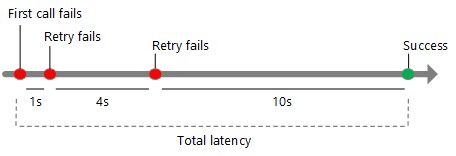

The following table summarizes resiliency strategies for common failure types. Most aren't limited to a particular technology; each provides a general approach to planning and implementing resiliency.

| **Failure type** | **Resiliency** **strategy** |
|:---|:---|
| **Hardware failure** | Build redundancy into the application by deploying components across different fault domains. For example, ensure your VMs are placed in two different racks. |
| **Datacenter failure** | Build redundancy into the application with fault isolation zones across datacenters. |
| **Regional failure** | Replicate the data and components into another region so that the application can be quickly recovered. |
| **Transient failure** | Retry transient failures. |
| **Heavy load** | Load balance across instances to handle spikes in usage. |
| **Dependency service failure** | Degrade gracefully if a service fails and there's no failover path, providing an acceptable user experience.  |
| **Accidental data deletion or corruption** | Back up the data so that it can be restored if there's any deletion or corruption. |
| **Application deployment failure** | Automate deployments with a rollback plan. |

## Build redundancy

Build redundancy into your application to avoid a single point of failure. For example, in an application that depends on IaaS VMs, deploy the VMs into different fault domains in an availability set and place them behind a load balancer. You can also deploy VMs across two or more availability zones behind a zone-redundant load balancer.

## Replicate data and components

Replicating data is a general strategy for handling non-transient failures in a data store. Many storage technologies provide built-in replication, including Azure Storage, Azure SQL Database, Cosmos DB, and Apache Cassandra. It's important to consider both the read and write paths. Depending on the storage technology, you might have multiple writable replicas, or a single writable replica and multiple read-only replicas.

To maximize availability, replicas can be placed in multiple regions. However, this increases the latency when replicating the data. Typically, replicating across regions is done asynchronously; this implies an eventual consistency model and potential data loss if a replica fails. 

## Retry transient failures

Transient failures can be caused by a momentary loss of network connectivity, a dropped database connection, or a timeout when a service is busy. Often, a transient failure can be resolved simply by retrying the request. For many Azure services, the client SDK implements automatic retries in a way that's transparent to the caller.

Each retry attempt adds to the total latency. Also, too many failed requests can cause a bottleneck, as pending requests accumulate in the queue. These blocked requests might hold critical system resources such as memory, threads, database connections, and so on; this can cause cascading failures. To avoid this, increase the delay between each retry attempt, and limit the total number of failed requests. The following diagram explains the relationship between retry attempts and total latency.

> [!IMPORTANT]
> Check whether an operation is safe to repeat (idempotent) before retrying it. A timeout can occur after the service has completed a write; retrying that request can duplicate work unless duplicate requests are detected. Review the SDK's retry behavior before adding another retry loop. Retry only transient failures, bound attempts and total latency, and provide an explicit failure or an appropriate fallback response when retries are exhausted.

## Load balance across instances

For scalability, a cloud application should be able to scale out by adding more instances. This approach also improves resiliency because unhealthy instances can be removed from rotation. For example:

- Put two or more VMs behind a load balancer. The load balancer distributes traffic to all the VMs.
- Scale out an Azure App Service app to multiple instances. App Service automatically balances load across instances.
- Use Azure Traffic Manager to distribute traffic across a set of endpoints.

## Degrade gracefully

If a service fails and there's no failover path, the application might be able to degrade gracefully while still providing an acceptable user experience. For example:

- Put a work item on a queue, to be handled later.
- Return an estimated value.
- Use locally cached data.
- Show the user an error message. (This option is better than having the application stop responding to requests.)

## Back up the data

You should always configure backups for all your data sources. Accidental deletion or corruption can happen at any time, and it could be days before you notice such issues. For this reason, it's important to configure longer retention for your backup copies depending on the nature and criticality of the application.

> [!NOTE]
> Replication improves availability but can also replicate deletions or corruption; it doesn't replace recoverable backups. Choose backup frequency and retention to meet your recovery and business requirements. During restore tests, verify data integrity and completeness, and measure complete application recovery against your RTO and RPO.

## Key Azure services

Azure provides the following features to improve resiliency, from an individual VM to an entire region:

- **Single VM**. Azure provides connectivity SLAs for single-instance VMs that depend on the disk configuration. The 99.9% single-instance SLA requires Premium SSD for all operating-system disks and Premium SSD, Premium SSD v2, or Ultra Disk for all data disks. Eligible Standard SSD and Standard HDD configurations have lower SLA levels; with mixed disk types, the lowest applicable VM SLA for those disk types applies. Consult the current Virtual Machines SLA for all conditions. An SLA doesn't make a single VM fault tolerant. For production workloads that require high availability, deploy redundant instances across appropriate fault domains or availability zones.
- **Availability sets**. To protect against localized hardware failures, such as a disk or network switch failing, deploy two or more VMs in an availability set. An availability set is a logical grouping of VMs that allows Azure to understand how your application is built to provide for redundancy and availability. Each virtual machine in your availability set is assigned an **update domain** and a **fault domain** by the underlying Azure platform. Each availability set can be configured with up to three fault domains and twenty update domains. Update domains indicate groups of virtual machines and underlying physical hardware that can be rebooted at the same time. Fault domains define the group of virtual machines that share a common power source and network switch. VMs in an availability set are distributed across the fault domains, so if a hardware failure affects one fault domain, network traffic can still be routed to the VMs in the other fault domains.  
- **Availability zones**. An availability zone is a physically separate zone within an Azure region. Each availability zone has a distinct power source, network, and cooling. Deploying VMs across availability zones helps to protect an application against datacenter-wide failures. Not all regions support availability zones. If you're planning to use availability zones in your deployment, first validate that your application architecture and codebase can support this configuration. If you're deploying commercial off-the-shelf software, consult with the software vendor and test adequately before deploying into production. An application must be able to maintain state and prevent loss of data during an outage within the configured zone. The application must support running in an elastic and distributed infrastructure with no hard-coded infrastructure components specified in the codebase.
- **Azure Site Recovery**. Azure Site Recovery helps to replicate Azure virtual machines to another Azure region for business continuity and disaster recovery. You can conduct periodic disaster recovery drills to ensure you meet the compliance needs. The VM will be replicated with the specified settings to the selected region so that you can recover your applications in the event of outages in the source region. You should factor in the RTO and RPO numbers for your solution here and ensure that when testing, the recovery time and recovery point are appropriate for your needs.
- **Multiple regions**. To protect an application against a regional outage, deploy the required application components and data across regions and configure a tested recovery approach. Azure Traffic Manager can provide DNS-based routing among regional endpoints. Some Azure regions have a paired region, but many don't. Region pairing doesn't automatically replicate your resources or provide application failover. Select regions according to service availability, data residency, latency, capacity, and recovery requirements.

When you design a multi-region application, remember that network latency across regions is higher than within a region. For example, if you're replicating a database to enable failover, use synchronous data replication within a region, but asynchronous data replication across regions.

When selecting primary and recovery regions, verify that both support the required Azure services, service tiers, and recovery features. It's also critical to select the right deployment topology for disaster recovery, especially if your RPO/RTO requirements are low. To support low recovery times, consider an active/passive (full replica) topology or an active/active topology. Provision and test enough capacity in the surviving region or regions to handle the expected failover load, including traffic moved from a failed active region. If recovery depends on scaling, account for allocation constraints and scaling time when evaluating your RTO. Keep in mind these deployment topologies might increase complexity and cost as resources in the secondary region are pre-provisioned and can sit idle.
