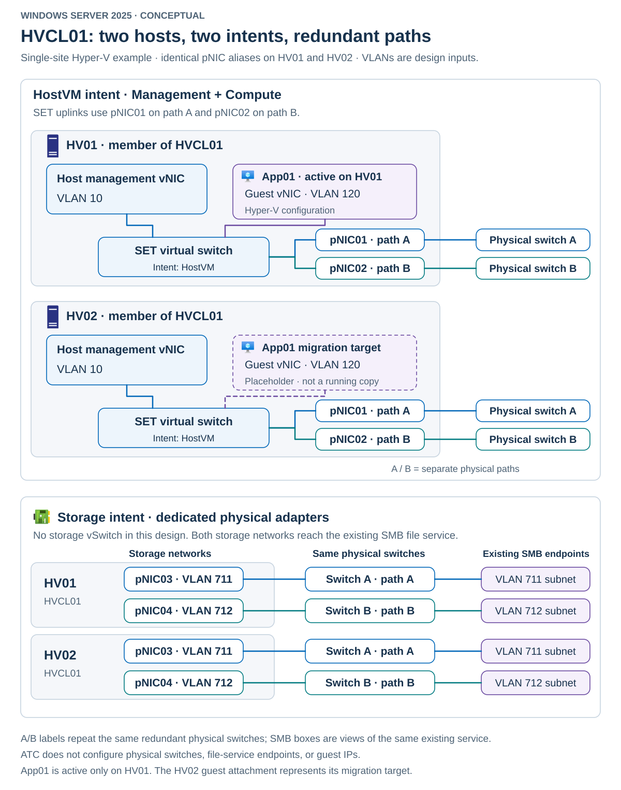

A host can have the correct VLAN and still use the wrong SMB path. An intent can finish provisioning while a switch drops storage traffic. A VM can migrate to a healthy node and lose connectivity because its destination switch doesn't match.

> [!NOTE]
> In Network ATC, an *intent* is a named declaration that identifies physical network adapters and the traffic they should carry: management, compute (VM), storage, or a supported combination. Network ATC uses the intent to configure and maintain the required host networking. Successful provisioning means the host configuration has been applied. It doesn't guarantee that physical switches are configured correctly or that traffic reaches its destination.

Network ATC reduces host configuration inconsistency. It doesn't remove the need to design the physical network or verify workload behavior. Your operational task is to connect three kinds of evidence: the declared intent, the resulting host configuration, and the traffic that actually flows.

## Module scenario

The example cluster, `HVCL01`, has two Windows Server 2025 Datacenter nodes, `HV01` and `HV02`. Each node has four physical adapters with matching names and capabilities. An existing SMB file service supplies VM storage. Its endpoints are reachable on the planned storage networks.

The example divides host traffic as follows.

| Component | Adapters or network | Purpose |
|---|---|---|
| `HostVM` intent | `pNIC01,pNIC02` | Combined host management and VM compute traffic |
| Host management | VLAN 10 | Administration and required host services |
| VM `App01` | Guest VLAN 120 | Example application traffic |
| `Storage` intent | `pNIC03,pNIC04` | Dedicated SMB storage paths |
| Storage path A | VLAN 711 | First storage subnet and file-service endpoint |
| Storage path B | VLAN 712 | Second storage subnet and file-service endpoint |

These VLANs are example design inputs. Automatic host storage addresses must fit the file-service endpoint networks. If enterprise addressing requires different subnets, use the manual-addressing alternative rather than assuming that a VLAN number determines IP reachability.

The following diagram separates the two intents and their physical paths.

Each node uses its first two adapters for a SET-backed virtual switch. The management operating system and guests connect through different virtual adapters. The dedicated storage intent uses the remaining physical adapters. It doesn't need a storage virtual switch in this design. `App01` is active on one node, with the other available as a migration target.

> [!NOTE]
> A *SET-backed virtual switch* is a Hyper-V virtual switch that uses **Switch Embedded Teaming (SET)**, which integrates physical network adapter teaming directly into the virtual switch. Here, `pNIC01` and `pNIC02` form the team, providing shared uplinks for host management and VM traffic. SET distributes traffic across the adapters and allows traffic to continue through the remaining adapter if one fails.

Ownership remains divided even when host configuration is automated.

| Owner | Responsibilities |
|---|---|
| Network ATC | Intent-managed host adapter settings, required switches and host vNICs, VLANs, QoS, and applicable cluster network policy |
| Physical-network team | Switch ports, permitted VLANs, physical paths, MTU, congestion handling, and switch DCB |
| Hyper-V administrator | VM attachment, guest VLAN selection, migration readiness, and workload placement |
| Guest administrator | Guest IP configuration, application connectivity, and guest firewall policy |
| IPAM/DNS administrator | Address allocation, routes, name registration, and conflicts with existing networks |
| File-service administrator | SMB endpoint availability, addressing, permissions, and server-side RDMA readiness |

Cluster services and bootstrap management access are assumed. The creation examples use prepared adapters without conflicting switch or team bindings. Existing production configurations require the adoption process explained later.

Hyper-V doesn't inherently require a storage intent. A host using storage outside the ATC-managed network can use management/compute intents alone. Cluster creation, storage-service deployment, multi-site replication, and management-interface setup aren't part of this module.
