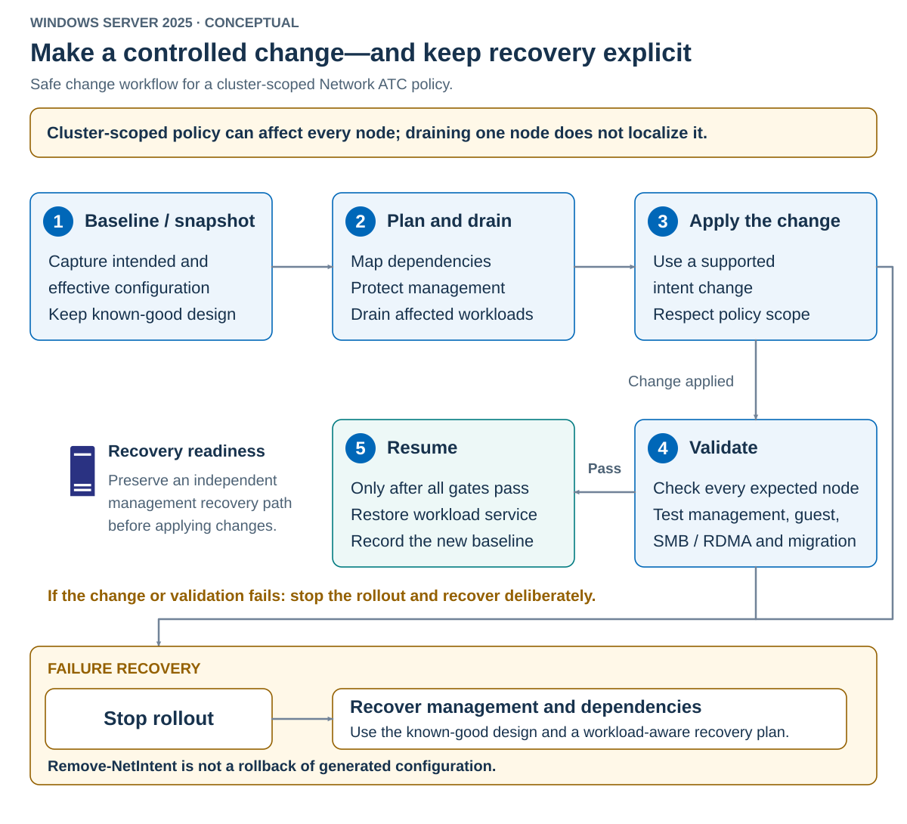

Network ATC lifecycle management covers more than creating an intent. It includes adopting ATC on existing hosts, adding adapters or nodes, changing traffic roles, servicing hardware and software, and retiring configurations. These operations can affect live workloads and shared network resources, so each change needs an approved plan, a record of the working configuration, and a way to recover connectivity if something goes wrong. This section explains how to manage those transitions, account for existing dependencies, and confirm that management, storage, and VM traffic work as intended after each change.

Existing networking has dependencies that don't appear in an intent name. A switch can carry guest traffic, host management, storage vNICs, and settings owned by another tool.

`Add-NetIntent` isn't a conversion command for an occupied switch or an LBFO team. Plan the transition before releasing any resource.

## Choose an adoption strategy

Select the strategy from available hardware, workload mobility, and recovery requirements.

| Strategy | Use it when | Required safeguard |
|---|---|---|
| Retain existing networking | The current supported design has a separate owner or transition risk is unacceptable | Keep ATC away from those resources |
| Rebuild selected resources | A maintenance window permits interruption | Record dependencies and rehearse recovery |
| Use spare adapters for transition | Compatible unclaimed ports and switch connectivity are available | Validate the new paths before moving dependents |

Spare adapters reduce some cutover dependencies. They don't waive symmetry, capacity, intent exclusivity, or switch requirements.

The following diagram shows the sequence from baseline through acceptance and recovery.



## Plan and perform the cutover

Use this ordered procedure for a dependency-aware transition.

1. Inventory switches, teams, physical members, host vNICs, VM attachments, addresses, routes, VLANs, QoS, and external management ownership.
1. Record the intended replacement design and the known-good recovery configuration.
1. Confirm independent management access and enough capacity on unaffected hosts and paths.
1. Drain or move affected workloads and verify that storage and management remain reachable.
1. Release only the approved conflicting resources, then apply the prepared intent.
1. Verify every applicable node, restore or reconnect dependent interfaces, and validate actual workloads.
1. Resume placement only after acceptance. Retain old-resource evidence until the recovery window closes.

The order is important. For example, removing a switch before moving its management or storage dependency can eliminate the path needed to recover it.

VM vNICs must reconnect to the intended switch with their VLAN settings preserved. Check the corresponding switch on every destination host. A migration target with a differently mapped switch can break connectivity after a successful VM move.

## Preserve reconstruction evidence

Capture structured state in an existing restricted directory. Retain the captures in the approved evidence location described earlier in the module. The following example asks for the capture directory and refuses to overwrite existing evidence files.

```powershell
$capture = Read-Host 'Existing restricted evidence directory'
if (-not (Test-Path -LiteralPath $capture -PathType Container)) {
    throw 'Create and secure the evidence directory before capture.'
}

Get-NetIntent -ClusterName HVCL01 -ErrorAction Stop |
    Export-Clixml -LiteralPath (Join-Path $capture 'intents.xml') `
        -Depth 10 -NoClobber -ErrorAction Stop
Get-NetIntent -ClusterName HVCL01 -GlobalOverrides -ErrorAction Stop |
    Export-Clixml -LiteralPath (Join-Path $capture 'global-overrides.xml') `
        -Depth 10 -NoClobber -ErrorAction Stop
Get-VMSwitch -ComputerName HV01,HV02 -ErrorAction Stop |
    Export-Clixml -LiteralPath (Join-Path $capture 'switches.xml') `
        -NoClobber -ErrorAction Stop
Get-NetIPAddress -CimSession HV01,HV02 -ErrorAction Stop |
    Export-Clixml -LiteralPath (Join-Path $capture 'addresses.xml') `
        -NoClobber -ErrorAction Stop
```

Also retain interface mappings, routes, DNS settings, relevant QoS, switch-side configuration, and VM attachment details. Capture OS/module versions and the time of the change. Inspect the saved nested properties because serialization depth can truncate an incomplete capture. Increase the depth only as needed for the required evidence.

An exported object is evidence, not a restore transaction. `Import-Clixml` reconstructs serialized data. It doesn't recreate live switches, restore connectivity, or atomically reapply ATC policy.

Keep the approved desired values and reconstruction commands under change control. Protect captures because they can expose internal addresses, topology, and names.

## Add adapters or change roles

Use `Update-NetIntentAdapter` for membership changes. Supply the complete intended adapter list, not only the new members.

Suppose an approved expansion adds matching `pNIC05,pNIC06` adapters to every node. After preparing their physical paths, the following example expands `HostVM` while leaving the storage pair separate.

```powershell
Get-NetAdapter -Name pNIC05,pNIC06 -CimSession HV01,HV02 `
    -ErrorAction Stop

Update-NetIntentAdapter -ClusterName HVCL01 -Name HostVM `
    -AdapterName pNIC01,pNIC02,pNIC05,pNIC06 `
    -Wait -ErrorAction Stop

Get-NetIntent -ClusterName HVCL01 -Name HostVM | Format-List *
Get-NetIntentStatus -ClusterName HVCL01 -Name HostVM
```

Review symmetry and the resulting switch membership, not just adapter existence. New members can change capacity and traffic distribution. Adapter replacement can also change aliases or advanced properties even when the cable returns to the same port.

Use `Update-NetIntentType` for approved role changes. For a separate standalone starting configuration in which `HostVM` was management-only, the following adds the compute role.

```powershell
Update-NetIntentType -ComputerName HVSTAND01 -Name HostVM `
    -Management -Compute -Wait -ErrorAction Stop

Get-NetIntent -ComputerName HVSTAND01 -Name HostVM | Format-List *
Get-NetIntentStatus -ComputerName HVSTAND01 -Name HostVM
```

Keep required roles explicit and verify the resulting configuration. Don't infer that removing a role will safely dismantle every dependent resource. Some changes require resource recreation or a separate cutover.

Before creating an intent, give each physical adapter its intended alias and use the same aliases for corresponding adapters on every cluster node. An alias is the adapter name shown by `Get-NetAdapter`, such as `pNIC01`, and supplied to the intent through `-AdapterName`. If you rename an adapter after deployment, the intent can still refer to the old name and fail to find the required adapter. Treat a later rename as a planned network configuration change, not just a display-name edit. Ensure that the actual adapter names and the intent's adapter membership agree on every affected node before accepting the change.

## Add a node

A joining node receives the cluster's intents. Prepare its features, adapters, aliases, drivers, firmware, and physical switch ports before introducing it to the cluster.

Adding a node is also a workload-placement change. The cluster's VM load balancer can migrate VMs to a new node when it joins, before you've accepted its ATC configuration and storage paths. Inspect the current balancing policy before the join:

```powershell
Get-Cluster -Name HVCL01 -ErrorAction Stop |
    Format-List Name, AutoBalancerMode, AutoBalancerLevel
```

An `AutoBalancerMode` value of `1` enables balancing when a node joins. A value of `2` also enables periodic balancing. A value of `0` disables the built-in balancer. Inspect the actual configuration rather than assuming a default, and record the current policy in the change record before making any temporary adjustment.

If join-triggered balancing could move VMs onto the unaccepted node, arrange an approved temporary change to mode `0` before the join. Keep the recorded value available for restoration after acceptance.

> [!IMPORTANT]
> Before running the join command, use the approved change plan to prevent workloads from being placed on `HV03` until its network is accepted. Account for cluster failover eligibility and external placement automation as well as the built-in balancer. Disabling the built-in balancer alone doesn't make a node ineligible for failover. Adding a node and then pausing it also leaves a gap between those operations. If the required placement controls can't be established, defer the live-cluster join and use a controlled maintenance window with the affected VM workloads stopped and placement automation held.

After establishing those placement safeguards and obtaining the required validation and approval, run the following block from an elevated interactive Windows PowerShell console on `HV01`, an existing member of `HVCL01`, to add the example expansion node.

The `Add-ClusterNode` reference states that the cmdlet can't be run remotely without CredSSP authentication on the server computer. For this example, don't copy the block into an ordinary `Enter-PSSession` or `Invoke-Command` session. The `-Cluster HVCL01` parameter selects the cluster, not the console's execution context. If remote execution is required, use a separately approved authentication path rather than broadly enabling credential delegation or disabling Credential Guard.

```powershell
Add-ClusterNode -Cluster HVCL01 -Name HV03 -ErrorAction Stop
Get-ClusterNode -Cluster HVCL01
Get-NetIntentStatus -ClusterName HVCL01
```

Extend the expected-node inventory to include `HV03`. Confirm provisioning and workload paths before releasing the temporary placement controls or restoring the recorded balancing policy. Missing physical aliases can produce `PhysicalAdapterNotFound`.

Membership alone doesn't prove readiness. A node can join while its intended storage configuration is still incomplete. Keep the placement safeguards in effect if acceptance fails, and resolve or back out the change through the approved plan.

## Node maintenance

Node maintenance requires both enough remaining capacity and a clear distinction between local servicing and cluster-wide policy changes.

Follow this maintenance sequence.

1. Confirm surviving-node, storage-path, and management capacity.
1. Drain the selected node and verify that its clustered workloads moved.
1. Perform the approved driver, firmware, hardware, or OS servicing and required restart.
1. Recheck intent state, interfaces, effective policy, and workload paths.
1. Resume the node only after acceptance.

The following commands bracket the servicing operation. Run the resume command only after the intervening work and validation complete.

```powershell
Suspend-ClusterNode -Cluster HVCL01 -Name HV01 -Drain -ErrorAction Stop
Get-ClusterGroup -Cluster HVCL01
```

After the approved servicing and validation, resume without forcing immediate failback.

```powershell
Get-NetIntentStatus -ClusterName HVCL01
Resume-ClusterNode -Cluster HVCL01 -Name HV01 `
    -Failback NoFailback -ErrorAction Stop
```

Draining `HV01` doesn't make `Set-NetIntent -ClusterName HVCL01` a change to only `HV01`. The policy can apply to every node, including nodes still carrying production traffic.

Don't restart ATC services as an unexplained repair step. Determine why the service or configuration is unhealthy, collect evidence, and follow the applicable recovery procedure.

## Removal isn't rollback

Removing an intent with `Remove-NetIntent` removes the declaration that tells Network ATC which configuration to maintain. Network ATC no longer uses that intent to apply settings or correct drift, but the configuration it already created remains. For example, the command doesn't delete the provisioned Hyper-V virtual switches or clear the Data Center Bridging (DCB) traffic classes and quality of service (QoS) policies managed through the NetQoS cmdlets.

Removal isn't rollback because the command doesn't restore the host's network to its state before the intent was created. Retained resources can still carry workload traffic, so their dependencies and future management must be reviewed separately. Before removing an intent, capture the current configuration and plan any required migration, cleanup, or reconstruction from the approved known-good design. Only change retained resources after confirming which workloads and other configurations depend on them.

After retiring all dependencies of a compute-only intent named `RetiredCompute`, the following removes that intent.

```powershell
Remove-NetIntent -ClusterName HVCL01 -Name RetiredCompute `
    -ErrorAction Stop

Get-NetIntent -ClusterName HVCL01
Get-VMSwitch -ComputerName HV01,HV02
Get-NetQosTrafficClass -CimSession HV01,HV02
```

The remaining resources are expected evidence to inspect, not proof that the removal failed. Remove only resources confirmed to be unused and owned by the retired design. Don't delete switches by a broad name wildcard or clear every QoS policy.

> [!IMPORTANT]
> Removing global overrides isn't a way to reset one named intent's exception. The Windows Server 2025 command reference defines `Remove-NetIntent -GlobalOverrides` in a separate parameter set that doesn't accept `-ClusterName` or `-Name`. Review all affected global settings before considering removal. Use an elevated local Windows PowerShell session on a node of the intended cluster, and inspect the installed command's syntax and help before executing the removal. Don't pass an override object as a positional argument to the switch-based syntax.

Use the following read-only preparation commands:

```powershell
Get-Cluster -ErrorAction Stop |
    Select-Object Name

Get-Command Remove-NetIntent -Syntax
Get-Help Remove-NetIntent -Detailed

Get-NetIntent -ClusterName HVCL01 -GlobalOverrides -ErrorAction Stop |
    Format-List *
```

Confirm that the local cluster is `HVCL01` before proceeding. If installed help differs from the reference, resolve the supported syntax and affected policy with the documentation or support guidance for that build before making a destructive change. A successful read of `HVCL01` doesn't retarget a later command that has no `-ClusterName` parameter.

Cluster-node eviction is another separate operation. It doesn't sanitize networking. Before repurposing a node or giving it standalone intents, inspect retained local configuration and repository ownership.

Recovery restores required dependencies and connectivity from the known-good design. It isn't a transactional inverse of the last ATC command. Define who can use out-of-band access, which state must be restored first, and when the change must be abandoned.
