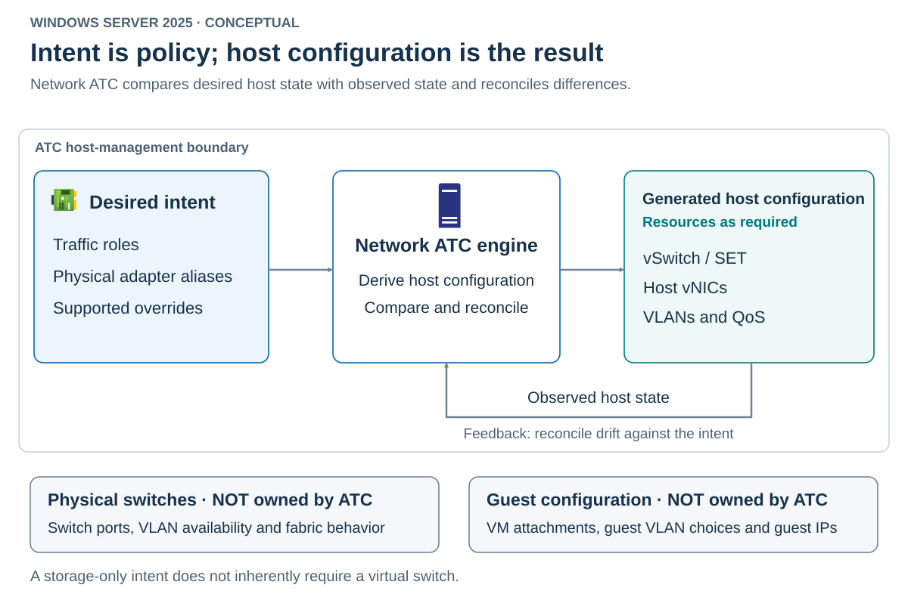

An *intent* names a set of physical adapters and declares their traffic roles. The name identifies the configuration. The adapter list establishes which resources Network ATC manages. The roles determine which host networking components it needs to provision.

For example, the `HostVM` intent declares: "Use `pNIC01` and `pNIC02` for host management and VM compute traffic." Network ATC uses this declaration to create a SET-backed virtual switch and a host management virtual adapter. The intent doesn't attach VMs to the switch or configure their guest networks. Those tasks remain the administrator's responsibility.

## Roles and generated resources

Management, compute, and storage describe traffic purpose, not three mandatory physical networks. An intent can combine roles when the design calls for convergence.

The roles have different effects and limits.

| Role | Meaning | Design implication |
|---|---|---|
| Management | Host management access | Can appear in one intent |
| Compute | VM connectivity to the physical network | Can appear in multiple intents using different adapters |
| Storage | Host SMB traffic | Can appear in one intent |

A physical adapter can belong to only one intent. A single intent can use the same two physical adapters, such as `pNIC01` and `pNIC02`, for both host management and VM compute traffic. Both adapters serve both traffic roles rather than one adapter being dedicated to each role. You can't also assign either adapter to a separate storage intent. Available adapters constrain how many independent intents you can create.

If an intent requires a virtual switch, Network ATC creates one. Multiple physical members use embedded teaming. When storage shares those uplinks, Network ATC creates the necessary host storage vNICs and maps them to physical adapters. A dedicated storage-only intent can configure physical adapters directly.

> [!NOTE]
> Don't infer a virtual-switch topology from the word *intent*. Inspect the resources that the selected role combination requires.

## Desired state and reconciliation

*Desired state* is the policy Network ATC is expected to enforce. *Observed state* is the current configuration on a host. Reconciliation compares them and reapplies managed settings when they differ.

The next diagram shows the control loop and its ownership boundary.



A command that directly changes a network setting modifies the current configuration. An intent defines the configuration that Network ATC should apply and maintain. If you directly edit an ATC-owned property, the engine can restore the intended value. If you need a persistent exception, express it through a supported override.

This behavior doesn't make Network ATC an SDN controller. It doesn't provision guest overlays, configure physical switches, or assign guest addresses. It also doesn't turn every property on every adapter into managed state.

You can deliberately leave adapters outside ATC ownership. That's useful when another workload or management system has a separate supported configuration. Keep the boundary explicit. A cleanup operation against all switches or all QoS policies can damage those unrelated resources.

## Local scope and cluster scope

Scope identifies the repository in which the intent is stored and the hosts to which it applies. It isn't determined merely by where you open PowerShell.

Use the following scope rules when targeting commands.

| Target | Behavior |
|---|---|
| `-ComputerName HVSTAND01` | Targets the local repository of a standalone host |
| `-ClusterName HVCL01` | Targets cluster policy that applies across participating nodes |
| Neither parameter, on a cluster node | Network ATC detects local cluster membership |
| Neither parameter, on a standalone host | Network ATC targets that host |

Cluster nodes receive the cluster's intents and require matching adapter names. Local-repository intents are skipped while a host belongs to a cluster. Consequently, `-ComputerName HV01` isn't a safe way to stage a cluster intent on just `HV01`.

Use explicit scope in reusable scripts. Automatic scope detection is convenient interactively, but the same script can otherwise target a different repository after a host joins or leaves a cluster.

Inspect the two scopes independently when diagnosing an unexpected result.

```powershell
Get-NetIntent -ClusterName HVCL01 -ErrorAction Stop
Get-NetIntent -ComputerName HVSTAND01 -ErrorAction Stop
```

The first result describes cluster policy. The second describes a separate standalone host. They aren't two views of the same intent store.

## Remote execution

Run the examples in elevated Windows PowerShell with administrative rights on the targets. For cluster-administration examples, use an interactive console on an existing cluster node, such as `HV01`, unless the example specifies a different execution context. This is the default origin for the examples, not a claim that every cmdlet is local-only. Commands with explicit remote targets still operate on the hosts they name.

Network ATC targeting, PowerShell remoting, and CIM sessions are different mechanisms. If you choose a remote PowerShell session instead of the default interactive console, check the specific cmdlet's authentication and delegation requirements before running it. Selecting a cluster with `-Cluster` or `-ClusterName` doesn't establish that remote session or satisfy those requirements.

An ATC `-ClusterName` operation can contact the node currently serving the cluster name. If you already reached another node through a remote session, that contact can require a second authentication hop. A resulting access failure isn't evidence of a broken storage network.

The documented local cluster endpoint avoids that particular extra hop when the command is already running on a cluster node.

```powershell
Get-NetIntent -ClusterName $env:COMPUTERNAME -ErrorAction Stop
```

This still targets cluster scope. Substituting `-ComputerName` changes the repository, not just the transport. Don't resolve authentication problems by broadly enabling credential delegation or embedding credentials in scripts.

> [!NOTE]
> Submitting an intent, completing provisioning, and carrying workload traffic are separate events. The engine processes changes asynchronously. `-Wait` waits for the operation, but doesn't prove switch configuration, file-service access, or application health. Treat a change as ready only after the intended configuration, all applicable nodes, and the workload path agree.
