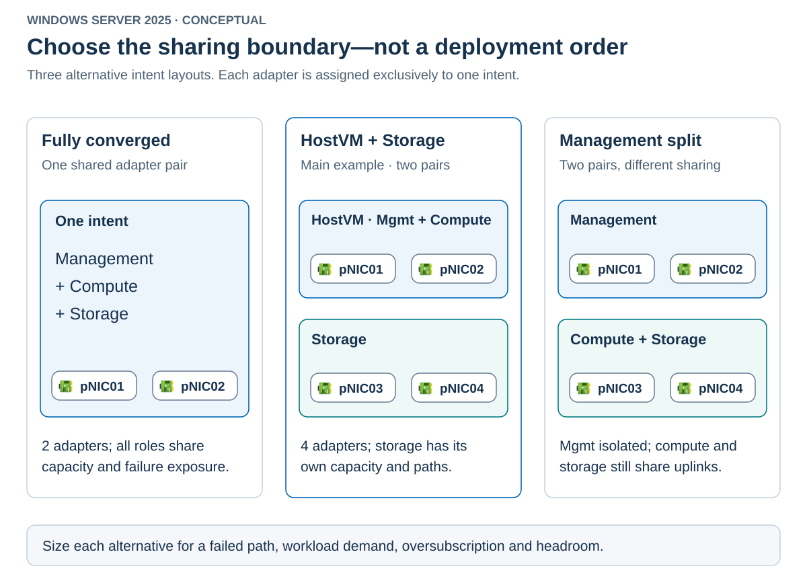

Convergence trades physical separation for shared capacity and fewer ports. Separation gives traffic classes dedicated uplinks but increases hardware and cabling requirements. Neither approach removes the need for redundancy.

Choose which traffic types share physical adapters based on bandwidth demand and any requirement for dedicated uplinks. The layout must also preserve the required connectivity and capacity if an adapter or physical switch fails. Don't choose a layout just because it's simpler to configure with `Add-NetIntent`.

## Compare intent layouts

Common layouts place the same traffic roles on different sets of adapters.

| Layout | Typical intent arrangement | Prefer it when | Main tradeoff |
|---|---|---|---|
| Fully converged | Management, compute, and storage on one pair | Port count is constrained and shared capacity is sufficient | Storage and VM bursts compete on the same uplinks |
| Separate storage | Management/compute pair plus storage pair | Storage needs a distinct capacity and failure boundary | Requires four physical adapters per host |
| Separate management | Management pair plus compute/storage pair | Management must be physically separate | Guest and storage traffic still compete |
| Fully separated | A different pair for each role | Isolation or capacity requirements justify six adapters | More hardware and operational complexity |
| Management/compute only | One combined pair | Storage doesn't use ATC-managed networking | Storage remains under another configuration owner |
| Storage only | Dedicated storage adapters | Existing management and compute remain independent | Ownership must remain clear during maintenance |
| Multiple compute intents | Different compute adapter sets and switches | Different VM networks need separate physical uplinks | Every additional intent consumes distinct adapters |

The diagram highlights three alternative convergence boundaries.

These are alternatives, not successive deployment steps. Don't run each example against the same physical adapters.

## Switch Embedded Teaming and physical-switch configuration

Switch Embedded Teaming, or SET, places the team within the Hyper-V virtual switch. The team operates in switch-independent mode. Don't configure its uplinks as an LACP aggregation because the physical switches aren't negotiating an LACP team with SET.

The load-balancing algorithm controls how traffic is distributed among members. It doesn't guarantee that a single flow can consume the sum of all link speeds. SMB Multichannel can establish multiple connections, which is a separate mechanism from SET's flow distribution.

Two ports don't necessarily provide two independent paths. Both can depend on the same adapter, cable bundle, switch, power source, or upstream link. Name the failure you need to survive, then trace the dependencies for that failure.

For the running example, use the following physical path convention.

| Path | Host adapters | Required connectivity |
|---|---|---|
| A | `pNIC01` and `pNIC03` | Switch path A, with the applicable management/guest or storage VLANs |
| B | `pNIC02` and `pNIC04` | Switch path B, with the applicable management/guest or storage VLANs |

This convention simplifies inspection. It doesn't prove that the switches or upstream networks are independent.

## Capacity under failure

Size the network for both normal and degraded operation. Include management, VM traffic, SMB storage, and live migration. Reserve headroom for bursts and recovery activity.

Suppose a pair of 25-Gbps links carries 30 Gbps of combined demand during a migration. Losing one link leaves no more than 25 Gbps of raw line rate before protocol overhead and other constraints. The design can't sustain the same demand, even if every connection remains available.

The response might be lower migration concurrency, a bandwidth cap, separate storage uplinks, or reduced workload placement. Adding VLANs doesn't add bandwidth.

VLANs divide Layer 2 traffic domains. QoS determines treatment during contention. Physical separation can provide dedicated capacity. Apply each control to the problem it actually solves.

## Switched and switchless storage

A switched storage topology connects hosts and endpoints through physical switches. It supports the example's external file-service endpoints and requires consistent VLAN, MTU, and DCB configuration along the paths.

A supported switchless topology connects storage adapters directly between hosts. Removing a switch changes the cabling and peer-connectivity requirements. Expansion can require additional ports or a different topology. Don't infer support for an arbitrary node count from the fact that two hosts can be cabled together.

The running example remains switched. Its external SMB service isn't reachable merely by creating a direct host-to-host storage link.
