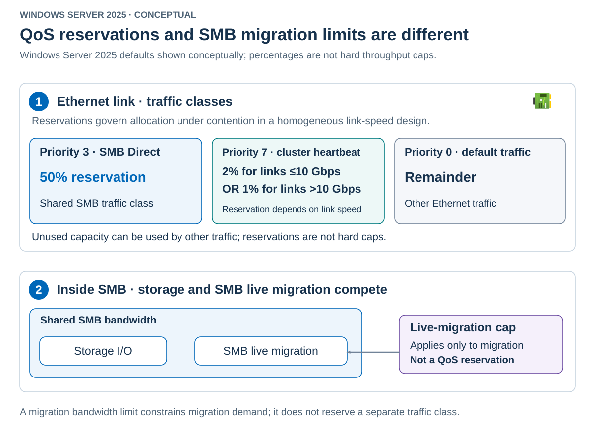

Storage networking combines addressing, path selection, adapter capabilities, and congestion behavior. These are related controls, but they aren't interchangeable.

A storage VLAN doesn't assign a usable endpoint address. An enabled RDMA adapter doesn't prove that an SMB session is using RDMA. A host QoS policy doesn't prove that the physical switch applies the same priority treatment.

## Automatic storage addressing

Network ATC automatically configures storage addresses uniformly across cluster nodes and checks whether a selected address is already in use. Its documented examples associate the first storage networks with `10.71.1.X`, `10.71.2.X`, and `10.71.3.X`.

The default storage VLAN sequence is as follows.

| Storage adapter position | Default VLAN |
|---|---:|
| First | 711 |
| Second | 712 |
| Third through eighth | 713 through 718, respectively |

Inspect the assigned address and prefix. Don't derive the entire allocation algorithm, supported scale, or routing design from these examples. In particular, address collision detection doesn't replace enterprise IPAM or guarantee that an existing remote subnet won't overlap.

The three addressing domains have different owners.

| Addressing domain | Responsibility |
|---|---|
| Host management | Preserve or deliberately configure host IP, routes, gateway, DNS, and registration |
| Host storage | Use ATC generation or explicitly select administrator-managed addressing |
| Guest operating system | Configure through the guest, DHCP, or the guest-management system |

Network ATC doesn't configure the external file-service endpoints. Their addresses must remain reachable from the host storage interfaces.

## Administrator-managed storage addresses

Administrator-managed storage addressing means that you assign and maintain the IP addresses and subnet prefixes on the host storage interfaces instead of letting Network ATC generate them. Choose this approach when automatic addressing doesn't fit the approved network design. For example, an existing SMB file service might require hosts to use prescribed storage subnets, your organization might allocate addresses through an IP address management (IPAM) system, or the generated ranges might overlap with other networks.

Plan these assignments before deployment and record a unique address for each storage interface on each node. You must maintain the allocations as nodes or adapters change. Disabling automatic storage IP generation changes who manages the addresses, not who manages the rest of the intent. Network ATC still applies the storage VLAN and adapter settings.

Use a storage override when the approved network requires different address assignment. The following is an alternative initial deployment for prepared adapters with no existing `Storage` intent.

```powershell
$storageOverride = New-NetIntentStorageOverrides `
    -EnableAutomaticIPGeneration $false

Add-NetIntent -ClusterName HVCL01 -Name Storage `
    -Storage -AdapterName pNIC03,pNIC04 -StorageVlans 711,712 `
    -StorageOverrides $storageOverride -Wait -ErrorAction Stop
```

The override transfers address-assignment responsibility to you. It doesn't supply the missing addresses. It also isn't a live-renumbering procedure for an existing storage network.

On `HV01`, the following demonstrates assigning an approved address to its first dedicated storage interface. Use it only after disabling automatic generation for the initial design and confirming that no conflicting address exists.

```powershell
$address = Read-Host 'Approved HV01 address on storage VLAN 711'
$prefix = [byte](Read-Host 'Approved IPv4 prefix length')

New-NetIPAddress -InterfaceAlias pNIC03 -AddressFamily IPv4 `
    -IPAddress $address -PrefixLength $prefix -ErrorAction Stop

Get-NetIPAddress -InterfaceAlias pNIC03 -AddressFamily IPv4
```

Assign the other interfaces from the approved plan with unique addresses. An isolated storage subnet typically doesn't need a default gateway. A routed storage design needs explicit routing decisions, not copied management settings.

Keep IPv6 configured according to supported Windows networking guidance. The automatic IPv4 examples don't establish IPv6-only ATC support and aren't a reason to disable IPv6.

## Verify source paths and endpoints

Inspect addressing, routes, and DNS behavior on the interfaces that actually carry storage traffic.

```powershell
Get-NetIPAddress -InterfaceAlias pNIC03,pNIC04
Get-NetRoute -InterfaceAlias pNIC03,pNIC04
Get-DnsClient -InterfaceAlias pNIC03,pNIC04
Get-DnsClientServerAddress -InterfaceAlias pNIC03,pNIC04

$fileService = Read-Host 'DNS name of the prepared SMB file service'
Test-NetConnection -ComputerName $fileService -Port 445 `
    -InformationLevel Detailed
```

Review the selected source address and interface along with TCP reachability. A successful TCP 445 probe shows that an SMB endpoint can be contacted. It doesn't prove SMB authorization, multiple paths, RDMA negotiation, or storage throughput.

Incorrect DNS registration can advertise an isolated storage address for host administration. Incorrect routing can send storage traffic over management. Correct those ownership problems before tuning performance.

## RDMA states and transport choice

Remote Direct Memory Access, or RDMA, allows supported endpoints to transfer data with reduced CPU involvement. SMB Direct uses RDMA where the SMB endpoints and selected paths support it.

Evaluate RDMA at four distinct levels.

| Level | Question |
|---|---|
| Capability | Do the adapter, driver, firmware, and platform support the required transport? |
| Configuration | Is RDMA enabled on the relevant interface? |
| Operation | Are the adapter and physical network operating correctly? |
| Workload use | Does the active SMB connection actually carry RDMA traffic? |

iWARP uses TCP-based RDMA. RoCE carries RDMA over Ethernet, and RoCEv2 uses an IP/UDP transport. These choices impose different congestion and fabric requirements. Match the NIC capability and switch design rather than treating the transport as a free-form preference.

For the documented Network ATC RoCE configuration, use a nonzero VLAN in the range 1 through 4094. A VLAN override of zero can cause `InvalidIsolationID`. Don't force RoCE on hardware or a fabric designed for another transport.

Driver technology identifiers are integers, not hardware enablement licenses. For example, identifier `4` represents RoCEv2. Setting that value doesn't create RoCEv2 support in an incompatible NIC.

## DCB, PFC, ETS, and DCBx

Data Center Bridging (DCB) supplies Ethernet mechanisms used to control selected traffic classes. Priority Flow Control (PFC) pauses traffic for particular priorities rather than pausing every class. Enhanced Transmission Selection (ETS) allocates transmission opportunities among classes. DCBx exchanges configuration information with a peer.

PFC isn't a bandwidth reservation. ETS isn't an end-to-end throughput guarantee. DCBx willingness determines whether an adapter can accept peer-provided configuration. If host and switch policy disagree, a configured host policy might not produce the intended operational behavior.

> [!IMPORTANT]
> For the RoCE design described here, configure matching PFC and ETS behavior on the participating hosts and every relevant physical switch port. With Network ATC's default priorities, enable PFC for SMB Direct priority 3, not for cluster heartbeat priority 7 or default traffic priority 0. A matching VLAN and bandwidth reservation don't prove that flow control is correct. If an approved override changes a traffic priority, use that priority consistently throughout the path. iWARP uses TCP and doesn't have the same lossless-fabric requirement, although the ATC-managed QoS policy and any DCB configuration you deploy must still match the approved design.

The documented default reservations are shown below. The speed-dependent rows describe homogeneous link designs. The final column gives the expected PFC treatment when using these priorities in the documented RoCE design.

| Traffic | Priority | Reservation | PFC for this RoCE design |
|---|---:|---|---|
| SMB Direct | 3 | 50% | Enabled |
| Cluster heartbeat, links at or below 10 Gbps | 7 | 2% | Disabled |
| Cluster heartbeat, links above 10 Gbps | 7 | 1% | Disabled |
| Other traffic | 0 | Remaining bandwidth | Disabled |

For mixed capabilities, inspect the effective policy rather than extrapolating a new rule from the table. Adapters also have finite traffic-class capacity. A policy that exceeds that capacity can fail to program.

The next diagram distinguishes an Ethernet traffic reservation from a migration-specific bandwidth limit.



Storage and SMB live migration can compete within SMB traffic. A migration cap limits that workload's consumption. It doesn't reserve bandwidth for every SMB operation, and it doesn't replace the physical-network QoS configuration.

Inspect the configured and operational views together.

```powershell
$nodes = 'HV01', 'HV02'
Get-NetQosPolicy -PolicyStore ActiveStore -CimSession $nodes
Get-NetQosTrafficClass -CimSession $nodes
Get-NetQosFlowControl -CimSession $nodes
Get-NetQosDcbxSetting -CimSession $nodes
Get-NetAdapterQos -Name pNIC03,pNIC04 -CimSession $nodes
```

`ActiveStore` exposes effective policies, including competing policy sources. Traffic-class output describes OS configuration. `Get-NetAdapterQos` provides adapter capabilities and operational information when available. If the adapter and its connected switch support DCBx, it can also return QoS configuration from that switch. This conditional peer information doesn't validate the complete physical path or the SMB endpoint.

For a RoCE deployment using the default priorities, compare the flow-control output with the table above. On each storage adapter, inspect the operational traffic classes and flow-control settings returned by `Get-NetAdapterQos`, not just the OS policy objects. When adapter QoS is disabled, that command reports capabilities rather than an applied operational policy. An adapter that doesn't support DCB can return no information. Neither result proves that the intended RoCE configuration is active. The `OperationalClassifications` field can be unavailable, so don't use that field alone as a failure test.

Also inspect DCBx willingness. When `Willing` is `$false`, Windows sends its PFC and traffic-class settings to the adapter. When it's `$true`, Windows doesn't send those settings and the adapter can accept peer configuration. Confirm that this behavior matches the intended host-owned configuration and investigate unexpected peer ownership rather than enabling willingness as a generic repair.

Have the physical-network and file-service owners confirm the corresponding settings on both switch paths and the SMB endpoints. Host-side output, including any DCBx peer information, isn't a substitute for that independent verification. Resolve mismatches through the supported configuration owner, then repeat the active SMB/RDMA and degraded-path acceptance checks. Don't manually overwrite ATC-managed QoS settings just to make a single diagnostic result match.

## MTU and SMB path selection

MTU must be consistent along the selected path. A larger host setting doesn't make every switch or endpoint accept larger frames. Ethernet jumbo-packet settings and RDMA transport payload sizes are related but aren't identical units to copy blindly.

SMB Multichannel discovers usable interfaces and can establish multiple connections. SMB Direct depends on SMB Multichannel. Disabling Multichannel prevents SMB Direct use even when RDMA remains enabled on an adapter.

Inspect active connections during representative SMB traffic.

```powershell
$nodes = 'HV01', 'HV02'
Get-SmbClientNetworkInterface -CimSession $nodes
Get-SmbServerNetworkInterface -CimSession $nodes
Get-SmbMultichannelConnection -IncludeNotSelected -CimSession $nodes
```

On the Hyper-V hosts, the client view is directly relevant to external VM storage. Server-interface output describes the queried hosts, not the external file service. Inspect the file-service endpoints separately when authorized.

Compare selected and unselected connections, their interfaces, and their RDMA capability. An empty connection list when no SMB workload is active isn't a useful performance test.
