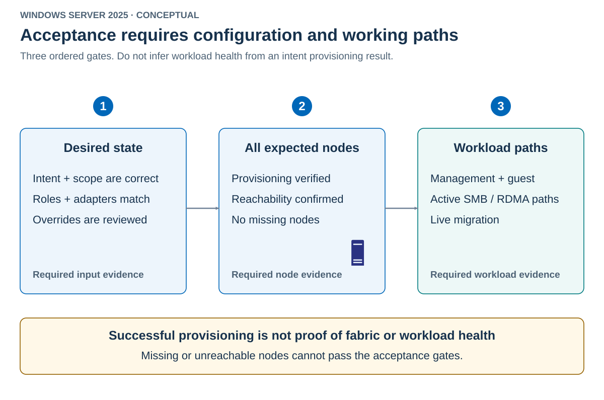

*Convergence* means the managed configuration has reached its intended state. It's necessary for acceptance, but it isn't the entire acceptance test.

Use the following three evidence gates in order:

1. Correct desired configuration.
1. Successful provisioning on every expected node.
1. Working workload paths.

The diagram makes those gates explicit.



A missing node fails the second gate. A blocked storage VLAN fails the third gate even if the first two pass.

## Inspect the intent and its status

Read the intended configuration and global settings separately from their provisioning status.

```powershell
Get-NetIntent -ClusterName HVCL01 -Name Storage | Format-List *
Get-NetIntent -ClusterName HVCL01 -GlobalOverrides | Format-List *

Get-NetIntentStatus -ClusterName HVCL01 -Name Storage |
    Format-Table IntentName, Host, ProvisioningStatus, ConfigurationStatus

Get-NetIntentStatus -ClusterName HVCL01 -GlobalOverrides
```

The status fields answer different questions.

| Field | Interpretation |
|---|---|
| `IntentName` | Which declared configuration the record concerns |
| `Host` | Which node the record describes |
| `ProvisioningStatus` | Progress or result of provisioning |
| `ConfigurationStatus` | Reported condition of the configuration |

Inspect complete objects when troubleshooting. Establish the healthy status values from a verified baseline on the target build before writing automated predicates. Don't invent a universal health enumeration or interpret any nonempty result as success.

## Bound the observation period

Use an explicit expected-node inventory. Deriving expected nodes only from the returned status would hide a node that never reported.

The following pattern polls one intent. Enter the exact healthy values already established from the verified baseline, not values guessed from a failing node. The deadline bounds the polling loop, not an unresponsive underlying remote call.

```powershell
$expectedNodes = 'HV01', 'HV02'
$goodProvisioning = Read-Host 'Verified healthy ProvisioningStatus value'
$goodConfiguration = Read-Host 'Verified healthy ConfigurationStatus value'
if ([string]::IsNullOrWhiteSpace($goodProvisioning) -or
    [string]::IsNullOrWhiteSpace($goodConfiguration)) {
    throw 'Both verified healthy status values are required.'
}

$deadline = (Get-Date).AddMinutes(5)
do {
    $status = @(Get-NetIntentStatus -ClusterName HVCL01 `
        -Name Storage -ErrorAction Stop)
    $rows = @($status | ForEach-Object {
        [pscustomobject]@{
            Node = ([string]$_.Host).Split('.')[0].ToUpperInvariant()
            Provisioning = [string]$_.ProvisioningStatus
            Configuration = [string]$_.ConfigurationStatus
        }
    })
    $reportedNodes = @($rows.Node | Sort-Object -Unique)
    $missing = @($expectedNodes | Where-Object {
        $_ -notin $reportedNodes
    })
    $unexpected = @($reportedNodes | Where-Object {
        $_ -notin $expectedNodes
    })
    $unhealthy = @($rows | Where-Object {
        $_.Provisioning -ne $goodProvisioning -or
        $_.Configuration -ne $goodConfiguration
    })
    $ready = $rows.Count -eq $expectedNodes.Count -and
        $missing.Count -eq 0 -and $unexpected.Count -eq 0 -and
        $unhealthy.Count -eq 0
    $rows | Format-Table
    if (-not $ready) {
        if ((Get-Date) -ge $deadline) {
            throw "Storage intent didn't reach the required node states."
        }
        Start-Sleep -Seconds 10
    }
} while (-not $ready)
```

Short-name normalization is appropriate for this two-node example. In a broader naming environment, use an approved identity mapping that can't confuse similarly named hosts.

The loop stops on query errors and rejects missing, unexpected, duplicate, or unhealthy records. For unattended use, store the approved status values and node inventory as controlled inputs, configure remote-operation timeouts, and route failures to monitoring. Don't prompt interactively in a scheduled job.

## Corroborate effective configuration

The policy record and actual host resources must agree. Verify interfaces, switch members, host vNIC mappings, VLANs, addresses, and QoS before testing the workload.

Use the following evidence groups as an acceptance checklist.

| Gate | Evidence required |
|---|---|
| Intent | Correct repository, name, roles, adapters, VLANs, and retained overrides |
| Nodes | Every expected node reports the required state with no unresolved failure |
| Host resources | Correct switch/team members, vNIC mappings, addresses, and effective QoS |
| Fabric | Required VLANs, MTU, DCB, and surviving paths are configured |
| Workload | Management, guest traffic, SMB paths, and migration behave as designed |

An endpoint ping is too narrow. It can use the wrong source interface and doesn't prove SMB authorization or RDMA. A VM's running state is also too narrow. The guest can be running while its VLAN is blocked.

## Observe automatic drift repair

A direct edit to an ATC-owned property changes observed state without changing desired state. Reconciliation can restore the intended value. A typed override changes the intended value, so the new value becomes the target.

The following sequence is illustrative, not captured host output.

| Observation | Desired property | Observed property | Meaning |
|---|---|---|---|
| Baseline | Approved value B | B | Configuration agrees |
| Accidental direct edit | B | Different value D | Drift exists |
| Reconciliation completes | B | B | ATC repaired the managed property |
| Approved override | New value C | C after convergence | Desired state intentionally changed |

Use captured evidence or a disposable environment to demonstrate the difference. Don't deliberately change a production management or storage adapter merely to watch it recover.

Read the property before and after the demonstration.

```powershell
$nodes = 'HV01', 'HV02'
Get-Date
Get-NetAdapterAdvancedProperty -Name pNIC03,pNIC04 `
    -RegistryKeyword '*JumboPacket' -CimSession $nodes |
    Select-Object PSComputerName, Name, RegistryKeyword, RegistryValue

Get-NetIntentStatus -ClusterName HVCL01 -Name Storage
```

Associate each sample with its timestamp. The property must be one that ATC actually owns on the chosen adapters. A retry can expedite reapplication, but don't confuse an explicitly requested retry with evidence that periodic repair occurred unaided.

Drift detection and configuration-change detection have different intervals. `Update-NetworkATC` configures those timers. It doesn't install an OS update or upgrade the PowerShell module.

Inspect its syntax without changing the timers.

```powershell
Get-Command Update-NetworkATC -Syntax
```

Reducing an interval isn't a general fix for a failed intent. Correct the cause rather than repeatedly asking the service to apply an impossible configuration.

## Monitor after deployment

Monitoring must continue after initial acceptance. Poll relevant intent and global status, correlate events, and detect missing nodes or sustained failures.

Use the following triggers to require renewed evidence.

- An intent, VLAN, adapter, or override changes.
- A node joins, leaves, restarts, or returns from maintenance.
- Drivers or firmware are serviced.
- Switch ports, VLANs, DCB, or physical paths change.
- Workload latency, CPU use, or migration duration deviates from the baseline.

Choose alert persistence according to the operation. Brief expected reconfiguration isn't identical to a sustained failure, but neither should be silently discarded. A stale last-known-good result isn't current health.

Monitoring-platform deployment is outside this module. The important contract is that a failed query, a missing node, and a failed workload test remain visible rather than being converted into success.
