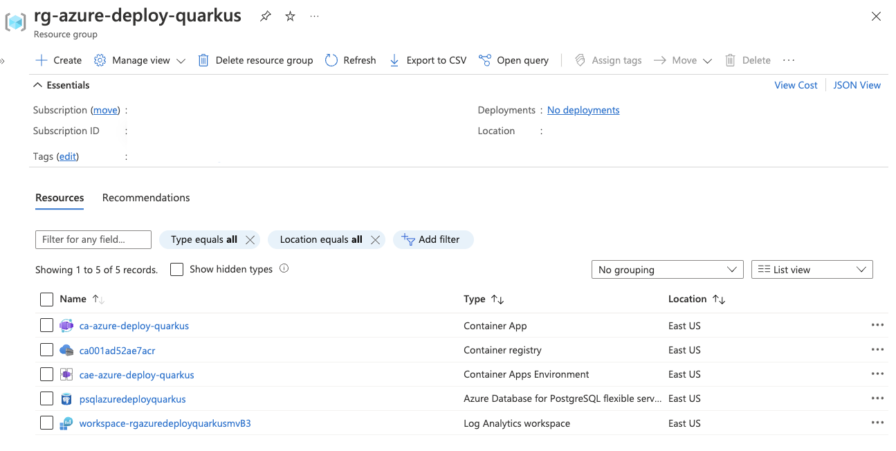

In this unit, you package the Quarkus application and deploy it to Azure Container Apps with its database password supplied as a runtime secret.

Continue in the local Bash shell from the previous unit, in the generated `todo` project directory. Keep all the exported resource and database variables in that shell. Stop foreground Quarkus development mode with **Ctrl+C** before packaging, and don't rerun the random-name and password block.

## Set up the Dockerfile for the Quarkus application

Container Apps is used to deploy containerized applications. So you first need to containerize the Quarkus application into a Docker image. This process is easy because the Quarkus Maven plugin has already generated some Dockerfiles under `src/main/docker`.

Use this command to rename one of these Dockerfiles, *Dockerfile.jvm*, to *Dockerfile* and move it to the root folder:

```bash
mv src/main/docker/Dockerfile.jvm ./Dockerfile
```

Replace the content after the long comment in the Dockerfile with the following:

```dockerfile
FROM registry.access.redhat.com/ubi8/openjdk-17:1.18

ENV LANGUAGE='en_US:en'


# We make four distinct layers so if there are application changes the library layers can be re-used
COPY --chown=185 target/quarkus-app/lib/ /deployments/lib/
COPY --chown=185 target/quarkus-app/*.jar /deployments/
COPY --chown=185 target/quarkus-app/app/ /deployments/app/
COPY --chown=185 target/quarkus-app/quarkus/ /deployments/quarkus/

EXPOSE 8080
USER 185
ENV JAVA_OPTS_APPEND="-Dquarkus.http.host=0.0.0.0 -Djava.util.logging.manager=org.jboss.logmanager.LogManager"
ENV JAVA_APP_JAR="/deployments/quarkus-run.jar"

ENTRYPOINT [ "/opt/jboss/container/java/run/run-java.sh" ]
```

> [!IMPORTANT]
> Don't put database credentials into source files, Docker build arguments, or images, and don't print or trace their values. An application secret separates the credential from the image, but authorized secret-reading principals can still retrieve it. For production, follow the [passwordless authentication guidance](/azure/developer/java/ee/deploy-java-quarkus-app) and [Key Vault secret guidance](/azure/container-apps/manage-secrets), and apply appropriate permissions.

This Dockerfile expects the packaged Quarkus application in the *target/quarkus-app* folder, including the *quarkus-run.jar* launcher and its supporting directories. Keep the literal, profile-scoped expressions from the previous unit in `application.properties`. With Docker running and accessible from this Bash environment, run a clean package:

```bash
./mvnw clean package
```

This command runs the automated tests against a separate PostgreSQL Dev Service and packages the application in *target/quarkus-app*. The `test` profile must not use the Azure database. Don't skip the tests; resolve any build or test failure before continuing. A clean package also avoids reusing old application build output that might contain literal credentials.

Rebuilding the current image doesn't remove credentials from older images or source copies. If you previously distributed or exposed a credential-bearing artifact, rotate the credential and remove obsolete artifacts through your authorized cleanup process. The following deployment steps don't perform that rotation or remove old artifacts.

## Create the Container Apps environment and deploy the container

Deploy in three stages so that Quarkus doesn't start before its database secret and runtime settings are available. Use only the new, exercise-owned app named in `AZ_CONTAINERAPP`, in `AZ_RESOURCE_GROUP`. Don't run the bootstrap step against an unrelated or production app. Complete each command successfully before continuing.

First, create the app and environment by using [Microsoft's public quickstart image](/azure/container-apps/get-started?tabs=bash). This temporary image listens on port 80 and doesn't need database credentials:

```bash
az containerapp up \
    --name "$AZ_CONTAINERAPP" \
    --environment "$AZ_CONTAINERAPP_ENV" \
    --location "$AZ_LOCATION" \
    --resource-group "$AZ_RESOURCE_GROUP" \
    --image mcr.microsoft.com/k8se/quickstart:latest \
    --ingress external \
    --target-port 80
```

This call establishes the app, environment, and default Log Analytics workspace in the exercise resource group. It doesn't deploy your Quarkus application yet.

Next, store the database password as a secret on the existing app before referencing it:

```bash
az containerapp secret set \
    --name "$AZ_CONTAINERAPP" \
    --resource-group "$AZ_RESOURCE_GROUP" \
    --secrets "postgres-password=$AZ_POSTGRES_PASSWORD" \
    --output none
```

Finally, from the `todo` project root, deploy the clean Quarkus application to that same app, environment, and resource group. The target port changes to 8080. The first two runtime values come from the current shell; the password is supplied through a [secret reference](/azure/container-apps/environment-variables):

```bash
az containerapp up \
    --name "$AZ_CONTAINERAPP" \
    --environment "$AZ_CONTAINERAPP_ENV" \
    --location "$AZ_LOCATION" \
    --resource-group "$AZ_RESOURCE_GROUP" \
    --ingress external \
    --target-port 8080 \
    --source . \
    --env-vars \
        "AZ_POSTGRES_JDBC_URL=$AZ_POSTGRES_JDBC_URL" \
        "AZ_POSTGRES_USERNAME=$AZ_POSTGRES_USERNAME" \
        "AZ_POSTGRES_PASSWORD=secretref:postgres-password"
```

This [local-source deployment](/azure/container-apps/quickstart-code-to-cloud) creates an Azure container registry if needed, builds the Docker image from the root Dockerfile, pushes it to the registry, and updates the existing app with the Quarkus image and runtime configuration. It retains the database secret while configuring registry access. The commands can take several minutes to complete.

All resources created by this exercise remain in `AZ_RESOURCE_GROUP`, so the resource-group cleanup at the end of the module still applies. This password-based exercise retains the default registry-authentication flow of `az containerapp up`; it isn't a complete production security architecture.

## Validate the deployment

First, confirm that the resources were created by searching for your resource group on the [Azure portal](https://portal.azure.com). You should see resources similar to the following; your generated names will differ:



You can also list the resources in the exercise resource group, including PostgreSQL and the resources created by `az containerapp up`:

```bash
az resource list \
    --location "$AZ_LOCATION" \
    --resource-group "$AZ_RESOURCE_GROUP" \
    --output table
```

You should see output similar to this example:

```output
Name                               ResourceGroup        Location    Type                                       Status
---------------------------------  -------------------  ----------  -----------------------------------------  --------
caea3a6e0afeacr                     rgquarkus-12345678   eastus      Microsoft.ContainerRegistry/registries
psqlquarkus-12345678                rgquarkus-12345678   eastus      Microsoft.DBforPostgreSQL/flexibleServers
caquarkus-12345678                  rgquarkus-12345678   eastus      Microsoft.App/containerApps
caequarkus-12345678                 rgquarkus-12345678   eastus      Microsoft.App/managedEnvironments
workspace-rgquarkus12345678abcd     rgquarkus-12345678   eastus      Microsoft.OperationalInsights/workspaces
```

Resource creation alone doesn't confirm application readiness. In the Azure portal, open your container app and inspect its active revision. Verify that it uses your newly built Quarkus image, not `mcr.microsoft.com/k8se/quickstart:latest`, and starts successfully. Resolve startup errors before continuing to the POST and GET checks. A working temporary quickstart page isn't proof that the Quarkus deployment succeeded.

## Verify the deployed application

After the Quarkus revision is running, verify the application's API. First, get the complete ingress FQDN in the same Bash shell:

```bash
export AZ_APP_URL=$(
    az containerapp show \
        --name "$AZ_CONTAINERAPP" \
        --resource-group "$AZ_RESOURCE_GROUP" \
        --query "properties.configuration.ingress.fqdn" \
        --output tsv \
)

echo "AZ_APP_URL=$AZ_APP_URL"
```

Use the complete FQDN returned in `AZ_APP_URL`; it includes the environment's DNS suffix. The application's to-do endpoint is `https://<the AZ_APP_URL value>/api/todos`. Container Apps provides [HTTPS/TLS termination](/azure/container-apps/ingress-overview) for this default endpoint.

Create a to-do by using cURL. The `--include` option displays response headers so that you can check for HTTP 201 and the created item's JSON body:

```bash
curl --include --header "Content-Type: application/json" \
    --request POST \
    --data '{"description":"Configuration","details":"Congratulations, you have set up your Quarkus application correctly!","done": "true"}' \
    "https://$AZ_APP_URL/api/todos"
```

Retrieve the data by using a new cURL request. Check for HTTP 200 and the items you created in this unit and the previous unit:

```bash
curl --include "https://$AZ_APP_URL/api/todos"
```

The response body is a JSON array containing the items you created in the Azure database. Identifiers, timestamps, and order can vary. Repeating a POST creates another item; this sample is illustrative, not an exact response assertion:

```json
[
   {
      "description" : "Take Quarkus MS Learn",
      "details" : "Take the MS Learn on deploying Quarkus to Azure Container Apps",
      "done" : true,
      "id" : 1,
      "createdAt" : "2025-02-26T08:03:28.390854Z"
   },
   {
      "description" : "Take Azure Container Apps MS Learn",
      "details" : "Take the ACA Learn module",
      "done" : false,
      "id" : 2,
      "createdAt" : "2025-02-26T08:03:34.142249Z"
   },
   {
      "description" : "Configuration",
      "details" : "Congratulations, you have set up your Quarkus application correctly!",
      "done" : true,
      "id" : 3,
      "createdAt" : "2025-02-26T08:05:00.000000Z"
   }
]
```

Successful POST and GET responses from the Quarkus revision, with the expected descriptions, confirm the application check. Don't use the bootstrap page or resource list alone as the success criterion.

To stream the container logs, run this command in the Bash shell containing your resource variables:

```bash
az containerapp logs show \
    --name "$AZ_CONTAINERAPP" \
    --resource-group "$AZ_RESOURCE_GROUP" \
    --follow
```

In a second local Bash terminal, replace `<returned-fqdn>` with the complete FQDN displayed earlier and send more requests while following the logs. This terminal needs only the application address, not the database password:

```bash
export AZ_APP_URL="<returned-fqdn>"
curl --include "https://$AZ_APP_URL/api/todos"
```

When you finish following the logs, press **Ctrl+C** in the original terminal. Keep that shell open with its resource variables for the next unit.

> [!NOTE]
> To view the JSON list in a browser, open `https://<the AZ_APP_URL value>/api/todos`, replacing the placeholder with the returned FQDN. The module doesn't implement a to-do web page at `/`.
