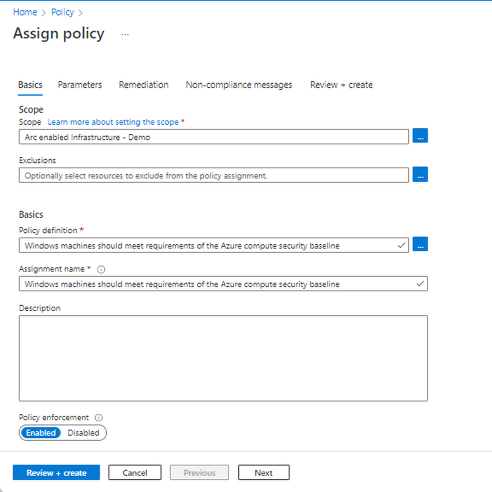
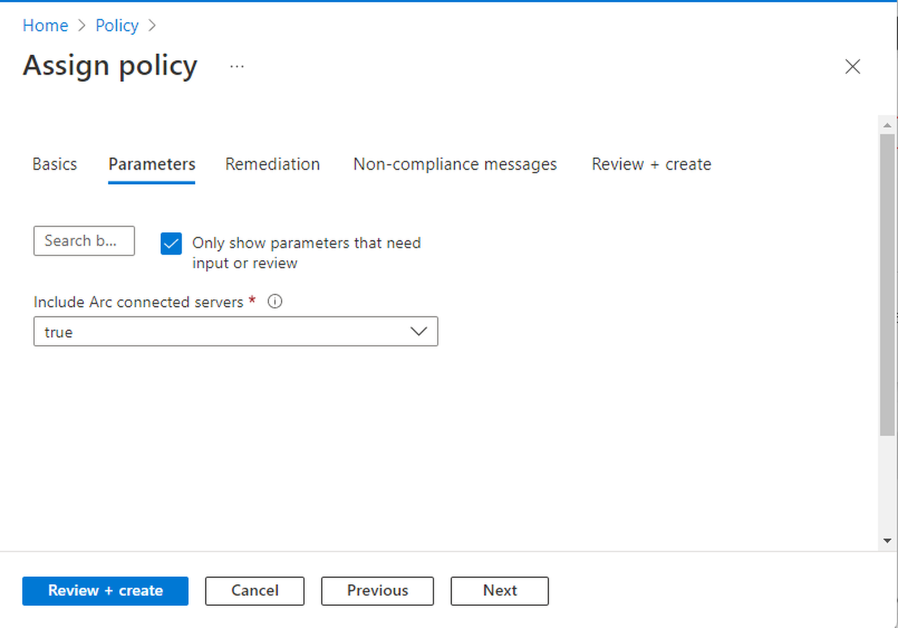
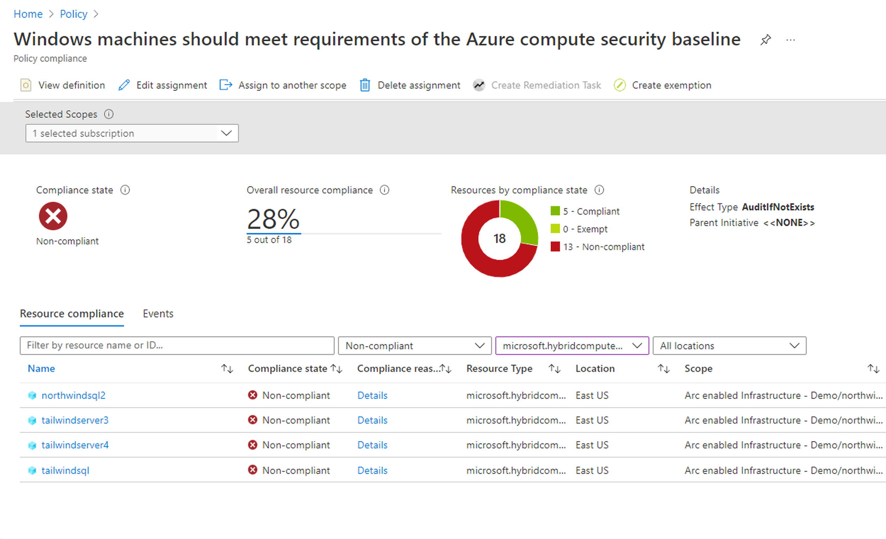

Fabrikam Residences onboarded its machines to Azure Arc-enabled servers and now wants to ensure that these machines meet Azure's compute security baseline. In this unit, you learn how to assign Azure policies to your Azure Arc-enabled servers and view their compliance.

## Overview of Azure Policy

Azure Policy evaluates resources in Azure by comparing the properties of those resources to business rules. These business rules, described in JSON format, are known as policy definitions. To simplify management, several business rules can be grouped together to form a policy initiative (sometimes called a policySet). Once your business rules are formed, the policy definition or initiative is assigned to any scope of resources that Azure supports. For example, management groups, subscriptions, resource groups, or individual resources.

Azure Machine Configuration integrates with Azure Policy to evaluate operating system settings on Azure Arc-enabled servers. Other built-in policies govern resource properties or deploy extensions. The policy's effect determines whether it reports compliance, deploys a resource, or modifies resource properties.

## Assign Azure Policy

Here we walk through assigning an Azure policy to ensure that your Arc-enabled Windows servers meet Azure's compute security baseline.

Before you start, use an account that can create policy assignments at the scope you intend to use. For example, the account can have **Resource Policy Contributor** at that scope or an inherited parent scope. **Contributor** and **Reader** alone don't provide this permission. Have an authorized administrator grant any missing access. See Azure Policy RBAC in More Info in the Summary unit.

1. Open the Azure portal in your browser. Its address is in More Info in the Summary unit.
1. In the portal, browse **Policy** and select **Assignments** from the left pane.
1. Select **Assign policy**. On **Basics**, select the ellipsis (**...**) next to **Scope**. Choose the subscription and resource group containing the Arc-enabled servers for this exercise, then select **Select**. Verify any prepopulated scope rather than assuming it targets the intended servers.
1. Open the **Policy definition** selector.
1. Search **security baseline** from Available Definitions and select the Policy Definition: **Windows machines should meet requirements of the Azure compute security baseline** before moving to the next step.

   

1. Set the parameter **Include Arc connected servers** to **true**.

   

1. Select **Review + create** and **Create**.

After creation succeeds, confirm the assignment on **Policy** > **Assignments** at the selected scope. Compliance results become available on **Policy** > **Compliance** after evaluation completes. Assignment propagation and compliance evaluation are separate, and evaluation time varies. An assignment appearing in the list doesn't mean that the machines have already been evaluated.

## View compliance

After the policy assignment is complete, you can review compliance with the policy and investigate the settings reported as noncompliant.

1. In the same portal page for **Policy**, select **Compliance** from the left pane.
1. Select the policy **Windows machines should meet requirements of the Azure compute security baseline** to view its compliance status.
1. You can filter by different resource types, compliance, or locations. To view just the compliance of Azure Arc-enabled servers, select **All Resource Types** and change the selection to only **microsoft.hybridcompute/machines**.

   

Based on the compliance results, you can edit the assignment, create an exemption, or delete the assignment. An exemption changes how compliance is assessed; it doesn't correct the machine's configuration.

> [!NOTE]
> The **Windows machines should meet requirements of the Azure compute security baseline** policy used in this exercise has an `AuditIfNotExists` effect. It reports noncompliance but doesn't change the machine's settings. Azure Policy remediation tasks apply to policies with `deployIfNotExists` or `modify` effects, so you can't create one for this audit-only assignment. Review the reported settings and correct the underlying configuration through your approved administration process.
