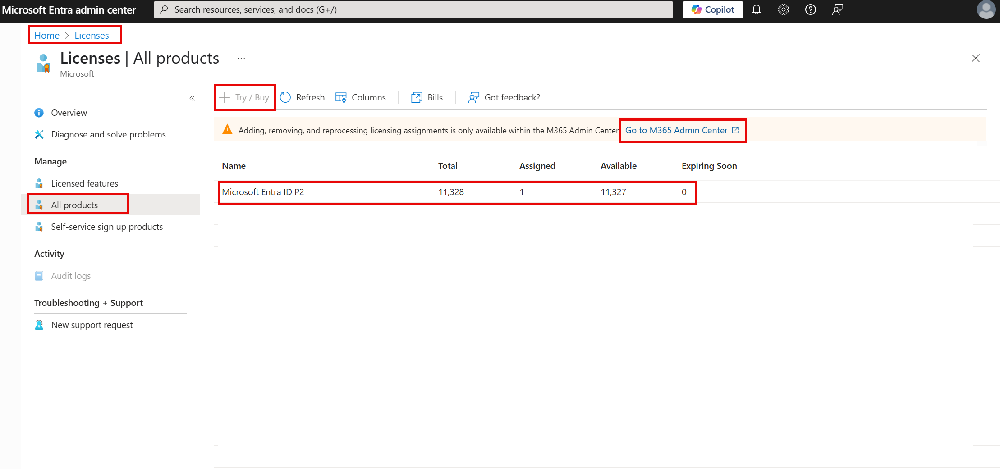

Your company always looks for the most experienced healthcare professionals and external contractors with whom to work. Research projects can become costly if they're not managed properly. Your company wants to improve its cost effectiveness. The company asks you to investigate how Microsoft Entra ID is licensed. They also want you to provide a clear and concise outline of the critical terminology they might come across in Microsoft Entra ID.

In this unit, you explore how Microsoft Entra ID is licensed and which features fall under the different licenses. You see how to add or change licenses in Microsoft Entra ID, and you learn the key terms you need to understand when you use Microsoft Entra ID.

## Microsoft Entra ID licenses

You can use different features of Microsoft Entra ID, depending on the type of license you choose:

- **Microsoft Entra ID Free**: You can manage users and groups, and you get necessary reports, on-premises Active Directory synchronization, and self-service password change for cloud-only users who know their current password. You also get single sign-on for Microsoft 365, Azure services, and many non-Microsoft SaaS applications.

> [!NOTE]
> Some Microsoft 365 subscriptions include a Microsoft Entra ID plan; they aren't separate Microsoft Entra ID editions. For example, Microsoft 365 E3 and Microsoft 365 Business Premium include Microsoft Entra ID P1, and Microsoft 365 E5 includes Microsoft Entra ID P2. Check your subscription's [included Microsoft Entra ID plan](/entra/fundamentals/licensing#microsoft-entra-licensing-options) and the feature-specific requirements for [self-service password reset](/entra/identity/authentication/concept-sspr-licensing) and [company branding](/entra/fundamentals/how-to-customize-branding#prerequisites).

- **Microsoft Entra ID P1**: You get all the features from the free tier, but you can also let users access on-premises and cloud-based services and resources. You can use self-service group management or dynamic groups, where users are added and removed automatically based on your criteria. This tier supports on-premises identity-management suites like Microsoft Identity Manager. Self-service password reset is also supported for users who are based on-premises.

- **Microsoft Entra ID P2**: You get all the features of the previous two tiers, along with Microsoft Entra ID Protection. This feature helps you configure risk-based Conditional Access to protect applications from identity risks. You can also use privileged identity management, which lets you monitor and put detailed restrictions on Administrators.

  > [!NOTE]
  > Device writeback through Microsoft Entra Connect requires Microsoft Entra ID P1 or P2. Check whether your purchased bundle includes that entitlement. Device writeback and password writeback are separate features. See [Enable device writeback](/entra/identity/hybrid/connect/how-to-connect-device-writeback).

- **Microsoft Entra ID Governance**: An advanced set of identity governance capabilities available for Microsoft Entra ID P1 and P2 customers. Microsoft Entra ID Governance is available as six products: Microsoft Entra ID Governance, Microsoft Entra ID Governance Step Up for Microsoft Entra ID P2, Entra ID Governance Frontline Worker, Microsoft Entra ID Governance Step up for Microsoft Entra ID F2, Microsoft Entra ID Governance for Government, and Microsoft Entra ID Governance Add-on for Microsoft Entra ID P2 for Government. These six products differ only in their prerequisites. They contain the entitlement management, privileged identity management, and access reviews capabilities that were in Microsoft Entra ID P2, plus additional advanced identity governance capabilities.

- **Microsoft Entra Suite**: A complete cloud-based solution for workforce access, available for Microsoft Entra ID P1 and P2 customers. Microsoft Entra Suite brings together Microsoft Entra Private Access, Microsoft Entra Internet Access, Microsoft Entra ID Governance, Microsoft Entra ID Protection, and Microsoft Entra Verified ID. The Microsoft Entra ID Governance portion provides the same identity governance capabilities as the Microsoft Entra ID Governance product. The difference is that they have different prerequisites.

- **Microsoft Entra External ID for customers**: Customer-facing apps use an external tenant and monthly active user (MAU) billing. An MAU is a unique user who authenticates during a calendar month. MAUs are combined across workforce and external tenants linked to a subscription. The core offering is free for the first 50,000 MAU; premium add-ons, such as SMS authentication, have separate charges. This is a separate billing model from Microsoft Entra ID P1 and P2 workforce licenses. See [External ID billing](/entra/external-id/external-identities-pricing) and [the External ID pricing FAQ](/entra/external-id/customers/faq-customers#external-id-pricing).

Choose the license type you want based on your organization's needs.

> [!NOTE]
> Changing a known password and resetting a forgotten password are different licensing scenarios. For ordinary cloud-only users, Microsoft Entra ID Free supports password change, while password reset requires an eligible license. Resetting an on-premises password through password writeback requires Microsoft Entra ID P1, P2, or Microsoft 365 Business Premium; standalone Microsoft 365 Business Standard doesn't include that writeback entitlement. See [Self-service password reset licensing](/entra/identity/authentication/concept-sspr-licensing).

View your active license plans in the Microsoft Entra admin center by selecting **Licenses** > **All products**. Here, you can also buy or try new licenses. Visit the Microsoft 365 Admin Center to add or remove users or groups of users and see which users are included.

Select a license plan to see which users are included. In the plan, you can add or remove users or groups of users.

## Microsoft Entra terminology

To use Microsoft Entra ID effectively, you need to understand some key Active Directory terms.

Here's an explanation of some of those terms:

|Term|Description|
|---------|---------|
|Identity|Something that has to be identified and authenticated. An identity is typically a user with a username and password credentials, but the term can also apply to applications or services.|
|Account|An identity and its associated data. An account can't exist without an identity.|
|Microsoft Entra account|An identity created in Microsoft Entra ID, or in services like Microsoft 365. These identities are stored in Microsoft Entra ID. For example, internal staff members might use Microsoft Entra accounts daily at work.|
|Azure subscription| Your level of access to use Azure and its services. For pay-as-you-go access, use your credit card to set up an Azure subscription. There are several types of subscriptions. For example, enterprise-level customers can use Azure Enterprise Agreement subscriptions. Each account can use many subscriptions.|
|Microsoft Entra tenant|An instance of a Microsoft Entra ID. This tenant is automatically created for you when you first sign up for Azure or other services like Microsoft 365. A tenant (which represents an organization) holds your users, user groups, and applications.|
|Workforce tenant|A tenant for employees, internal business apps, and other organizational resources. You can invite external business partners as guests through B2B collaboration.|
|External tenant|A separate tenant configured for customer-facing apps and customer accounts in Microsoft Entra External ID.|
|Multitenant|Access by multiple tenants to the same applications and services in a shared environment. These tenants represent multiple organizations.|
|Microsoft Entra directory|An Azure resource created for you automatically when you subscribe to Azure. You can create many Microsoft Entra directories. Each of these directories represents a tenant.|
|Custom domain|A domain you customize for your Microsoft Entra directory. When you create a Microsoft Entra directory, Azure automatically assigns it a default domain like `<your-organization>.onmicrosoft.com`. However, you can customize domain names. Your users could then have accounts like `user@contoso.com` instead of `user@contoso.onmicrosoft.com`.|
|Owner role|The role you use to manage all Azure resources, including the access levels users need for resources.  |
|Global Administrator| The role that gives you access to all Administrative capabilities in Microsoft Entra ID. When you create a tenant, you automatically have this role for the tenant. This role allows you to reset passwords for all users and Administrators, for example.|
| | |

## Default user permissions

In a workforce tenant, Microsoft Entra ID gives all users a default set of permissions. Permissions dictate what a user can and can't do. The set of permissions granted by default depends on whether a user is a natural member of the tenant (as an internal employee) or a member of an outside organization. The latter is considered a guest. An example of a guest would be a vendor that's performing work for you, but isn't an official employee of the organization. Guest users are invited to the tenant through a Microsoft Entra feature called Microsoft Entra B2B.

Member users can do many things guest users can't. For example, member users manage their own profile details, like their phone number and profile photos. Guest users typically have more restrictions. For instance, guest users can view their display photos but can't change them. You could make use of this restriction by granting guest-user access to the external healthcare professionals your company works with regularly. This way, they'd have more restricted permissions than a regular internal staff member, but they'd still have enough permissions to do their work.

### Comparison of member and guest default permissions

Here are some of the default permissions for member users and guest users:

|Area  |Member user permissions  |Guest-user permissions  |
|---------|---------|---------|
|Users and contacts|Can view all profile details. Can change own password, mobile phone number, and profile photos.|Can view the profile name, email, sign-in name, photo, and user principal name. Can view the user type properties of other users and contacts. Can change own password.|
|Devices|Can read all properties of devices. Can manage all properties of owned devices.|No device permissions by default.|
|Applications |Can register new applications.|Can read properties of registered and enterprise applications and list permissions granted to applications. Can't register new applications by default.|
|Policies|Can read all properties of policies and manage all properties of owned policies.|No permissions.|
|Subscriptions|Can read all subscriptions and enable service plan members.|No permissions.|
|Roles and scopes|Can read all Administrative roles and memberships. Can read all roles and scopes and membership of Administrative units.|No permissions.|

> [!NOTE]
> This table describes default member and guest permissions in a workforce tenant, not every permission a user can receive. Tenant guest-access settings, assigned roles, and object ownership can change effective access. Review [Default user permissions](/entra/fundamentals/users-default-permissions) when evaluating a specific account. For customer accounts, see [Default user permissions in external tenants](/entra/external-id/customers/reference-user-permissions).
