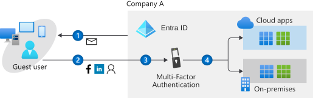
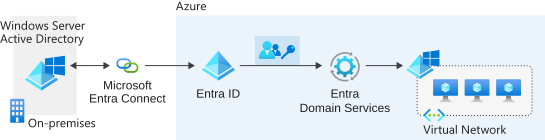
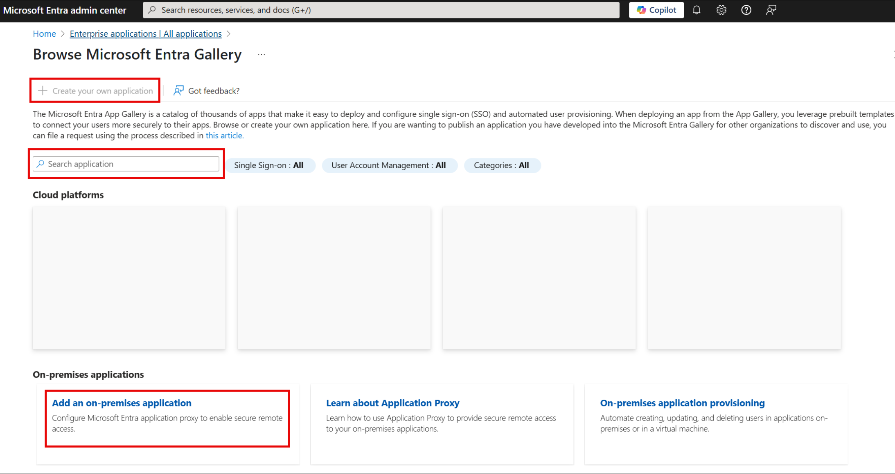
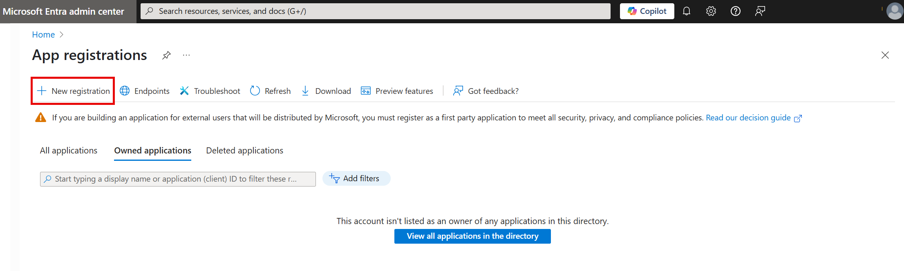
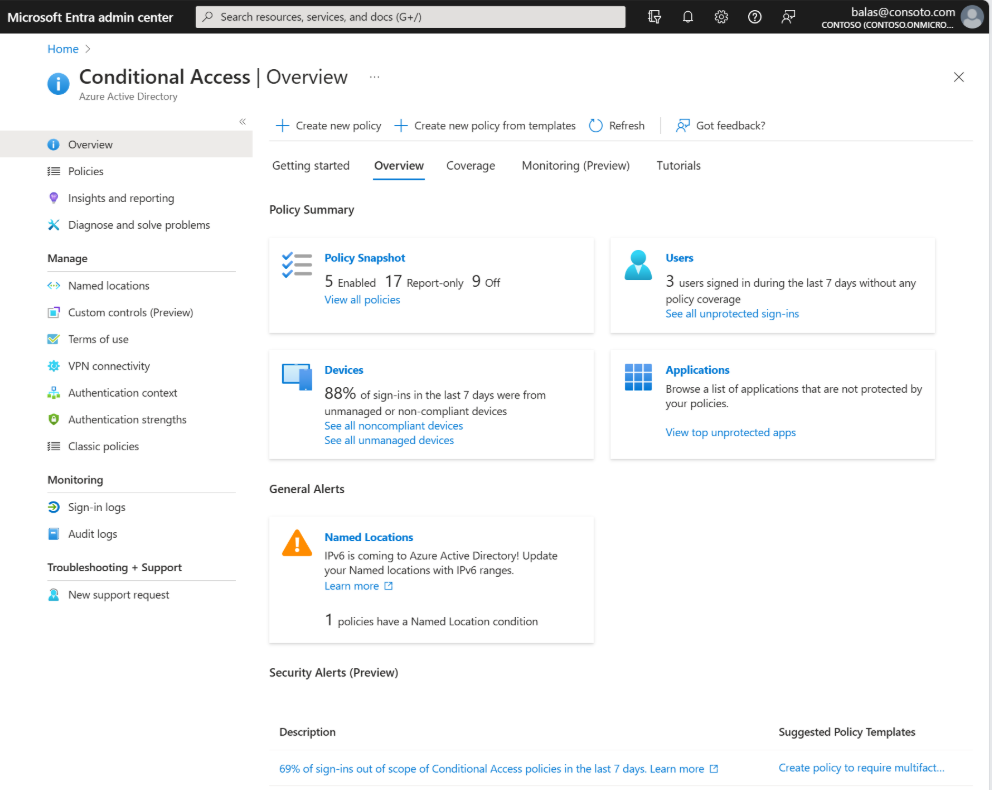
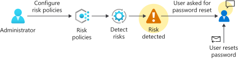
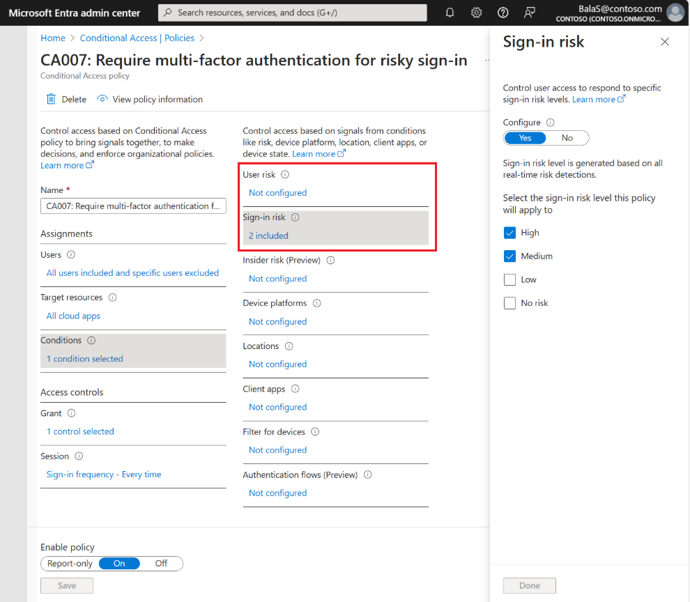

Your company wants to improve how it provides services to doctors and how it collaborates with external healthcare organizations. You're asked to investigate what other capabilities and services Microsoft Entra ID can provide for the organization.

Here, we explore Microsoft Entra B2B collaboration, Microsoft Entra External ID for customers, Microsoft Entra Domain Services, and Microsoft Entra ID Protection. You learn how these services help secure application access for employees, partners, and customers. Except for the customer-identity section, the examples use your workforce tenant.

## Microsoft Entra B2B

Use Microsoft Entra B2B collaboration, a capability of Microsoft Entra External ID, to invite external users to your workforce tenant. Your organization can then collaborate with external healthcare partner staff members.

For example, your company works with external healthcare partners. You can invite these partners as guest users to your tenant. When their work is done, you can revoke access for those external partners until they need it again.

Here's the B2B collaboration process:

1. The external user either receives an email invitation that includes a redemption link or gets a direct link.
1. The user selects the redemption link to access the apps they were invited to.
1. If multifactor authentication is set up, the user receives a verification code on their phone.
1. The user provides the code they received.
1. The user can access the app, whether it's on-premises or in the cloud.

This feature is available for all licensing tiers in Microsoft Entra ID.

## Microsoft Entra External ID for customers

Use Microsoft Entra External ID to add customer identity and access management (CIAM) to customer-facing apps. For example, doctors can register for your healthcare services and sign in with an email address or a supported social identity provider.

Customer apps use an *external tenant*, separate from the *workforce tenant* used by employees and B2B guests. The workforce tenant created later in this module isn't an external tenant. See [Workforce and external tenant configurations](/entra/external-id/tenant-configurations).

To implement this scenario, create an external tenant in the Microsoft Entra admin center, register the app, and configure a sign-up and sign-in user flow. The user flow defines the sign-in methods and information collected during registration. Add the app to the user flow and integrate it with External ID. See [Create an external tenant](/entra/external-id/customers/how-to-create-external-tenant-portal), [Create a user flow](/entra/external-id/customers/how-to-user-flow-sign-up-sign-in-customers), and [Add an app to a user flow](/entra/external-id/customers/how-to-user-flow-add-application).

For example, a returning customer using browser-based sign-in with an email address and password can complete SMS-based multifactor authentication (MFA) as follows. This example assumes the customer has registered a phone number, SMS is enabled in the external tenant, and a Conditional Access policy requires MFA.

1. The customer opens the app in a browser or on a mobile device.
1. The app redirects the customer to the sign-in page, where they enter their email address and password.
1. After the password is verified, the customer receives an SMS verification code on their registered phone.
1. The customer enters the code to complete MFA.
1. The customer returns to the app after successful authentication.

SMS verification requires a linked Azure subscription and incurs additional charges. Review [MFA in external tenants](/entra/external-id/customers/concept-multifactor-authentication-customers) and [External ID billing](/entra/external-id/external-identities-pricing) before enabling paid features.

## Microsoft Entra Domain Services

Microsoft Entra Domain Services lets you add virtual machines to a domain without needing domain controllers. Your internal staff users can access virtual machines by using their company Microsoft Entra credentials.

Use this service to reduce the complexity of migrating on-premises apps to Azure. An organization could also use Microsoft Entra Domain Services to handle its infrastructure if it runs apps both on-premises and in the cloud. The process might go like this:

1. The organization deploys its apps and servers in a virtual network on Azure.
1. Microsoft Entra Connect Sync synchronizes identity information between the on-premises Active Directory instance and the organization's tenant in Microsoft Entra ID.
1. The company enables Microsoft Entra Domain Services on their Microsoft Entra tenant.
1. The apps and servers in Azure can use features like domain joining and Kerberos authentication.

Microsoft Entra Domain Services is charged on an hourly, pay-as-you-go basis according to the selected SKU: Standard, Enterprise, or Premium. Object count and authentication volume help you choose an appropriate SKU, but the service no longer uses variable per-object pricing. Check [Domain Services pricing](https://azure.microsoft.com/pricing/details/microsoft-entra-ds/) for the selected region and applicable additional Azure infrastructure charges.

## App management

Your company might provide many apps that internal and external users rely on. Users might want to access these apps from different devices and locations. You can use Microsoft Entra ID as a cloud-based solution to manage user access for all of these apps.

You can manage different categories of apps in Microsoft Entra ID in **Enterprise Applications** > **+ New Application**:

- **Microsoft Entra App Gallery applications**. Thousands of SaaS apps are integrated with Microsoft Entra ID.
- **Non-gallery applications**. You can manually add any apps that you don't see in the gallery.
- **On-premises applications**. You can add on-premises apps by configuring the Microsoft Entra application proxy. This process creates secure remote access for your on-premises apps. To connect them, download and install the Application Proxy connector on-premises.

    > [!NOTE]
    > Microsoft Entra application proxy requires Microsoft Entra ID P1 or P2. Registering an application or using a gallery application doesn't, by itself, provide this entitlement. See [Microsoft Entra licensing](/entra/fundamentals/licensing#app-provisioning).

    

- **Custom applications**. You can register your company-built apps with Microsoft Entra ID in **App Registrations**. You can then control and monitor authentication for these apps.

    

In the following sections, you learn about other Microsoft Entra features you can use to benefit your apps.

### Protect your apps through Conditional Access policies

You can use Conditional Access policies to require users to pass more authentication challenges before they access an app. For example, you can configure a Conditional Access policy to require users to complete a multifactor authentication challenge after their credentials are verified, and before they access the app.

For workforce tenants, Conditional Access policies require Microsoft Entra ID P1 or P2.

### Monitor your app access

Microsoft Entra ID provides reports to help you investigate sign-in activity and directory changes. Basic sign-in and audit logs are available across license tiers, but report availability and detail depend on the feature and license.

For user-risk reporting in Microsoft Entra ID Protection, the Risk detections report isn't available with Microsoft Entra ID Free, provides limited information with P1, and provides full access with P2 or Microsoft Entra Suite. Free and P1 provide limited information in the Risky users and Risky sign-ins reports. See [ID Protection license requirements](/entra/id-protection/overview-identity-protection#license-requirements).

## Microsoft Entra ID Protection

Microsoft Entra ID Protection helps you to automatically detect, investigate, and remediate identity risks for users. It also lets you export all the information collected about risks. You can export the information to non-Microsoft tools and solutions so that you can further analyze it.

Microsoft Entra ID Protection uses risk policies to automatically detect and respond to threats. You can configure a risk policy to set up how it should respond to a particular type of risk. Use policies in this way to save time and give you peace of mind.

First, the Administrator configures the risk policies by using automated risk detection and remediation through Microsoft Entra ID Protection. The policies then monitor for identity risks. When a risk is detected, the policies enforce measures to remediate it. For example, a policy might require a user to reset their password in response to a detected risk. The user then resets their password, and the risk is remediated.

You can configure risk policies through the Microsoft Entra admin center. There are two types of risk policies in Microsoft Entra Conditional Access you can set up. You can use these policies to automate the response to risks allowing users to self-remediate when risk is detected. Microsoft Entra ID Protection is available for the Premium P2 licensing tier.

