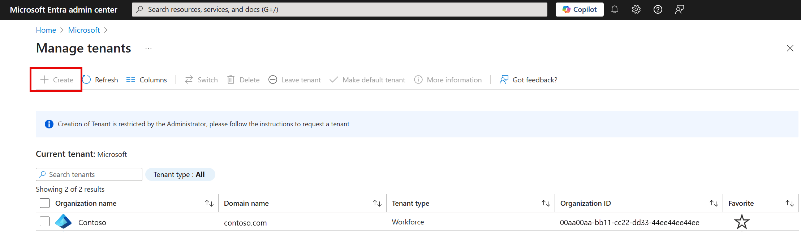
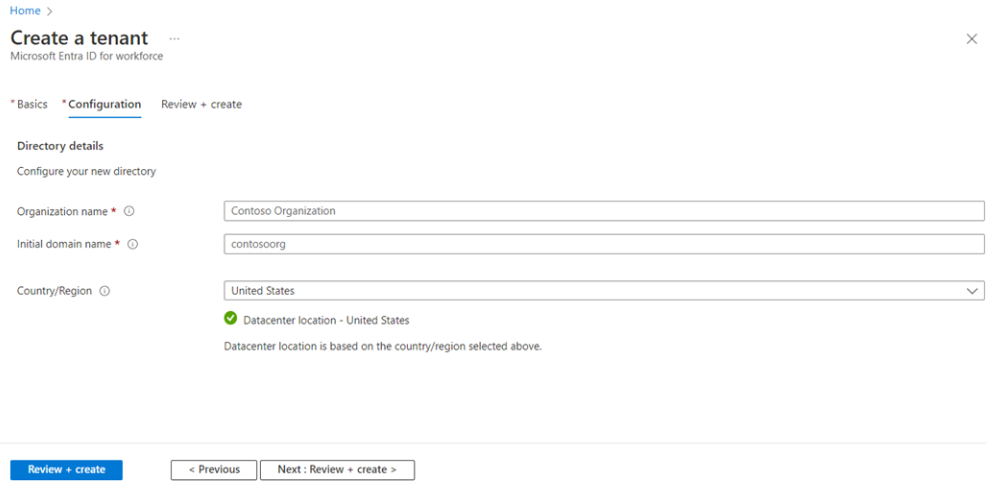

Your organization decides to use Microsoft Entra ID to manage secure workforce access for internal staff members and external healthcare partners. You're asked to look into implementing this access for your organization.

Here, you learn how to take a phased approach to deploying Microsoft Entra ID for your organization. You learn how to lay a foundation, deploy Microsoft Entra ID by creating a workforce tenant, and associate a subscription with it. These stages apply to workforce identities, not the separate external tenant for customer-facing apps.

## Deploy in phases

A good way to deploy Microsoft Entra ID is in phases. Your deployment is split into several stages. Each stage addresses a key aspect of Microsoft Entra ID. A phase includes the tasks you need to complete before you go to the next stage. This approach lays a secure foundation for your Microsoft Entra instance.

### Stage 1: Build a secure foundation

In the first stage, you build a foundation of security for your Microsoft Entra ID. Internal staff members and external healthcare partners all need the most secure access you can provide. Configure baseline security features before you add or create user accounts. The work you do here helps ensure your Microsoft Entra instance is in a secure state from the start. The following table describes your tasks.

| Task | Description | License needed |
|---|---|---|
| **Assign more than one Global Administrator**| Give at least two Microsoft Entra accounts the Global Administrator role. Make sure you don't use these accounts daily. Ensure the accounts have long and complicated passwords.| Free |
| **Use regular Administrative roles where possible** | Administrators who aren't Global Administrators should never have more permissions than they need to do their work. Use these regular Administrator roles by default. Avoid using the Global Administrator roles unless needed. | Free |
| **Configure Privileged Identity Management (PIM) to track Administrators** | Use PIM to monitor how your Administrator roles are used. This action helps you improve your governance and compliance.| Microsoft Entra ID P2 |
| **Configure self-service password reset** | Let internal users reset their passwords through policies that you configure. This action reduces the number of help desk tickets for password resets. | An eligible plan with cloud-only SSPR, such as Microsoft 365 Business Standard, or Microsoft Entra ID P1 or P2 |
| **Create a list of banned passwords** | Use this list to prevent users from using passwords that are common phrases or words in your organization. For example, your list can include your company name or headquarters location. | Microsoft Entra ID P1 |
| **Warn users to not reuse credentials** | When someone reuses the same credentials on multiple platforms, an attacker can use the credentials to access all of those platforms if a single platform is compromised. | Free |
| **Set passwords to never expire for cloud-based user accounts** | Routine password resetting tempts users to increment their existing passwords. For example, they might change their password from `R4ndom1Strong` to `R4ndom2Strong` and so on. In this case, because most of the password remains the same, it increases the risk of using already exposed credentials to gain access to an account. | Free |
| **Enforce multifactor authentication through Conditional Access policies** | Configure Conditional Access policies to require users to pass multiple authentication challenges before they can access an application. | Microsoft Entra ID P1 |
| **Configure Microsoft Entra ID Protection** | Flag and block suspicious sign-ins and compromised user credentials for your organization's users. You can also use Microsoft Entra ID Protection to automatically trigger multifactor authentication or a password reset, depending on the severity of the detected risk. | Microsoft Entra ID P2 |

> [!NOTE]
> Changing a known password and resetting a forgotten password are different licensing scenarios. For ordinary cloud-only users, Microsoft Entra ID Free supports password change, while password reset requires an eligible license. Resetting an on-premises password through password writeback requires Microsoft Entra ID P1, P2, or Microsoft 365 Business Premium; standalone Microsoft 365 Business Standard doesn't include that writeback entitlement. See [Self-service password reset licensing](/entra/identity/authentication/concept-sspr-licensing).

### Stage 2: Add users, manage devices, and configure synchronization

Now you can add users and plan how to handle external guest-user access. The following table describes your tasks in this stage.

| Task | Description | License needed |
|---|---|---|
|**Install and configure Microsoft Entra Connect**| Use Microsoft Entra Connect to synchronize users from your on-premises instance of Active Directory to Azure. | Free                                                |
|**Use password hash synchronization**| You can synchronize password changes and detect and fix bad passwords. You get reports about leaked user credentials. | Free                                                |
|**Use password writeback**| Configure password writeback so any changes to passwords in Azure are written to your on-premises instance of Active Directory. | Microsoft Entra ID P1                                          |
|**Use Microsoft Entra Connect Health**|  Use Microsoft Entra Connect Health to monitor the health statistics for your Microsoft Entra Connect environment. | Microsoft Entra ID P1                                          |
|**Give users the licenses they need at a group level**| When you assign licenses at a group level, you control licensing for many users simultaneously. This action saves your organization time and reduces complexity.|Free|
|**Use Microsoft Entra B2B Collaboration for guest-user access**| Use this resource to ensure that external healthcare partner users can use their own work or social identities to access your applications and services. You don't need to manage their credentials for them. | Required licenses depend on which features you want the guest users to access|
|**Prepare a device-management strategy** | Put together a plan based on which devices your company allows. For example, are you going to permit Bring Your Own Device (BYOD), or is the company only accepting its own devices given to users? |Free|
|**Provide authentication methods that don't require passwords**| After an administrator enables passwordless phone sign-in and users complete Microsoft Authenticator registration, users can sign in without entering a password. The sign-in screen displays a number. Users enter that number in Authenticator, approve the request, and use their device PIN or biometric to complete authentication. | Microsoft Entra ID P1 |

### Stage 3: Manage your applications

You can now integrate your applications with Microsoft Entra ID. The following table describes your tasks in this stage.

| Task | Description | License needed |
|---|---|---|
| **Identify applications**                                   |  Investigate the applications in your organization. Your organization could, for example, have applications on-premises or software-as-a-service (SaaS) applications in the cloud. Choose applications that you want to manage in Microsoft Entra ID. | N/A |
|**Use SaaS applications in the Microsoft Entra gallery**|  Your organization probably uses SaaS applications that are already in the gallery, and that you can find in the Azure portal. Use these applications from the gallery whenever you can. You can save time by integrating your applications and Microsoft Entra ID.  | Free       |
| **Integrate your on-premises applications using Application Proxy**| You can let Microsoft Entra users sign in to your on-premises applications using their Microsoft Entra account. |Microsoft Entra ID P1 or P2|

### Stage 4: Monitor your Administrators, do access reviews, and automate user life cycles

Now you can address how much privilege your Administrators should have, and you can complete access reviews. In this stage, you also configure how to automate common user life-cycle tasks. The following table describes your tasks in this stage.

| Task | Description | License needed |
|---|---|---|
|**Use PIM to control Administrator access** | Ensure that Administrators can use their account only after they pass a multifactor authentication challenge or receive approval from an accepted approver. | Microsoft Entra ID P2 |
|**Complete access reviews for Microsoft Entra directory roles in PIM**| Configure access review policies in PIM so you can regularly review Administrative access based on your organization's requirements for privileged roles.  | Microsoft Entra ID P2 |
|**Configure dynamic group membership policies**| Save time and effort by automatically adding users to specific groups based on known profile information, like department or region. For example, you can automatically add all users who are part of the human resources department to a user group called Human Resources. | Microsoft Entra ID P1 or P2 |
| **Use group-based application assignment**| Use group-based access management to give all group members access to an application. When you use dynamic groups, users who are removed from a group automatically lose access to the application. This action helps keep your applications secure. |Microsoft Entra ID P1 or P2 |
| **Configure automated user account provisioning and deactivation** | Automatically create application-specific accounts to allow users to use SaaS applications based on existing Microsoft Entra users and groups. You can also automatically deprovision user accounts when a user leaves the organization. This action keeps your organization protected from unauthorized access. | Free|

## Create a tenant

To explore Microsoft Entra ID for your organization's users and resources, you need access to a workforce tenant. You can use an existing tenant that you're authorized to manage, or create an additional tenant when your organization permits it and your account meets the creation requirements.

> [!NOTE]
> Only paid customers can create additional workforce tenants through the admin-center flow. A free tenant or trial subscription doesn't, by itself, allow you to create additional workforce tenants. Initial account signup is a different scenario. If tenant creation is restricted in your organization, you need at least the Tenant Creator role. Review [Create a new Microsoft Entra tenant](/entra/fundamentals/create-new-tenant) before starting.

For an authorized test setup, follow the workforce-tenant procedure in that quickstart. In the Azure portal, open **Microsoft Entra ID > Overview > Manage tenants > Create**, and choose **Microsoft Entra ID** for a workforce tenant. Enter the organization name, initial domain, and country or region, then review the configuration before creating the tenant.

Use the form to create your Microsoft Entra resource.

## Understand subscription and tenant relationships

An Azure subscription trusts one Microsoft Entra tenant. A tenant can be trusted by multiple subscriptions. Creating a tenant doesn't require you to move an existing subscription to it.

> [!WARNING]
> Don't change the directory of an existing subscription as part of this introductory module. A directory transfer permanently removes Azure RBAC role assignments and custom roles associated with the transfer, and can disrupt managed identities, Key Vault access, and other directory-dependent services. If your organization needs a transfer, plan it as a separate migration and review the eligibility, permissions, impact assessment, and recovery steps in [Transfer an Azure subscription to a different Microsoft Entra directory](/azure/role-based-access-control/transfer-subscription).
