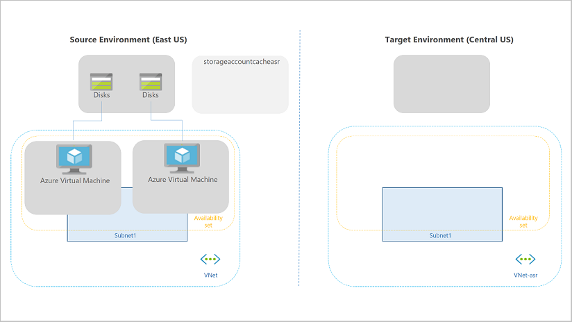
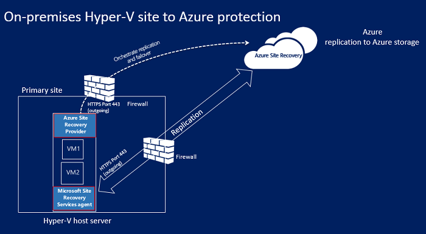

Azure Site Recovery orchestrates disaster recovery by replicating supported workloads from a primary location or region to a recovery location.

You can perform a failover to shift where your workloads run, including when there's a disruption at the primary location. After failover, the workloads can run in the recovery location. Once the primary location is ready, use the platform's supported failback workflow to return.

Before an outage, enable replication and allow initial synchronization to finish. Site Recovery then maintains recovery points from the replicated data. If the primary location becomes unavailable, fail over the protected workloads by using an available recovery point in the recovery location.

## Replication

Replication transfers changes from protected machines to the recovery location before a disaster occurs. Connectivity requirements depend on the source platform and whether you use public or private endpoints.

The diagram shows native Hyper-V-to-Azure replication without System Center Virtual Machine Manager (VMM). VMM-managed deployments place the Site Recovery Provider on the VMM server instead.

For on-premises replication to Azure service endpoints, use supported outbound HTTPS connectivity. You can use ExpressRoute Microsoft peering for the documented public-endpoint replication path.

Supported private-endpoint designs provide another option. Current Hyper-V and modernized VMware documentation supports site-to-site VPN replication when private endpoints are used. ExpressRoute private peering can also support the documented private-endpoint design. Configure the Recovery Services vault and storage endpoints separately, with the required routing, DNS resolution, permissions, and firewall access. Creating a vault private endpoint alone doesn't make the storage replication path private.

> [!IMPORTANT]
> Private endpoints don't remove all outbound connectivity requirements. The protected hosts and replication components still need access to the authentication and other service endpoints required by their scenario. Current documentation differs on site-to-site VPN support for physical-server replication. Confirm that specific design with Microsoft before relying on it.

The following table shows where the replication components run for each scenario.

| Scenario | Replication components and data path |
| --- | --- |
| Native Hyper-V to Azure without VMM | Install the Azure Site Recovery Provider and Azure Recovery Services agent on each Hyper-V host or cluster node. The Provider coordinates protection, and the agent sends replication data to Azure storage. No Site Recovery software needs to be explicitly installed in each guest VM for this native path. |
| Native Hyper-V to Azure with VMM | Install the Site Recovery Provider on the VMM server and the Azure Recovery Services agent on each Hyper-V host or cluster node. VMM VM networks are mapped to the target Azure virtual networks. |
| Modernized VMware VMs or physical servers to Azure | Use an on-premises Azure Site Recovery replication appliance and the Mobility service on protected machines. The appliance processes changes and sends them to Azure cache storage for processing into managed replica disks. |
| Azure VMs to another Azure region | Site Recovery automatically installs the Mobility service extension on each protected VM. Changes are written to a cache storage account in the source region and processed into replica managed disks in the target region. An on-premises replication appliance isn't required. |

The Recovery Services vault manages protection and recovery operations. Don't confuse it with the cache storage or replica disks that hold the replicated workload data.

Azure-to-Azure replication normally remains on Microsoft's network and doesn't require ExpressRoute. Connectivity used to reach a recovered VM is a separate consideration from the path used to replicate its data.

## Replication policies

A replication policy defines the settings for the retention history of recovery points. It also defines the frequency of app-consistent snapshots.

Policy defaults and supported settings depend on the replication scenario. Don't apply one scenario's limits to another.

The following table distinguishes the policy guidance for the scenarios in this module, including Hyper-V managed by VMM.

| Replication scenario | Recovery-point retention | Application-consistent recovery points |
| --- | --- | --- |
| Azure VMs to another Azure region | The default is one day. Managed-disk recovery supports a configured history of up to 15 days. | Disabled by default. When enabled, the minimum interval is one hour. |
| Modernized VMware VMs or physical servers to Azure | Up to 15 days. Review and explicitly configure the retention setting rather than relying on a universal default. | Disabled by default. When enabled, intervals from 1 to 12 hours are documented. |
| Hyper-V VMs to Azure | Use the values supported by the Hyper-V policy. The VMM-to-Azure tutorial identifies a two-hour default. Don't infer its maximum from the Azure-to-Azure limit. | The VMM-to-Azure tutorial identifies an hourly default. Verify the policy for the selected Hyper-V deployment. |

Hyper-V copies changes at a configured transmission interval. Azure VMs, modernized VMware VMs, and physical servers use continuous replication. Transmission frequency, recovery-point generation, retained history, and the achieved recovery point objective are different concepts.

> [!NOTE]
> You can't perform an offline replication using Azure Data Box or other storage technologies for the initial replication to Azure.

For scenarios where you're replicating from one Azure region to another, it's possible to replicate between Azure subscriptions if those subscriptions are associated with the same Microsoft Entra tenant.

## Recovery points

Azure Site Recovery has customizable replication policies that you can use to define the retention history of recovery points and the frequency of snapshots. You can create a recovery point from a snapshot of a virtual machine's disk.

The two types of snapshots available are *Crash-consistent* and *App-consistent*:

- **Crash-consistent** recovery represents the data persisted on disk at the recovery-point time, similar to the state after an abrupt power loss. It doesn't preserve unflushed memory contents. Azure-to-Azure and modernized VMware/physical documentation describes crash-consistent point generation every five minutes. This generation interval isn't a guarantee of a five-minute recovery point objective (RPO).

- **App-consistent** recovery uses application coordination to create a consistent point-in-time copy of persisted data. For supported Windows applications, Volume Shadow Copy Service (VSS) coordinates work such as flushing caches and completing transactions before the snapshot. Other workloads need the application-consistency mechanism supported for their scenario. After recovery, the VM and applications start from that persisted state.

> [!NOTE]
> An app-consistent recovery point isn't a saved copy of the running VM's memory or execution state. It doesn't guarantee zero data loss. Changes made after the selected recovery point can be lost. Configure and verify app-consistent recovery points when the workload requires them.

The retention window doesn't mean that every generated recovery point remains selectable throughout that window. For Azure-to-Azure replication with a one-day policy, five-minute recovery points are available for the latest two hours, and only one point per hour is retained beyond that. Longer retention settings use further pruning.

If a problem prevents new recovery points from being generated, the documented retention behavior keeps existing points beyond the configured window until new points are generated. This protects the remaining history during an interruption, but it isn't an independent backup or an unconditional indefinite-retention guarantee.

## Recovery plans

A recovery plan gathers machines into recovery groups to prepare for a failover. A recovery plan helps you define a systematic recovery process by creating small independent units that you can fail over. A unit typically represents an app in your environment.

- A recovery plan defines how machines fail over and the sequence in which they start after failover.

- You can use recovery plans for supported failover and failback workflows.

- You can add up to 100 protected instances to one recovery plan.

- You can customize a plan by adding order, instructions, and tasks to it.

- You can run a failover on a plan after you define it.

- Machines can be referenced in multiple recovery plans, provided subsequent plans skip the deployment or startup of a machine that was previously deployed using another recovery plan.

Recovering large applications can be a complex task. Manual steps make the process prone to error, and the person running the failover might not be aware of the intricacies of all apps. You can use a recovery plan to impose order and automate the actions needed at each step, by using scripts or Azure Automation runbooks for failover to Azure. For tasks that can't be automated, you can insert pauses for manual actions into recovery plans.

### Startup order and application consistency

Machines in the same recovery-plan group start in parallel. Groups start in sequence after the machines in the preceding group have failed over and started. A started VM doesn't necessarily mean that its database or application is ready. For Adatum's three-tier applications, include an application-specific readiness check or a manual confirmation before starting tiers that depend on the recovered database.

A recovery-plan group controls orchestration. It doesn't automatically make the machines' recovery points consistent with one another. For supported Azure-to-Azure workloads that require a shared recovery point, configure multi-VM consistency in a replication group separately and use an appropriate multi-VM recovery-point option.

> [!NOTE]
> Azure-to-Azure multi-VM consistency can affect workload performance, so enable it only for machines that need shared consistency. A replication group supports up to 16 VMs, and its members can't fail over individually. This limit is different from the number of protected instances that a recovery plan can contain. Not every tier in an application needs to belong to the same consistency group.

## What is a disaster-recovery drill?

A disaster-recovery drill checks whether the application can recover and whether the recovery process meets the organization's objectives.

- **Recovery point objective (RPO)**: The maximum acceptable data loss measured in time. An RPO of one day means the business can tolerate losing up to one day's changes.
- **Recovery time objective (RTO)**: The maximum acceptable time to restore business operations. An RTO of four hours means the application must be usable within four hours of the disruption.

These objectives are independent. A daily backup or a configured replication interval doesn't prove that either target is met. Check the age of recoverable data and measure the complete application recovery process.

Use the following sequence for a Site Recovery drill:

1. Check replication health and the available recovery points. Prepare an isolated non-production virtual network and the test identity, DNS, and application dependencies.
2. Select **Test failover** for the VM or recovery plan. Select an appropriate recovery-point option and the test network.
3. Validate application behavior and connectivity, record the recovered data timestamp, and measure recovery time. Keep test instances from sending production traffic or writing to production dependencies.
4. Record the results and select **Cleanup test failover** when testing is complete. Confirm that cleanup succeeds.

Test failover creates test VMs without switching production to the recovery location, and normal replication continues. Repeat the drill after material changes and on a schedule appropriate to the workload.

> [!IMPORTANT]
> A test VM can have the same identity and application configuration as its source. Connecting it to production networks or dependencies can cause conflicts and unintended changes. Network and application isolation are essential to a non-disruptive drill.

## Failover and failback

A failover starts the protected workload in the recovery location using replicated data and the configured target compute, networking, and availability settings.

The recovery-point choices depend on the replication scenario and whether you fail over an individual VM or a recovery plan. For Azure-to-Azure recovery, **Latest processed** uses an already processed point, which avoids additional processing time. **Latest** attempts to process data already received before recovery, which can reduce data loss but take longer. **Latest app-consistent** uses an available application-consistent point.

**Custom** lets you select a particular available recovery point for an individual VM. Custom recovery-point selection isn't available for recovery plans. An older point might help recover from corruption, but changes after that point aren't included.

The target environment becomes the de facto production environment in which your organization's production services run. After the target region is active, the source environment should no longer be used.

Use **Test failover** for an isolated drill and **Failover** for a production recovery. A test doesn't switch production service to the test VMs. A production recovery also needs controlled source isolation and application traffic switching.

For an ordinary failover, you can ask Site Recovery to shut down the source VM before recovery. This reduces the risk of simultaneous writes, but it doesn't guarantee zero data loss. Failover can continue if shutdown fails. Data loss also depends on replication progress and the recovery point that you select. Ensure that the original instance can't resume serving production traffic after the recovery instance takes over.

For supported Hyper-V scenarios, use **Planned failover** during a controlled outage when the source is available. That workflow shuts down the source and synchronizes the latest changes before failover. Its zero-data-loss behavior depends on successfully completing that planned workflow, not merely selecting a shutdown checkbox during an unplanned failover.

After failover, validate the recovered VM and application before committing. Where supported, you can change the recovery point while the failover is awaiting commit. **Commit** deletes the available Site Recovery recovery points for the VM, so you can't change the selected point afterward. Committing doesn't automatically protect the recovered workload. Follow the reprotection or failback workflow for its replication scenario.

> [!NOTE]
> Azure Site Recovery doesn't clean up the source environment after the failover is complete.

Failover isn't automatically triggered when the primary location has an outage. An administrator or an automation workflow must initiate it.

Failback is a planned recovery operation, not simply restarting the original VM. The original location must be ready to receive current data and run the workload. The synchronization, shutdown, commit, and reprotection steps depend on the replication scenario.

Failover of an already protected workload can use available replicated data when the primary site is unavailable. This doesn't allow new replication to begin from an unavailable source.

> [!IMPORTANT]
> Failback to an on-premises physical server isn't supported. For a physical workload that must return from Azure, confirm the supported destination and return procedure before selecting the recovery design. Microsoft's general FAQ describes return to a VMware VM, but the modernized physical-server architecture doesn't provide a consistent support statement for that workflow. Don't assume that it is available without confirmation from Microsoft.

## Reprotection and failback

For Azure-to-Azure recovery, validate and commit failover, then use **Re-protect** to replicate the recovered VM back to the original region when that region is available. Review permissions and target resources, allow synchronization to complete, and check replication health before the planned return. Keep the original source-region VM shut down while its disks are synchronized and during failback. Use **Failover** in the secondary-to-primary direction for the return. After validating the returned workload, commit the return and reprotect it toward the recovery region again.

For Adatum's VMs protected through native Hyper-V-to-Azure replication, failback uses **Planned failover**, not the Azure-to-Azure **Re-protect** sequence. The following example returns to the original on-premises location and synchronizes data before cutover to minimize downtime:

1. Restore connectivity to the on-premises Hyper-V infrastructure and confirm that it can host the returning VM. Ensure that the failover to Azure is committed. If VMM manages the VM, its metadata must still exist in the VMM database.
2. Start **Planned failover** from Azure to the on-premises location. Select the option to synchronize data before failover.
3. Wait for the initial synchronization to finish. The Azure VM continues running during this transfer.
4. At the agreed cutover time, select **Complete Failover**. This action shuts down the Azure VM, transfers the final changes, and starts the on-premises VM. Wait for this stage to complete.
5. Validate the returned VM and application, then select **Commit**.
6. Select **Reverse Replicate** to resume protection from on-premises to Azure, and verify replication health.

> [!NOTE]
> The full-download synchronization option transfers the entire disk during failover. It can involve more downtime than synchronizing changes before cutover. It can be appropriate when the Azure VM has been running for a long time or the original on-premises VM has been deleted. Don't assume that its timing is the same as the synchronize-before-failover example.

The detailed steps depend on whether you return to the original host or an alternate location. A recovery plan doesn't support Hyper-V failback to an alternate location.

> [!NOTE]
> Running in the recovery location doesn't automatically establish reverse replication. Verify the protection state after both failover and failback, and follow the workflow for the source platform.

## Monitor recovery readiness

Monitor replication health, reported RPO, latest available recovery points, failed jobs, target configuration, and test-failover status in the Recovery Services vault. The reported replication RPO and the timestamp of an already processed recovery point describe different stages of the replication process.

Configure notification routing for relevant Azure Monitor alerts, investigate errors promptly, and maintain supported versions of the replication components. Repeat application recovery tests regularly and after significant changes. Healthy replication alone doesn't prove that DNS, identity, network access, and application dependencies will work after recovery.
