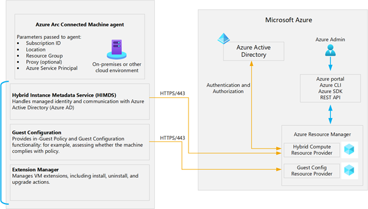

Using Microsoft Defender for Cloud to improve security posture across your entire digital estate, Microsoft Sentinel for security-event correlation and threat intelligence, and Azure Monitor to monitor on-premises services, Azure Arc-enabled servers delivers value through a simple architecture.

Wide World Importers has prioritized its deployment of Azure Arc-enabled servers. You want to first understand how Azure Arc can extend Azure's management plane to servers outside Azure and learn about what capabilities Azure Arc-enabled servers could deliver for the firm.  

## Overview of the Connected Machine agent  

Azure Arc relies on a locally installed agent to establish a logical connection between the local resource and Azure. This agent is the Connected Machine agent. The Connected Machine agent package contains several logical components, which are bundled together:

- The Hybrid Instance Metadata service (HIMDS) manages the connection to Azure and the connected machine's Azure identity.

- The Azure Machine Configuration agent, also called the guest configuration agent, assesses compliance with required guest settings and, for supported configurations, applies and monitors or automatically corrects those settings.

- The extension agent manages virtual machine (VM) extensions, including installation, removal, and upgrades.

When the Azure Connected Machine agent establishes a connection between Azure and a local resource, it effectively "Arc-enables" the resource. The non-Azure resource automatically becomes a hybrid Azure resource as part of the Azure Resource Manager plane. Azure Resource Manager serves as the management interface that allows you to create, modify, and delete Azure resources.

## Capabilities of Azure Arc-enabled servers

Azure Arc-enabled servers can make use of a breadth of capabilities, so you can bring Azure services to your machines anywhere: across on-premises, multicloud, and edge environments. The following table summarizes services that address security, observability, and governance needs.

| Service | Description |
|---|---|
| **Azure resources** | Azure Arc-enabled servers benefit from Azure's resource management functions, including:<ul><li>The ability to organize resources by using Azure management groups, subscriptions, resource groups, and tags.</li><li>A comprehensive inventory of multicloud and on-premises assets, including support for searching and indexing by using Azure Resource Graph.</li><li>A consolidated view of Azure and Azure Arc-enabled resources through the Azure portal, Azure command-line interface (CLI), Azure PowerShell, and REST API.</li></ul> |
| **Microsoft Defender for Cloud** | Use Defender for Cloud to review security posture. Enable the paid Defender for Servers Plan 1 or Plan 2 for the corresponding server-protection capabilities, including Defender for Endpoint integration and agent-based Microsoft Defender Vulnerability Management. Capabilities and charges depend on the selected plan. |
| **Microsoft Sentinel** | You can configure machines connected to Arc-enabled servers with Microsoft Sentinel to collect security-related events and correlate them with other data sources. |
| **Azure Monitor** | Use Azure Monitor Agent (AMA) and associated data collection rules (DCRs) to collect selected performance counters, events, and logs from supported Windows and Linux servers. Send log data to a Log Analytics workspace and configure alerts for your monitoring requirements. Use AMA-based VM insights for supported performance-monitoring scenarios. |
| **Azure Policy and Azure Machine Configuration** | Use Azure Policy to assess resource governance and deploy supported configuration policies. Use Azure Machine Configuration to audit operating system settings and, for configurations that support it, apply and monitor or automatically correct those settings inside the guest. |
| **Azure Automation** | Automate recurring operational tasks by using supported PowerShell or Python runbooks. Use an extension-based Hybrid Runbook Worker when the runbook must execute on a supported Arc-enabled server. |
| **Azure Update Manager** | Assess and install operating system updates on supported Windows and Linux Arc-enabled servers. Configure periodic assessments and scheduled maintenance according to your patching requirements. Update Manager uses the Connected Machine agent to deploy and manage its update extensions. |
| **Azure Change Tracking and Inventory** | Track supported software, service, file, and registry changes by using AMA, the Change Tracking extension, and an associated DCR. Store the collected data in a Log Analytics workspace. |

### Plan service prerequisites

> [!NOTE]
> Azure Update Manager doesn't require AMA, a Log Analytics workspace, or an Automation account. For non-Azure machines, connect the server to Azure Arc first. Update Manager uses the update sources already configured in the operating system; it doesn't supply an update repository. Review supported operating systems, network access to those sources, and applicable charges before enabling patching.

Follow the Change Tracking and Inventory guidance for Arc-enabled servers. Deploy AMA, the supported Change Tracking extension version (`2.20.0.0` or later as of October 2026), and the DCR configuration and association together. Confirm that inventory and change records appear in the `ConfigurationData` and `ConfigurationChange` tables in the destination workspace.

For on-premises Arc-enabled servers, configure Defender for Endpoint sensor-based vulnerability assessment through the applicable Defender for Servers plan. Agentless scanning applies to supported Azure, AWS, and Google Cloud virtual machines; Arc registration alone doesn't make an on-premises server eligible for agentless scanning. Follow the current Defender for Endpoint integration and vulnerability-assessment guidance, then verify that the machine is onboarded and assessment results are available. Installing the Connected Machine agent doesn't automatically enable the paid protection plan or its sensor.

## Extend Azure Arc-enabled servers

Azure Arc-enabled servers can use Azure VM extensions. Azure VM extensions are lightweight software components that automate configuration tasks after operating system deployment. Traditionally, Azure VM extensions were available only on Azure VMs, but it's now possible to use selected extensions on Azure Arc-enabled servers. The following table describes several supported extensions:

| Extension | Description |
|---|---|
| Custom Script Extension | Executes a script on the target Azure Arc-enabled server. |
| Azure Monitor Agent | Collects the guest operating system data specified by associated DCRs. On Arc-enabled servers, deploy the `AzureMonitorWindowsAgent` or `AzureMonitorLinuxAgent` extension from `Microsoft.Azure.Monitor`. |
| Azure Key Vault agent | Synchronizes certificates from an Azure Key Vault instance to the Arc-enabled server. |
| Microsoft Defender for Endpoint | Enables supported endpoint-protection integration on Arc-enabled servers and supplies the sensor used for agent-based vulnerability assessment. Review Defender for Servers plan requirements, supported operating systems, and deployment prerequisites before enabling it. |

The Machine Configuration agent is included in the Connected Machine agent on Arc-enabled servers. Don't deploy a separate Machine Configuration VM extension to these servers. Select policies and assignment modes that match the required audit or configuration outcome. Use Custom Script Extension for suitable scripted post-deployment tasks; it isn't a substitute for continuous configuration assessment and correction.

### Plan for dependency-mapping retirement

> [!IMPORTANT]
> VM insights Map and the Dependency Agent are deprecated and retire on June 30, 2028. New portal onboarding stopped on September 30, 2025, and support for new operating system versions and Azure regions stopped on June 30, 2025. Don't make this deprecated capability the basis of a new deployment.
>
> AMA-based VM insights performance monitoring is unaffected. For inventory, use Change Tracking and Inventory with AMA. If you require process and network dependency mapping, evaluate a suitable replacement solution using Microsoft's retirement guidance. AMA and Change Tracking and Inventory don't themselves replace dependency maps. Existing deployments should use that guidance to plan migration and offboarding.
