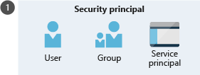
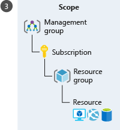

When it comes to identity and access, most organizations that are considering using the public cloud are concerned about two things:

1. Ensuring that when people leave the organization, they lose access to resources in the cloud.
1. Striking the right balance between autonomy and central governance. For example, giving project teams the ability to create and manage virtual machines in the cloud, while centrally controlling the networks those VMs use to communicate with other resources.

Microsoft Entra ID and Azure RBAC work together to make it simple to carry out these goals.

## Azure subscriptions

Each Azure subscription is associated with one Microsoft Entra tenant. Users, groups, service principals, and managed identities receive access to Azure resources through authorization mechanisms such as Azure role assignments; belonging to the directory doesn't by itself grant resource-management access. Microsoft Entra Connect Sync and Microsoft Entra Cloud Sync can synchronize on-premises Active Directory identities with Microsoft Entra ID. Choose a supported synchronization solution that meets your organization's requirements.

> [!IMPORTANT]
> Disabling an on-premises account isn't a guarantee that all cloud access ends immediately. For a synchronized identity, account-state changes must reach Microsoft Entra ID, and existing access tokens or application sessions can remain usable for a period of time. Follow the user access revocation procedure in the Summary unit's More info section, which addresses the on-premises identity, cloud account, and sessions. Review Azure role assignments separately as part of offboarding; blocking sign-in and removing authorization are different actions.

## What's Azure RBAC?

Azure RBAC is an authorization system built on Azure Resource Manager that provides fine-grained access management for resources in Azure. With Azure RBAC, you can grant the exact access that users need to do their jobs. For example, you can use Azure RBAC to let one employee manage virtual machines in a subscription, while another manages SQL databases within the same subscription.

For a video overview of Azure RBAC, see the Summary unit's More info section.

You can grant access by assigning the appropriate Azure role to users, groups, and applications at a certain scope. The scope of a role assignment can be a management group, subscription, a resource group, or a single resource. Child scopes inherit the permissions of a role assigned at a parent scope; inheritance doesn't add permissions to that role. For example, assigning Reader at a resource group lets a user view resource configuration in that group but doesn't grant permission to modify it. The assigned role determines which operations the user, group, or application can perform within the selected scope.

Azure resource access and Microsoft Entra directory administration use separate role systems:

| Role system | What it manages |
| --- | --- |
| Azure RBAC | Access to Azure resources at management group, subscription, resource group, or resource scope. |
| Microsoft Entra roles | Administration of directory resources, such as users, groups, and applications. |

Azure role assignments are inherited down the Azure resource hierarchy: management group, subscription, resource group, and resource. A subscription is associated with one Microsoft Entra tenant, but that association doesn't automatically give directory administrators access to the subscription's resources. Billing permissions are also distinct from Azure resource role assignments.

When full subscription resource administration and access delegation are required, assign the Azure **Owner** role at subscription scope. For narrower tasks, choose an appropriate job-function role or access-administration role, such as **Role Based Access Control Administrator**, at the smallest suitable scope.

> [!NOTE]
> A Microsoft Entra Global Administrator doesn't automatically have access to Azure resources. Directory administration and Azure resource access are separate. See Azure and Microsoft Entra role models in the Summary unit's More info section.

## What can I do with Azure RBAC?

Azure RBAC allows you to grant access to Azure resources that you control. Suppose you need to manage access to resources in Azure for the development, engineering, and marketing teams. You've started to receive access requests, and you need to quickly learn how access management works for Azure resources.

Here are some scenarios you can implement with Azure RBAC:

- Allow one user to manage virtual machines in a subscription and another user to manage virtual networks.
- Allow a database administrator group to manage SQL databases in a subscription.
- Allow a user to manage all resources in a resource group, such as virtual machines, websites, and subnets.
- Allow an application to access all resources in a resource group.

## Azure RBAC in the Azure portal

In several areas in the Azure portal, you'll see a pane named **Access control (IAM)**, also known as *identity and access management*. On this pane, you can see who has access to that area and their role. Using this same pane, you can grant or remove access.

For example, if Alain has been assigned the Backup Operator role for a resource group, you can see that assignment on the resource group's **Access control (IAM)** > **Role assignments** tab.

## How does Azure RBAC work?

You can control access to resources using Azure RBAC by creating role assignments, which control how permissions are enforced. To create a role assignment, you need three elements: a security principal, a role definition, and a scope. You can think of these elements as *who*, *what*, and *where*.

### 1. Security principal (who)

A *security principal* is just a fancy name for a user, group, or application to which you want to grant access.

### 2. Role definition (what)

A *role definition* is a collection of permissions. It's sometimes just called a role. A role definition lists the permissions the role can perform such as read, write, and delete. Roles can be high-level, like Owner, or specific, like Virtual Machine Contributor.

A role definition describes management permissions with `Actions` and `NotActions`, and data permissions with `DataActions` and `NotDataActions`. Use the documented permission names and resource-provider namespaces when defining a custom role. For the structure and examples, see Understand Azure role definitions in the Summary unit's More info section.

Azure includes several built-in roles that you can use. The following list describes four fundamental built-in roles:

- **Owner**: Has full access to all resources, including the right to delegate access to others.
- **Contributor**: Can create and manage all types of Azure resources, but can't grant access to others.
- **Reader**: Can view existing Azure resources.
- **User Access Administrator**: Lets you manage user access to Azure resources.

If the built-in roles don't meet the specific needs of your organization, you can create your own custom roles.

### 3. Scope (where)

*Scope* is the level where the access applies. This is helpful if you want to make someone a Website Contributor but only for one resource group.

In Azure, you can specify a scope at multiple levels: management group, subscription, resource group, or resource. Scopes are structured in a parent-child relationship. When you grant access at a parent scope, the child scopes automatically inherit those permissions. For example, if a group is assigned the Contributor role at the subscription scope, it inherits the role for all resource groups and resources within the subscription.

### Role assignment

Once you've determined the who, what, and where, you can combine those elements to grant access. A *role assignment* is the process of binding a role to a security principal at a particular scope for the purpose of granting access. To grant access, you'll create a role assignment. To revoke access, you'll remove a role assignment.

The following example shows how the Marketing group has been assigned the Contributor role at the sales resource group scope.

| Role-assignment element | Example |
| --- | --- |
| Security principal (who) | Marketing group |
| Role definition (what) | Contributor |
| Scope (where) | sales resource group |

The Contributor role's permissions apply within this resource group. For the exact permission identifiers and exclusions, see Contributor role permissions in the Summary unit's More info section.

## Azure RBAC is an allow model

Azure RBAC role assignments are additive. If one applicable assignment grants read access and another grants write access, the user can have both permissions, subject to applicable deny assignments and role-assignment conditions.

Within a role definition, `NotActions` excludes operations from the role's wildcard `Actions`. The calculation `Actions - NotActions` describes the management operations that the role grants. Data permissions are described separately by `DataActions` and `NotDataActions`.

> [!IMPORTANT]
> `NotActions` isn't a deny rule. Another applicable role assignment can grant an operation excluded by this role. An applicable deny assignment is different: it can block an operation even when a role assignment grants it.

For example, Contributor uses `Actions: ["*"]` with exclusions. Examples of operations that this role doesn't grant include:

- Authorization write and delete operations covered by `Microsoft.Authorization/*/Write` and `Microsoft.Authorization/*/Delete`, including role-assignment changes.
- Elevating access through `Microsoft.Authorization/elevateAccess/Action`.
- Sharing an image gallery through `Microsoft.Compute/galleries/share/action`.
- Managing a deployment stack's deny settings through `Microsoft.Resources/deploymentStacks/manageDenySetting/action`.

These are examples, not a complete role definition. See Contributor role permissions in the Summary unit's More info section for the full list of exclusions.

### Govern deployments with supported Azure Resource Manager features

Author resources, role assignments, and policy assignments in Bicep or ARM templates. Use template specs or Git to store and version the templates. Use Azure deployment stacks to manage a collection of deployed resources and its lifecycle, with deny settings when protection against changes is required.

> [!NOTE]
> Template specs provide template storage and versioning; they don't provide deployment-stack lifecycle management or deny enforcement by themselves. Deployment stacks don't grant the deploying identity extra permissions. That identity still needs permission to deploy the resources and any role or policy assignments in the template. Contributor's exclusion of the deny-setting action doesn't mean that all deployment-stack creation, update, and deletion operations are excluded. See Deployment stacks in the Summary unit's More info section for the permissions required by the selected deny settings.
