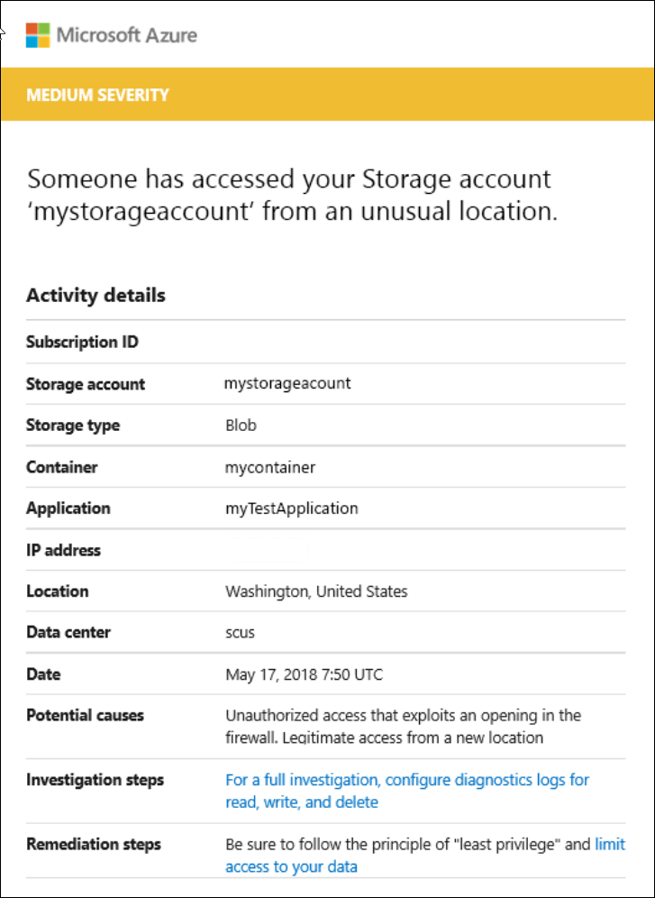
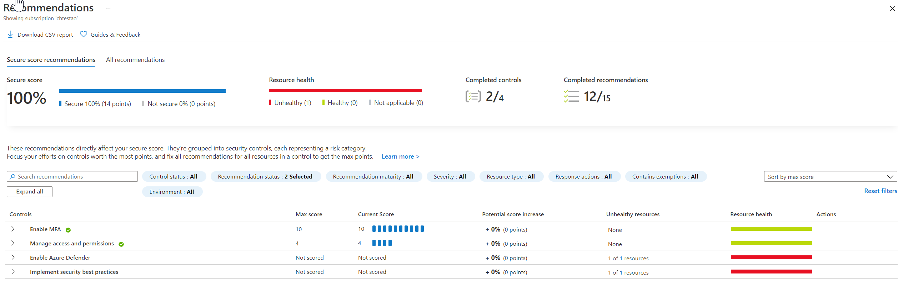

::: zone pivot="video"

>[!VIDEO https://learn-video.azurefd.net/vod/player?id=1e4ae7cf-9676-4deb-8dd7-045d5f2b6362]

> [!TIP]
> See the **Text and images** tab for more details!

::: zone-end

::: zone pivot="text"

Microsoft Defender for Storage provides an extra layer of security intelligence that detects unusual and potentially harmful attempts to access or exploit storage accounts. This layer of protection helps you address threats without being a security expert or managing security-monitoring systems.

Security alerts are triggered when anomalies in activity occur. These security alerts are integrated with Microsoft Defender for Cloud. By default, subscription owners also receive email notifications for high-severity alerts, with details of the suspicious activity. You can change who receives the emails and which alert severities trigger them.

Microsoft Defender for Storage protects Azure Blob Storage, Azure Files, and Azure Data Lake Storage Gen2. Activity monitoring is supported for standard blob, premium blob, page blob, Data Lake Storage Gen2, and SMB Azure file share storage accounts.

The recommended approach is to enable Microsoft Defender for Storage at the subscription level, which protects all existing and new storage accounts in that subscription. Follow these steps.

1. Sign in to the Azure portal and go to **Microsoft Defender for Cloud**.

1. Select **Environment settings** and choose the subscription you want to protect.

1. Select the three dots, and then select **Edit settings**.

1. On the **Defender plans** pane, locate **Storage** in the list, select **On**, and then select **Save**.

> [!NOTE]
> The current Defender for Storage plan is priced per storage account. Malware scanning is a configurable feature that's priced per GB scanned, and sensitive data threat detection is configurable at no extra cost. Protection for storage accounts created after you enable the plan at the subscription level starts up to 24 hours after creation. If you use the classic per-transaction plan, consider migrating to the current plan.

## Explore security anomalies

When storage activity anomalies occur, you receive an email notification with information about the suspicious security event. Details of the event include:

- Nature of the anomaly
- Storage account name
- Event time
- Storage type
- Potential causes
- Investigation steps
- Remediation steps
- Email also includes details about possible causes and recommended actions to investigate and mitigate the potential threat

    

You can review and manage your current security alerts from Microsoft Defender for Cloud's Security alerts tile. Selecting a specific alert provides details and actions for investigating the current threat and addressing future threats.

::: zone-end