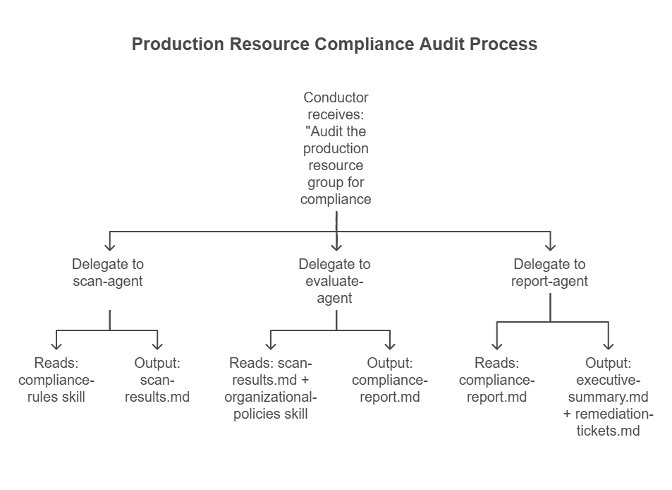

::: zone pivot="video"

>[!VIDEO https://learn-video.azurefd.net/vod/player?id=6875b19b-b857-4747-9072-525ff820eba0]

> [!TIP]
> The video for this section is also available in text-based form below.

::: zone-end

::: zone pivot="text"

Designing a multi-agent workflow starts with mapping your existing operational process. Most infrastructure workflows follow a predictable pattern: gather requirements, make design decisions, generate artifacts, execute actions, and produce documentation. Each of these phases becomes a candidate for a specialized agent.

## Step 1: Map your current workflow

Before building agents, document the steps you perform today. For an environment provisioning workflow, this might look like:

1. Receive a request describing the desired environment
2. Assess which Azure services and SKUs fit the requirements
3. Design the network topology and security boundaries
4. Write Bicep or Terraform templates
5. Deploy the infrastructure and validate the results
6. Create documentation for the operations team

Each numbered step represents a potential agent. The human coordination between steps is what the conductor agent replaces. That coordination involves reading the output of one step and using it as input for the next.

## Step 2: Define agent boundaries

A well-designed agent has a **single responsibility**. It does one thing well and produces a clear output artifact. When deciding where to split agents, consider:

- **Domain expertise**: A requirements agent needs different knowledge than a Bicep generation agent. Separate agents let you load different skills for each domain.
- **Tool access**: A deployment agent needs terminal access to run CLI commands. A documentation agent needs file creation but not terminal access. Limiting tool access per agent reduces risk.
- **Failure isolation**: If the deployment step fails, you want to retry just the deployment, not the entire pipeline. Separate agents make this possible.
- **Reusability**: A documentation agent that produces runbooks from deployment artifacts can be reused across multiple workflows, not just environment provisioning.

## Step 3: Define the artifact contract

Agents communicate through files, so define what each agent produces and what downstream agents expect. This is your artifact contract:

| Pipeline stage | Agent | Input artifacts | Output artifacts |
|---|---|---|---|
| Requirements | requirements-agent | User prompt | `requirements.md` |
| Architecture | architecture-agent | `requirements.md` | `architecture-assessment.md` |
| IaC generation | bicep-agent | `architecture-assessment.md` | `infra/main.bicep`, `implementation-plan.md` |
| Deployment | deploy-agent | `infra/main.bicep` | `deployment-summary.md` |
| Documentation | docs-agent | All prior artifacts | `docs/runbook.md` |

This contract helps agents evolve independently. Replacing a Bicep agent with a Terraform agent also changes the execution and validation contract; retaining a filename alone doesn't preserve compatibility. Downstream steps must validate the expected format, target and evidence.

## Step 4: Build the conductor

The conductor ties the workflow together. Configure its available delegation tools and allowed specialists using the selected host's supported format. An `agents` front-matter array is a Local-schema option, not a portable Copilot contract. Verify delegation and tool availability in the intended Copilot experience rather than assume that a Markdown role description provisions working subagents.

The requirements, architecture, Bicep, deployment and documentation agents below are illustrative roles. The conductor coordinates their outputs; it doesn't automatically inherit every specialist's execution permissions.

The conductor's system prompt specifies:

- The order in which to delegate tasks
- What artifacts to verify after each step
- How to handle failures (retry, skip, or stop)
- What information to pass to each subagent

Here's an example of how a conductor's system prompt might describe a handoff:

```Markdown
## Workflow

1. Delegate to requirements-agent with the user's scenario description
2. Verify that requirements.md exists and contains structured requirements
3. Delegate to architecture-agent: "Assess the architecture based on requirements.md"
4. Verify that architecture-assessment.md exists
5. Delegate to bicep-agent: "Generate Bicep templates per architecture-assessment.md"
6. Verify template identity, compilation, reviewed what-if diagnostics and target readiness
7. Obtain the independent approval required for this exact target and reviewed change
8. Delegate authorized execution; verify actual deployment results before continuing
9. Delegate to docs-agent: "Draft a runbook from verified artifacts and explicit remaining limits"
```

## Step 5: Create shared skills

Review the domain knowledge that multiple agents need and extract it into shared skills. Common skills for ops workflows include:

- **Naming conventions**: Resource naming patterns that all agents follow when generating identifiers.
- **Security baselines**: Minimum security requirements applied during architecture assessment and IaC generation. This includes TLS versions, authentication methods, and network rules.
- **Approved services and SKUs**: A lookup table of which Azure services and tiers your organization has approved for different environments.
- **Compliance requirements**: Regulatory or organizational policies that affect architecture decisions and deployment configurations.

Each skill is a package with a `SKILL.md` entry point and optional supporting resources that a compatible host loads as needed. Sharing reviewed skills reduces repeated guidance; it doesn't guarantee that every agent loaded the same revision or complied with it. Capture the relevant versions with the workflow evidence.

## Example: Compliance check pipeline

To illustrate how these design steps apply beyond provisioning, consider a compliance auditing workflow:



The same design principles apply: single responsibility per agent, artifact-based communication, shared skills for domain knowledge, and a conductor that coordinates the sequence.

## Practical considerations

When designing multi-agent workflows for ops tasks, keep these guidelines in mind:

- **Start small**: Begin with two or three agents for a well-understood workflow. Add agents as you identify clear boundaries.
- **Make artifacts human-readable**: Use Markdown for intermediate results. When something goes wrong, you need to read and edit the artifacts manually.
- **Version your agent definitions**: Store agent files, skills, and instructions in version control alongside your infrastructure code. Changes to agent behavior should go through the same review process as code changes.
- **Test individual agents first**: Before running the full pipeline, invoke each agent directly with sample inputs to verify its outputs meet your expectations.
- **Plan for human-in-the-loop**: Not every step should be fully automated from day one. Design your pipeline so that a human can review artifacts between stages and approve before the next agent runs.

## Strengthen the artifact contract

File existence is a weak handoff check. Add the task/attempt identity, source and input revisions, target environment, producer/configuration versions, validation status, evidence references and expiry conditions. A downstream agent must reject a missing, stale, malformed or mismatched artifact rather than manufacture a plausible substitute.

For a proposal step, distinguish `ready-for-review`, `blocked` and `failed`; none means "deployed". Markdown can remain human-readable, but machine-consumed metadata should have a validated schema. Keep actual approval and execution results separate from the producer's claims.

If approved input changes, invalidate dependent proposals and approvals as appropriate. An earlier approval doesn't authorize a new diff or target. Only independently verifiable output should cross an authority boundary.

## Bound concurrency, retries and operational effects

Parallelize independent read/proposal work where it saves time. Serialize changes to a shared branch, artifact, environment or external resource. Separate worktrees isolate local files, not production writes; use an appropriate workflow/platform coordination mechanism for shared targets.

Define maximum attempts, elapsed time, tool calls and available usage/cost budgets before execution. A budget in a prompt is guidance; the host or orchestration wrapper must enforce its limits. When enforcement isn't available, keep consequential execution under explicit operator control.

Use these failure decisions:

| Failure | Required response |
| --- | --- |
| Missing prerequisite, stale evidence or unclear scope | Block the dependent step and ask for the missing decision |
| Transient read failure | Retry only within the declared limit; retain the failed attempt and final error |
| Write timeout or lost acknowledgement | Treat outcome as unknown; inspect actual state before deciding whether retry is safe |
| Repeated tool errors or exhausted budget | Stop and return partial evidence with the blocker |
| Optional documentation failure | Report it explicitly; don't mark the entire workflow complete |

Use task/operation identifiers and supported idempotency controls to prevent duplicate actions. Don't replay the whole workflow to fix one failed report. Recheck current state before restarting a step; compensation or rollback requires compatibility and authorization, not just a reverse command.

Cancellation must stop new delegation and pending writes through the host's supported mechanism. Report which operations already happened or remain uncertain; ending the conversation isn't proof that an external job stopped.

## Evaluate a workflow before widening autonomy

Version the agent definitions, tools, skills, instructions, evaluator criteria and sanitized input fixtures. Include a normal case, conflicting requirements, stale artifacts, a malformed handoff, a transient read failure, a write with uncertain outcome and an out-of-scope request.

Run individual roles first, then the composed workflow. Evaluate output correctness and evidence quality, stop/escalation behavior, duplicate-action prevention, human review effort, latency and supported usage measures. Repeat representative cases because model-mediated outputs can vary.

For a **fictional** migration from manual triage, a team might require every critical boundary case to stop without a write and every accepted proposal to cite valid evidence. These are locally defined criteria, not a universal benchmark. Improved average speed cannot offset a critical authority violation.

Keep a reviewed previous configuration for controlled rollback of agent behavior. Module 4.1's telemetry and feedback approach supports the ongoing scorecard; passing a small evaluation set doesn't establish safety for every production scenario.

The transition from traditional ops to agentic workflows is incremental. You don't need to automate everything at once. Start with the workflows where you spend the most time coordinating between steps, and gradually expand as you build confidence in your agent definitions and skills.

::: zone-end
