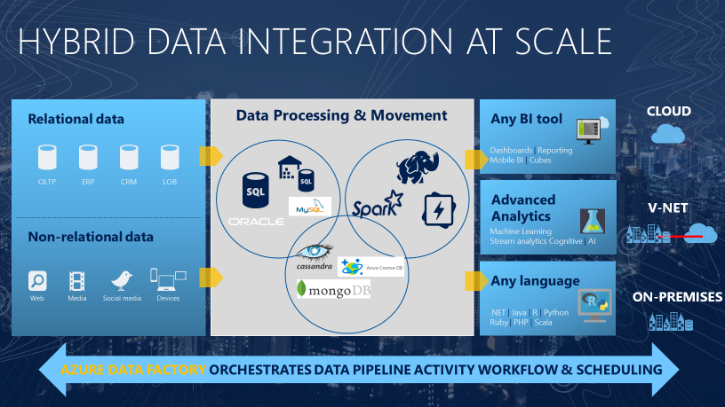

The need to trigger the batch movement of data, or to set up a regular schedule is a requirement for most analytics solutions. Azure Data Factory (ADF) is the service that can be used to fulfill such a requirement. ADF provides a cloud-based data integration service that orchestrates the movement and transformation of data between various data stores and compute resources.

Azure Data Factory is the cloud-based ETL and data integration service that allows you to create data-driven workflows for orchestrating data movement and transforming data at scale. Using Azure Data Factory, you can create and schedule data-driven workflows (called pipelines) that can ingest data from disparate data stores. You can build complex ETL processes that transform data visually with data flows or by using compute services such as Azure HDInsight Hadoop, Azure Databricks, and Azure SQL Database.

> [!NOTE]
> Data Factory in Microsoft Fabric is the next-generation evolution of Azure Data Factory, offering a simpler architecture, built-in AI, and deeper integration with the Microsoft Fabric analytics platform. If you're starting a new data integration project, consider [Data Factory in Microsoft Fabric](/fabric/data-factory/). This module focuses on Azure Data Factory as a standalone service.

## What is meant by orchestration

To use an analogy, think about a symphony orchestra. The central member of the orchestra is the conductor. The conductor doesn't play the instruments, they simply lead the symphony members through the entire piece of music that they perform. The musicians use their own skills to produce particular sounds at various stages of the symphony, so they might only learn certain parts of the music. The conductor orchestrates the entire piece of music, and therefore is aware of the entire score that's being performed. They also use specific arm movements that instruct the musicians how to play a piece of music.

ADF uses a similar approach. While it has native functionality to ingest and transform data, sometimes it instructs another service to perform the actual work on its behalf, such as Azure Databricks running a transformation query. In this case, Azure Databricks performs the work, not ADF. ADF orchestrates the execution of the query, and then provides the pipelines to move the data onto the next step or destination.

ADF also has built-in support for pipeline monitoring through Azure Monitor, an API, PowerShell, Azure Monitor logs, and health panels in the Azure portal.

