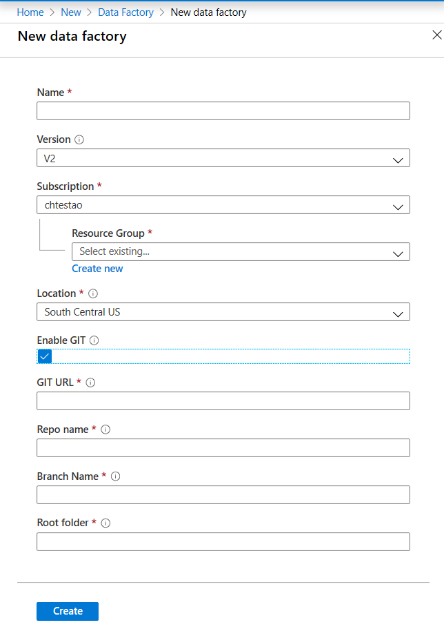

It's easy to set up Azure Data Factory (ADF) from within the Azure portal. You only require the following information:

- **Subscription**: The subscription in which the ADF instance is created
- **Resource group**: The resource group where the ADF instance resides
- **Region**: The datacenter location where the instance metadata is stored
- **Name**: The name of the Azure Data Factory instance, which must be globally unique
- **Version**: Select V2

On the **Git configuration** tab, you can integrate the code that you create with a Git repository to enable source control. Define the Git URL, repository name, branch name, and the root folder.

> [!div class="mx-imgBorder"]
> 

Alternatively, you can provision the service programmatically. The following example uses PowerShell to set up the environment.


``` PowerShell
# Sign in to Azure
Connect-AzAccount

# Select the target subscription
$SubscriptionId = "add your subscription in the quotes"
Select-AzSubscription -SubscriptionId $SubscriptionId

# Register the Microsoft Azure Data Factory resource provider
Register-AzResourceProvider -ProviderNamespace Microsoft.DataFactory

# Define resource group name and location
$resourceGroupName = "cto_ignite"
$rglocation = "West US 2"

# Create the resource group
New-AzResourceGroup -Name $resourceGroupName -Location $rglocation

# Create Azure Data Factory
Set-AzDataFactoryV2 -ResourceGroupName $resourceGroupName -Name "ctoigniteADF" -Location $rglocation
```