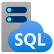

::: zone pivot="video"

>[!VIDEO https://learn-video.azurefd.net/vod/player?id=5ea815df-3026-4e5a-8df2-9a836cb8b176]

> [!TIP]
> See the **Text and images** tab for more details!

::: zone-end

::: zone pivot="text"

Azure SQL is a collective term for a family of Microsoft SQL Server based database services in Azure. Specific Azure SQL services include:

- **SQL Server on Azure Virtual Machines (VMs)** - A virtual machine running in Azure with an installation of SQL Server. The use of a VM makes this option an infrastructure-as-a-service (IaaS) solution that virtualizes hardware infrastructure for compute, storage, and networking in Azure; making it a great option for "lift and shift" migration of existing on-premises SQL Server installations to the cloud.
- **Azure SQL Managed Instance** - A platform-as-a-service (PaaS) option that provides near-100% compatibility with on-premises SQL Server instances while abstracting the underlying hardware and operating system. The service includes automated software update management, backups, and other maintenance tasks, reducing the administrative burden of supporting a database server instance.
- **Azure SQL Database** - A fully managed, highly scalable PaaS database service that is designed for the cloud. This service includes the core database-level capabilities of on-premises SQL Server, and is a good option when you need to create a new application in the cloud.

## Compare Azure SQL services

| --                       | SQL Server on Azure VMs                                                                                                                                              | Azure SQL Managed Instance                                                                                                                                                                  | Azure SQL Database                                                                                                                                                                                         |
| ------------------------ | -------------------------------------------------------------------------------------------------------------------------------------------------------------------- | ------------------------------------------------------------------------------------------------------------------------------------------------------------------------------------------- | ---------------------------------------------------------------------------------------------------------------------------------------------------------------------------------------------------------- |
|                          |                                                                                               |                                                                                                |                                                                                                                               |
| Type of cloud service    | IaaS                                                                                                                                                                 | PaaS                                                                                                                                                                                        | PaaS                                                                                                                                                                                                       |
| SQL Server compatibility | Fully compatible with on-premises physical and virtualized installations. Applications and databases can easily be "lift and shift" migrated without change.        | Near-100% compatibility with SQL Server. Most on-premises databases can be migrated with minimal code changes by using the [Azure Database Migration Service](/azure/dms/dms-overview?azure-portal=true) | Supports most core database-level capabilities of SQL Server. Some features that an on-premises application depends on might not be available.                                                               |
| Architecture             | SQL Server instances are installed in a virtual machine. Each instance can support multiple databases.                                                              | Each managed instance can support multiple databases. Additionally, *instance pools* can be used to share resources efficiently across smaller instances.                                  | You can provision a *single database* in a dedicated, managed (logical) server; or you can use an *elastic pool* to share resources across multiple databases and take advantage of on-demand scalability. |
| Availability             | Enterprise-class availability SLA for the virtual machines. The SLA covers the VMs, not the SQL Server processes that run on them. | Enterprise-class availability SLA that increases with zone redundancy. | Enterprise-class availability SLA that increases with zone redundancy. |
| Management               | You must manage all aspects of the server, including operating system and SQL Server updates, configuration, backups, and other maintenance tasks.                  | Fully automated updates, backups, and recovery.                                                                                                                                            | Fully automated updates, backups, and recovery.                                                                                                                                                           |
| Use cases                | Use this option when you need to migrate or extend an on-premises SQL Server solution and retain full control over all aspects of server and database configuration. | Use this option for most cloud migration scenarios, particularly when you need minimal changes to existing applications.                                                                   | Use this option for new cloud solutions, or to migrate applications that have minimal instance-level dependencies.                                                                                        |

## SQL Server on Azure Virtual Machines

SQL Server on Virtual Machines enables you to use full versions of SQL Server in the Cloud without having to manage any on-premises hardware. This is an example of the IaaS approach.

SQL Server running on an Azure virtual machine effectively replicates the database running on real on-premises hardware. Migrating from the system running on-premises to an Azure virtual machine is no different than moving the databases from one on-premises server to another.

This approach is suitable for migrations and applications requiring access to operating system features that might be unsupported at the PaaS level. SQL virtual machines are *lift-and-shift* ready for existing applications that require fast migration to the cloud with minimal changes. You can also use SQL Server on Azure VMs to extend existing on-premises applications to the cloud in hybrid deployments.

> [!NOTE]
> A *hybrid deployment* is a system where part of the operation runs on-premises, and part in the cloud. Your database might be part of a larger system that runs on-premises, although the database elements might be hosted in the cloud.

You can use SQL Server in a virtual machine to develop and test traditional SQL Server applications. With a virtual machine, you have the full administrative rights over the DBMS and operating system. It's a good choice when an organization already has IT resources available to maintain the virtual machines.

These capabilities enable you to:

- Create rapid development and test scenarios when you don't want to buy on-premises nonproduction SQL Server hardware.
- Become lift-and-shift ready for existing applications that require fast migration to the cloud with minimal changes or no changes.
- Scale up the platform on which SQL Server is running, by allocating more memory, CPU power, and disk space to the virtual machine. You can quickly resize an Azure virtual machine without the requirement that you reinstall the software that's running on it.

### Business benefits

Running SQL Server on virtual machines allows you to meet unique and diverse business needs through a combination of on-premises and cloud-hosted deployments, while using the same set of server products, development tools, and expertise across these environments.

It's not always easy for businesses to switch their DBMS to a fully managed service. There may be specific requirements that must be satisfied in order to migrate to a managed service that requires making changes to the database and the applications that use it. For this reason, using virtual machines can offer a solution, but using them doesn't eliminate the need to administer your DBMS as carefully as you would on-premises.

## Azure SQL Managed Instance

Azure SQL Managed Instance runs an instance of SQL Server in the cloud. You can create multiple databases on the same instance, and you have instance-level control similar to an on-premises SQL Server instance. SQL Managed Instance automates backups, software patching, database monitoring, and other general tasks, but you control security and resource allocation for your databases. For detailed information, see [What is Azure SQL Managed Instance?](/azure/azure-sql/managed-instance/sql-managed-instance-paas-overview).

Managed instances use other Azure platform services for backups, authentication, security, and telemetry, and connect to those services automatically.

All communications are encrypted and signed using certificates to protect your data.

### Use cases

Consider Azure SQL Managed Instance if you want to *lift-and-shift* an on-premises SQL Server instance and all its databases to the cloud, without incurring the management overhead of running SQL Server on a virtual machine.

Azure SQL Managed Instance provides a higher degree of compatibility with on-premises SQL Server than Azure SQL Database. If you have an existing SQL Server solution with advanced features that you want to move to the cloud with minimal changes, SQL Managed Instance is the better choice. To check compatibility with an existing on-premises system, you can run an Azure SQL assessment by using Azure Migrate or SQL Server enabled by Azure Arc. The assessment evaluates your SQL Server instances and databases and reports their readiness for migration to Azure SQL. For more information, see [Migration overview: From SQL Server](/data-migration/sql-server/overview).

### Business benefits

Azure SQL Managed Instance enables a system administrator to spend less time on administrative tasks because the service either performs them for you or greatly simplifies those tasks. Automated tasks include operating system and database management system software installation and patching, dynamic instance resizing and configuration, backups, database replication (including system databases), high availability configuration, and configuration of health and performance monitoring data streams.

Azure SQL Managed Instance has near 100% compatibility with SQL Server Enterprise Edition, running on-premises.

Azure SQL Managed Instance supports SQL Server Database engine logins and logins integrated with Microsoft Entra ID. SQL Server Database engine logins include a username and a password. You must enter your credentials each time you connect to the server. With Microsoft Entra authentication, you can use single sign-on, so you don't need to provide a username and password each time you connect to the server.

## Azure SQL Database

Azure SQL Database is a PaaS offering from Microsoft. You create a managed database server in the cloud, and then deploy your databases on this server.

> [!NOTE] 
> A SQL Database server is a logical construct that acts as a central administrative point for multiple single or pooled databases, logins, firewall rules, auditing rules, threat detection policies, and failover groups.

Azure SQL Database is available as a *Single Database* or an *Elastic Pool*.

### Single Database

This option enables you to quickly set up and run a single database. You create and run a database server in the cloud, and you access your database through this server. Microsoft manages the server, so all you have to do is configure the database, create your tables, and populate them with your data. You can scale the database if you need more storage space, memory, or processing power. By default, resources are preallocated, and you're charged per hour for the resources you've requested. You can also specify a *serverless* compute tier. In this tier, the database automatically scales compute resources within a range that you configure, based on workload demand. You're billed for the compute that the database uses, and in the General Purpose service tier, the database can pause automatically when it's inactive.

### Elastic Pool

This option is similar to *Single Database*, except that by default multiple databases can share the same resources, such as memory, data storage space, and processing power through multiple-tenancy. The resources are referred to as a *pool*. You create the pool, and only your databases can use the pool. This model is useful if you have databases with resource requirements that vary over time, and can help you to reduce costs. For example, your payroll database might require plenty of CPU power at the end of each month as you handle payroll processing, but at other times the database might become much less active. You might have another database that is used for running reports. This database might become active for several days in the middle of the month as management reports are generated, but with a lighter load at other times. Elastic Pool enables you to use the resources available in the pool, and then release the resources once processing has completed.

### Hyperscale

The Hyperscale service tier supports very large databases—up to 128 TB—with rapid, on-demand scaling and fast backup and restore regardless of data size.

### Use cases

Azure SQL Database is a low-cost option that requires minimal administration. It isn't fully compatible with on-premises SQL Server installations. It's often used in new cloud projects where the application design can accommodate any required changes to your applications.

> [!NOTE]
> You can run an Azure SQL assessment to detect compatibility issues with your databases that can affect database functionality in Azure SQL Database. For more information, see [Migration overview: From SQL Server](/data-migration/sql-server/overview).

Azure SQL Database is often used for:

- Modern cloud applications that need to use the latest stable SQL Server features.
- Applications that require high availability.
- Systems with a variable load that need the database server to scale up and down quickly.

### Business benefits

Azure SQL Database automatically updates and patches the SQL Server software to ensure that you're always running the latest and most secure version of the service.

The scalability features of Azure SQL Database ensure that you can increase the resources available to store and process data without having to perform a costly manual upgrade.

The service provides an enterprise-class availability SLA that increases when you enable zone redundancy. Azure SQL Database supports point-in-time restore, enabling you to recover a database to the state it was in at any point in the past. Databases can be replicated to different regions to provide more resiliency and disaster recovery.

Microsoft Defender for SQL provides advanced security capabilities, such as vulnerability assessment and Advanced Threat Protection, to help detect and remediate potential security problems with your databases. Advanced Threat Protection also detects anomalous activities that indicate unusual and potentially harmful attempts to access or exploit your database. It continuously monitors your database for suspicious activities, and provides immediate security alerts on potential vulnerabilities, SQL injection attacks, and anomalous database access patterns. Advanced Threat Protection alerts provide details of the suspicious activity, and recommend action on how to investigate and mitigate the threat.

Auditing tracks database events and writes them to an audit log in a destination that you choose, such as an Azure storage account. Auditing can help you maintain regulatory compliance, understand database activity, and gain insight into discrepancies and anomalies that might indicate business concerns or suspected security violations.

SQL Database helps secure your data by providing encryption that protects data that is stored in the database (*at rest*) and  while it's being transferred across the network (*in motion*).

Azure SQL Database offers a free tier with monthly limits of 100,000 vCore seconds of serverless compute and 32 GB of storage per database, so you can start building at no cost.

Microsoft Copilot in Azure with Azure SQL Database (preview) answers natural language questions about your database in the Azure portal, such as how to troubleshoot performance issues. For more information, see [Microsoft Copilot in Azure with Azure SQL Database](/azure/azure-sql/copilot/copilot-azure-sql-overview).

::: zone-end
