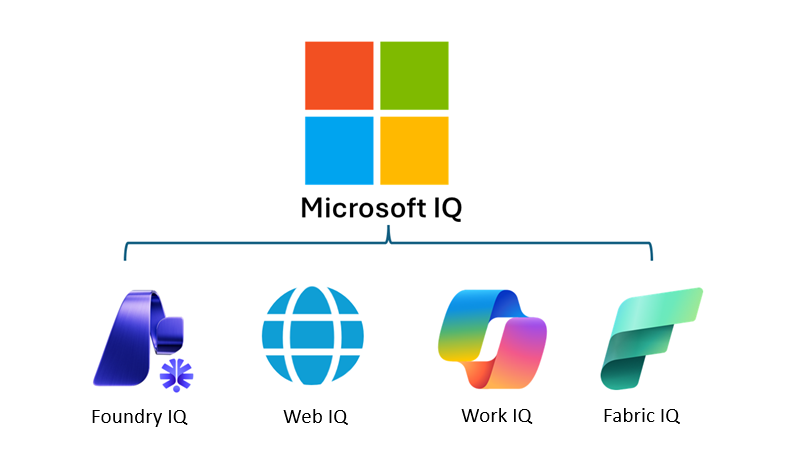

::: zone pivot="video"

> [!VIDEO https://learn-video.azurefd.net/vod/player?id=34b6eff9-0584-4b47-80e2-c157c7360f72]

::: zone-end

::: zone pivot="text"

Generative AI models can answer many questions from their training data, but that data has a cutoff date. A model doesn't automatically know about a concert announced this morning, a recently updated product specification, or a change to travel guidance. An answer can sound convincing while relying on information that's no longer accurate.

Consider an agent that helps music fans learn about bands and plan trips to concerts. Its model might know a band's history, but questions such as "Are they playing any gigs soon?" require current evidence. The agent needs a way to find relevant web sources and use them as grounding context.

**Microsoft Web IQ** is a suite of AI-native web search and grounding APIs that gives agents and applications access to current web information. It returns ranked, citation-ready context from web pages, news, images, and videos. An agent can use that evidence to generate an answer with sources the user can check.

This is a form of *retrieval-augmented generation* (RAG): retrieve relevant information at run time, add it to the model's context, and generate a response grounded in that information. It doesn't require retraining the model whenever the world changes.

In this module, you'll explore Web IQ's methods, learn how to configure a Web IQ resource, and connect it to an agent in Microsoft Foundry through the Model Context Protocol (MCP). You'll also consider how to verify that an answer is supported by the retrieved evidence.

## Microsoft IQ - The intelligence platform for agents

Web IQ is a component of **Microsoft IQ**, a platform of knowledge retrieval services for grounding AI agents in relevant context. Each component focuses on a different kind of knowledge:

- **Foundry IQ** provides a managed knowledge layer that organizes enterprise and web sources into reusable knowledge bases for agentic retrieval.
- **Web IQ** provides current web information, including web pages, news, images, and videos.
- **Work IQ** provides work context from Microsoft 365, such as documents, communications, and relationships between people and their work.
- **Fabric IQ** provides business context and meaning over organizational data in Microsoft Fabric, helping agents interpret data using shared business concepts and relationships.

These complementary services help you choose the grounding sources that match an agent's task, rather than relying only on the model's training data. Access to organizational information depends on the permissions and configuration of the services and sources involved.

::: zone-end

> [!NOTE]
> We recognize that different people like to learn in different ways. You can choose to complete this module in video-based format or you can read the content as text and images. The text contains greater detail than the videos, so in some cases you might want to refer to it as supplemental material to the video presentation.
