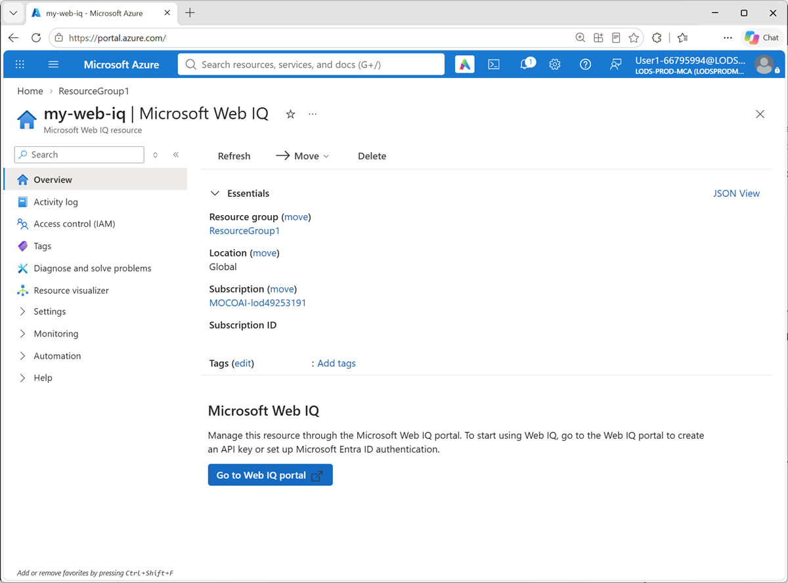
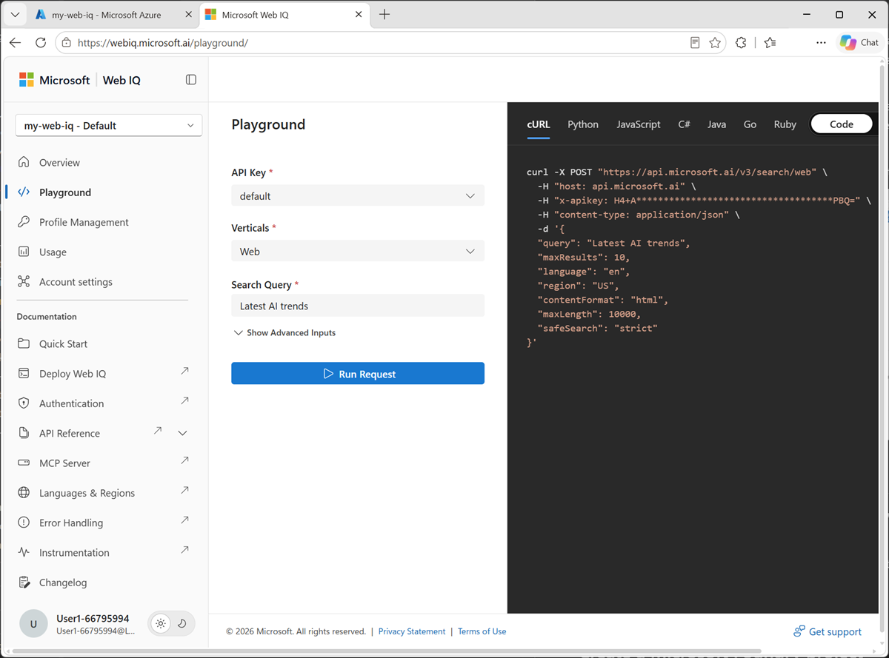

::: zone pivot="video"

> [!VIDEO https://learn-video.azurefd.net/vod/player?id=50c12fba-9e36-472a-b36a-99e6b833031f]

> [!TIP]
> See the **Text and images** tab for more details!

::: zone-end

::: zone pivot="text"

Configuring Web IQ involves two connected environments. The **Azure portal** is where you create the resource used for billing and management. The **Web IQ portal** connects that resource to an application profile, provides credentials, and lets you test retrieval.

> [!IMPORTANT]
> Web IQ requires a paid Azure subscription. Free trials and subscriptions funded through Azure credits aren't supported. Review the service terms and pricing before creating resources.

## Create an Azure resource

At a high level, create the resource as follows:

1. Sign in to the [Azure portal](https://portal.azure.com?azure-portal=true) with an account that has permission to create resources in your subscription.
2. Search for **Microsoft Web IQ** and select **Create**.
3. Select the paid subscription and a resource group, and enter a resource name. If prompted for a region, select **Global**.
4. Review and accept the Web IQ terms of use, then select **Review + create** and **Create**.
5. Wait for deployment to finish and open the resource.

The Azure resource associates Web IQ usage with your subscription. Applications call the Web IQ API service directly; the Azure resource isn't a custom search index or a model deployment.

## Connect the resource and obtain an AppID

Next, open the [Web IQ portal](https://webiq.microsoft.ai?azure-portal=true), either directly or through **Go to Web IQ portal** on the Azure resource page.

1. Select **Get Started** and sign in with the account associated with the subscription.
2. If prompted, provide the Microsoft Entra tenant ID for that subscription.
3. Select the same subscription and the Web IQ resource you created.
4. Complete the connection by selecting **Finish**.
5. Confirm that the new **Web IQ AppID** appears in the selector at the top left of the portal.

A Web IQ AppID identifies the application's Web IQ profile. It determines allowed APIs, rate limits, API keys, and any bound Microsoft Entra application client IDs. Record the AppID for client configurations that require it, and select the correct profile when testing or managing credentials.

> [!NOTE]
> A **Web IQ AppID**, a **Microsoft Entra application (client) ID**, and an **API key** aren't interchangeable. The AppID identifies the Web IQ profile; an Entra client ID identifies a registered application; an API key is a secret used to authenticate requests.

## Test in the Web IQ portal

Use the **Playground** to verify retrieval before connecting an agent:

1. Make sure the intended AppID is selected.
2. Select an available method or search vertical, such as **Web**, **News**, **Images**, or **Videos**.
3. Enter a query, such as the name of a band and "upcoming tour dates." Review the available parameters, including language, region, and result limits.
4. Send the request and inspect the JSON response or formatted preview.
5. Check relevance, source URLs, dates, and the amount of content returned. Refine the query or settings and compare results.

A successful request confirms that the resource, subscription, AppID, and credentials are connected. If the resource doesn't appear, check that you selected the same tenant and subscription used during deployment. Method availability depends on the profile's enabled services.

## Prepare credentials for clients

For a quick start, open **Profile management** in the Web IQ portal and obtain an API key for the selected profile. A key-authenticated REST or MCP client sends this secret in the `x-apikey` header. The key already belongs to one AppID; don't add an `APPID` query parameter to key-authenticated requests.

For production applications, consider Microsoft Entra ID authentication. Register an application, bind its **Application (client) ID** to the Web IQ profile, and configure the client to obtain an access token for Web IQ. If the same Entra client ID is bound to multiple Web IQ AppIDs, token-authenticated requests must specify the intended Web IQ AppID using the `APPID` query parameter.

Keep credentials in secure connection settings or a secret manager, not in agent instructions, source code, or browser-side applications.

For detailed setup guidance, see [Deploy Microsoft Web IQ with the Azure portal](/web-iq/get-started/deploy-azure-portal?azure-portal=true) and [Authenticate with Microsoft Web IQ](/web-iq/get-started/authentication?azure-portal=true).

::: zone-end
