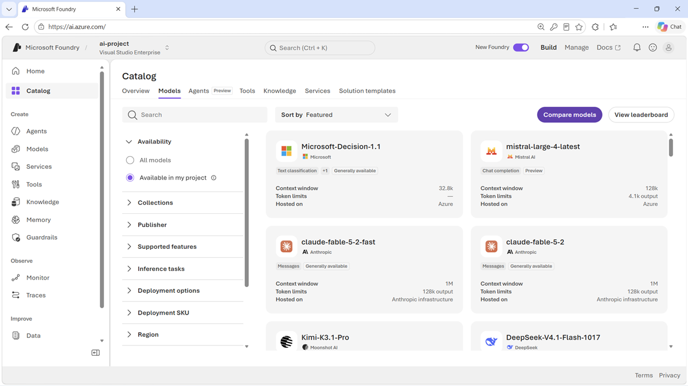
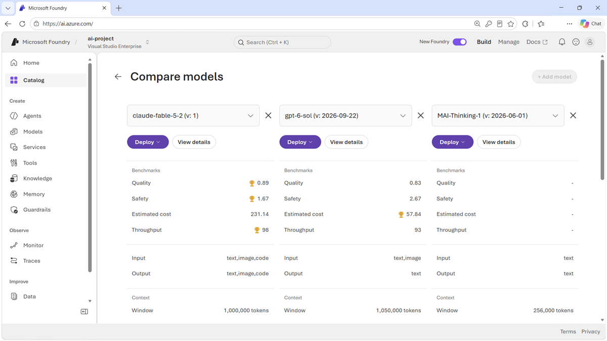
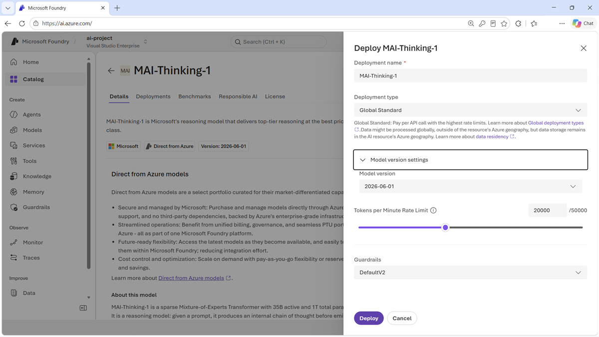

::: zone pivot="video"

>[!VIDEO https://learn-video.azurefd.net/vod/player?id=26b8ce31-a03e-4cbd-83f1-d37f26badde7]

> [!TIP]
> See the **Text and images** tab for more details!

::: zone-end

::: zone pivot="text"

Generative AI and agentic solutions are based on language models. Large language models (LLMs) form the foundation of  generative AI solutions that can provide a wide variety of responses. Today, a broad range of models exist that serve different needs. For example, the AI capabilities in a lightweight phone application may run best on a small language model, while a government application may require a domain-specialized model.

**Microsoft Foundry** provides an integrated environment for discovering, evaluating, deploying, and operating generative AI models. It brings together a rich model catalog, flexible deployment options, and built‑in governance capabilities so teams can build copilots, agents, and AI-powered applications with enterprise confidence.

> [!NOTE]
> In order to use Microsoft Foundry, you need an Azure subscription. For more information, review [Get started in Microsoft Foundry](/training/modules/get-started-ai-in-foundry/).

## Discover models in Foundry's model catalog

**Foundry's model catalog** is a central hub for discovering and using a wide selection of generative AI models from an extensive range of providers. In Foundry, you can filter models by source, capabilities, inference tasks, and more. Foundry enables you to understand and compare model capabilities, as well as test and build scalable, secure, responsible AI solutions.

  

The model catalog offers a broad selection of models including models sold directly by Azure alongside models from partners and open-source communities.

- **Models Sold Directly by Azure**: These models are hosted by Microsoft under Microsoft Product Terms. They offer high levels of integration with Azure, enterprise-grade service level agreements (SLAs), preconfigured security, and compliance alignment.

- **Models from Partners and the Community**: Includes open-source or vendor-hosted models integrated through the catalog. These models support broader experimentation and rapid innovation and are often suitable for specialized or domain‑specific tasks.

The catalog includes the latest frontier models from the world's leading AI labs, including (among others):

- Microsoft AI's family of *MAI* models.
- OpenAI's family of *GPT* models.
- Anthropic's family of *Claude* models.

Each model is supported by:

- Model descriptions and capabilities (text generation, reasoning, coding, multimodal, embeddings, etc.)
- Benchmark results and performance comparisons
- Supported inference tasks and fine‑tuning options
- Responsible AI documentation (model cards, constraints, caveats)

The extensive information about the available models can be compared to help you find the best option for your particular scenario; balancing factors like performance, safety, and cost.

> [!NOTE]
> Availability for some models may be restricted by region and quota.

## Deploy models in Foundry

When you've identified the model you want to use, Foundry provides flexible deployment mechanisms that let you tailor performance, cost, and governance. **Deploying a model** takes an AI model and makes it available for use in production through a stable, scalable, and secure endpoint. Deployment of a configured model turns the model into a service that applications can call—usually through an API. Deploying a configured model helps ensure consistent performance and reliability. It also allows developers to prevent unauthorized or unsafe use.

Deployment parameters that you can customize in Foundry include:

- **Deployment type**: such as standard, global batch, and regional provisioned throughput, determine where and how inference is processed in Foundry. Deployment types are tied to throughput and data‑processing requirements.
- **Model version**
- **Tokens per minute (TPM)** rate limit

> [!NOTE]
> A **token** is the smallest unit of text or data that a generative AI model can process. Models break input into tokens—such as words, subwords, characters, or punctuation—so they can understand and generate language efficiently.

When you deploy a model, you can assign it a *Tokens Per Minute* (TPM) allocation. TPM determines the speed and scale the model can process inputs and the rate‑limit boundaries such as requests per minute (RPM). When you assign a higher TPM allocation to a model deployment, you're increasing its capacity to handle token traffic per minute. Lower TPM reduces how fast your deployment is allowed to consume tokens across requests.

Limits differ by model family, for example:

- High‑end reasoning models (for example: GPT *Sol* or Claude *Fable*) may have high TPM ceilings.
- Specialized or image models often operate under capacity units instead of TPM.

*Throttling*, in a compute context, means intentionally slowing down or limiting how much compute work can happen at one time. It's a protective mechanism used when a system is close to hitting its processing limits. Throttling temporarily restricts resource usage so the system can remain stable and responsive.

Deployment‑level quotas define how many tokens or requests can be processed before throttling occurs. Larger prompts and higher max output token settings consume more TPM, leading to rate-limit errors if exceeded (covered in throttling description search results). If you see throttling, lower **max tokens** or reduce concurrent requests in code.

When you deploy a model in Foundry, several things occur:

- Compute resources are allocated: Foundry assigns the hardware needed to run the model—CPUs, GPUs, memory, networking, and scaling rules.
- An API endpoint is created: You're able to securely invoke the model through the OpenAI Responses API, validated through management API checks.
- Configuration (such as model version, response style, safety settings) is locked in
- Monitoring and logging become active: usage metrics, performance, latency, errors, and costs are tracked

Next, learn how to configure these models in the Foundry portal playground and use them in a client application.

::: zone-end
