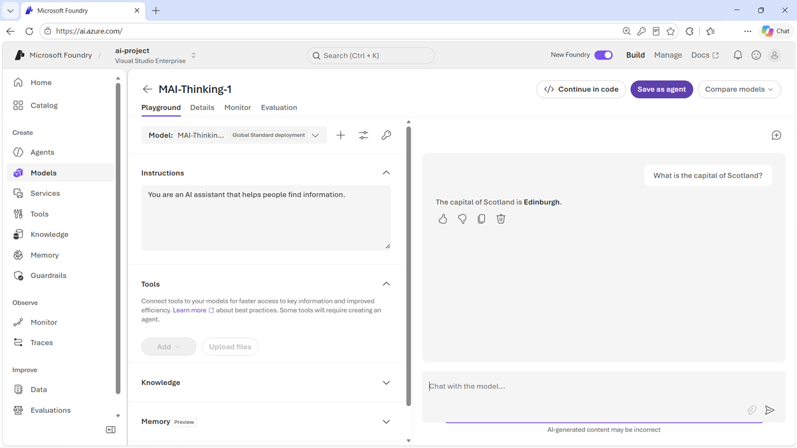

::: zone pivot="video"

>[!VIDEO https://learn-video.azurefd.net/vod/player?id=be63d373-cceb-4209-bfd2-231021763f99]

> [!TIP]
> See the **Text and images** tab for more details!

::: zone-end

::: zone pivot="text"

The easiest way to interact with a deployed model is to use the model playground in the Foundry portal. You can use the **Foundry Playgrounds** to try prompts, compare models, and capture working settings before you write any code.



## Key configuration parameters

Several *model arguments* or *parameters* influence runtime behavior, performance, and cost. In the playground settings, you can configure model parameters such as:

- **Temperature**: controls creativity vs. determinism.
- **Max output tokens** – caps response length; affects token consumption and throttling behavior.

Unlike the user prompt, which is the end-user request or question (example: Where should I travel?), **Instructions** (often referred to as a *system prompt*) set behavior, tone, tools, and constraints for the model. An example of a system prompt is: "You are a helpful, step‑by‑step tutor. Cite sources. Decline medical advice."

## Create a chat client by using the Foundry SDK

A chat client application submits user prompts to a deployed model and displays the responses; enabling users to engage with the model in a conversation.

You can use the Foundry SDK to build a client application for a deployed model. In this example, the client application uses key-based authentication to connect to the endpoint for the model, submit a prompt, and display the response.

```python
import os
from openai import OpenAI

client = OpenAI(
    base_url=f"{os.environ['AZURE_OPENAI_ENDPOINT']}/openai",
    api_key=os.environ["AZURE_OPENAI_API_KEY"]
)

response = client.responses.create(
    model=os.environ["MODEL_DEPLOYMENT_NAME"],
    input=[{"role": "system", "content": "You're a helpful assistant."},
           {"role": "user", "content": "What is the capital of France?"}],
    max_output_tokens=300,
    temperature=0.7
)

print(response.output_text)
```

::: zone-end
