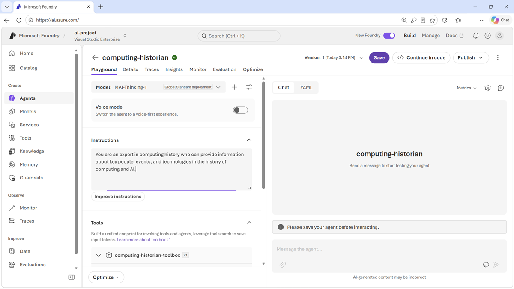

::: zone pivot="video"

>[!VIDEO https://learn-video.azurefd.net/vod/player?id=ba5b63c1-1dc4-433b-a323-88498a8a8231]

> [!TIP]
> See the **Text and images** tab for more details!

::: zone-end

::: zone pivot="text"

**Agents** are *applications* built with generative AI models. Agentic AI moves beyond responding to prompts in a chat to define autonomous AI assistants that can be reused across apps, experiences, and services.

An agent in Microsoft Foundry is a packaged, reusable AI component that brings together three things:

- **A model**: the generative AI model the agent uses for reasoning.
- **Instructions**: the system prompt that defines the agent’s role, behavior, style, constraints, and output rules.
- **Tools**: the actions the agent can take.

Agents can:

- Call external tools (APIs, functions, retrieval) automatically
- Break goals into structured steps
- Maintain working memory during a conversation
- Process user input, decide actions, and generate structured outputs

> [!NOTE]
> It's important to understand the difference between *models* and *agents*. Models encapsulate language understanding and intelligence to generate responses to prompts. Agents are packaged, task‑oriented workers built on top of that intelligence, often with specific domain knowledge, constraints, and capabilities.

## Create an agent in Foundry portal

To create an agent in Foundry, you can start by exploring a model or just go straight to agent development. In Foundry, an agent is a named configuration that comprises:  

- A generative AI model for language understanding and reasoning.
- Instructions that define the agent's role and responsibilities.
- Tools that enable the model to perform tasks.



**Tools** in Foundry allow a model to perform actions by calling external systems. They represent capabilities such as searching the web, querying a database, running code, or performing an action.

When enabled in the model playground, the model can inspect available tools, then call them when relevant to a user request. Examples of tools include:

- Code Interpreter (data analysis, file handling).
- Using knowledge sources and web search.
- Custom functions or APIs.

Tools allow the model to:

- Take real actions (read/write files, search, update systems)
- Execute workflows
- Integrate into enterprise systems

## Write code to use an agent

You can use an agent from a client application by using the **Foundry Projects SDK** to connect to the project and call it from a client using the **Project API**.

The Project API enables you to:

- Integrate agents into web apps, bots, or backend workflows
- Orchestrate multi‑step tasks
- Pass structured inputs or tool calls
- Run agents at scale with your Foundry deployments

Let's take a look at a Python code sample to use an agent:

```python
from azure.identity import DefaultAzureCredential
from azure.ai.projects import AIProjectClient

myEndpoint = "https://<resource>.services.ai.azure.com/api/projects/<resource-name>"

project_client = AIProjectClient(
    endpoint=myEndpoint,
    credential=DefaultAzureCredential(),
)

myAgent = "learning-agent"
# Get an existing agent
agent = project_client.agents.get(agent_name=myAgent)
print(f"Retrieved agent: {agent.name}")

openai_client = project_client.get_openai_client()

# Reference the agent to get a response
response = openai_client.responses.create(
    input=[{"role": "user", "content": "Tell me what you can help with."}],
    extra_body={"agent": {"name": agent.name, "type": "agent_reference"}},
)

print(f"Response output: {response.output_text}")
```

::: zone-end
