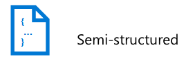
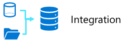
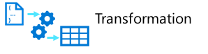
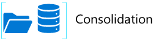

::: zone pivot="video"

>[!VIDEO https://learn-video.azurefd.net/vod/player?id=51f1e661-2c95-493d-8f26-c3b83157b4a6]

> [!TIP]
> See the **Text and images** tab for more details!

::: zone-end

::: zone pivot="text"

The data engineer often works with multiple types of data to perform many operations using many scripting or coding languages that are appropriate to their individual organization.

## Types of data

There are three primary types of data that a data engineer works with.

| Structured | Semi-structured | Unstructured |
|--|--|--|
|  |  |  |
| Structured data primarily comes from table-based source systems such as a relational database or from a flat file such as a comma separated (CSV) file. The primary element of a structured file is that the rows and columns are aligned consistently throughout the file. | Semi-structured data is data such as JavaScript object notation (JSON) files, which may require flattening prior to loading into your source system. When flattened, this data doesn't have to fit neatly into a table structure. | Unstructured data doesn't follow a predefined schema or tabular structure. Types of unstructured data that are commonly used include portable document format (PDF) files, word processor documents, and images. |

## Data operations

As a data engineer some of the main tasks that you perform in Azure include *data integration*, *data transformation*, and *data consolidation*.

### Data integration

Data integration involves establishing links between operational and analytical services and data sources to enable secure, reliable access to data across multiple systems. For example, a business process might rely on data that is spread across multiple systems, and a data engineer is required to establish links so that the required data can be extracted from all of these systems.

### Data transformation

Operational data usually needs to be *transformed* into suitable structure and format for analysis, often as part of an *extract, transform, and load* (ETL) process; though increasingly a variation in which you *extract, load, and transform* (ELT) the data is used to quickly ingest the data into a data lake and then apply "big data" processing techniques to transform it. Regardless of the approach used, the data is prepared to support downstream analytical needs.

### Data consolidation

Data consolidation is the process of combining data that has been extracted from multiple data sources into a consistent structure - usually to support analytics and reporting. Commonly, data from operational systems is extracted, transformed, and loaded into analytical stores such as a data lake or data warehouse.

## Common languages

Data engineers must be proficient with a range of tools and scripting languages - in particular SQL and Python, and potentially others.

- **SQL** - One of the most common languages data engineers use is SQL, or Structured Query Language, which is a relatively easy language to learn. SQL uses queries that include SELECT, INSERT, UPDATE, and DELETE statements to directly work with the data stored in tables.

- **Python** - Python is one of the most popular programming languages. It's used for many tasks, including web programming and data analysis. It's widely used for machine learning, and is increasingly common in data engineering with the use of notebooks. In large-scale data engineering workloads, data engineers typically use PySpark—the Python API for Apache Spark—to write transformation logic that runs across distributed Spark clusters.

- **KQL** - Kusto Query Language (KQL) is a query language for analyzing streaming and log data in real-time analytics scenarios. Data engineers use KQL in Microsoft Fabric's Real-Time Intelligence workload and Azure Data Explorer to query high-velocity data streams.

- **Others** - Depending upon the needs of the organization and your individual skill set, you may also use other popular languages within or outside of notebooks including R, Java, Scala, C#, and more. The use of notebooks is growing in popularity, and allows collaboration using different languages within the same notebook.

::: zone-end
