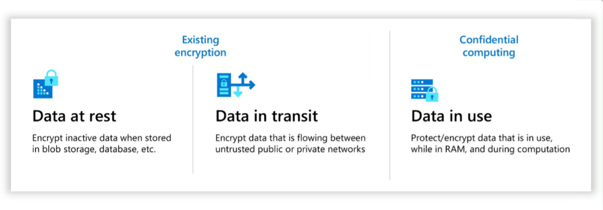

Secure key management is essential for helping protect and control data in the cloud. Azure provides robust key management solutions to help organizations securely store and access secrets. A secret is anything that you want to securely control access to, and it can include application programming interface (API) keys, passwords, certificates, and encryption keys.

The following table highlights the vocabulary in this module that relates to Azure Key Vault services.

| Term | Description |
| ----- | ---- |
| Tenant | An organization's instance of Microsoft cloud services, including Azure and Microsoft 365. |
| Key vault | A secure secrets store that provides management for keys and certificates. |
| Vault owner | Has full access and control over a key vault, including auditing and key life cycle management. |
| Vault consumer | A user with granted permissions to perform actions on assets in a key vault. |
| Secret | Anything that needs to have tightly controlled access, such as API keys, passwords, certificates, or encryption keys. |
| Managed HSM Administrators | Users with full control over an Azure Key Vault Managed HSM pool and its role assignments. |
| Managed HSM Crypto Officer | A role for managing roles, purging and recovering deleted keys, and exporting keys. It doesn't grant permission to perform cryptographic operations such as key wrapping and unwrapping. |
| Managed HSM Crypto User | A role for key management and cryptographic operations, including creating and deleting keys, but not purging or recovering deleted keys or exporting keys. |
| Managed HSM Crypto Service Encryption User | A role for service identities (like storage accounts) to read key metadata and wrap and unwrap keys for service encryption with customer-managed keys. It doesn't grant permission to delete keys. For more information on roles, see [Local RBAC built-in roles for Managed HSM](/azure/key-vault/managed-hsm/built-in-roles). |
| Resource | A manageable Azure item, such as a virtual machine (VM), storage account, or database. |
| Resource group | A container for managing related Azure resources in a solution. |
| Security Principal | An Azure identity that apps, services, or tools use to access resources with specific permissions. |
| Microsoft Entra ID | The Active Directory service for a tenant that manages identities and access. |
| Azure Tenant ID | A unique identifier for a Microsoft Entra instance in an Azure subscription. |
| Managed Identities | Azure identities that are automatically managed for more secure resource access in applications. |
| Federal Information Processing Standard (FIPS) 140 | A US government standard that defines minimum security requirements for cryptographic modules in information technology products and systems. |
| Single tenancy  | Refers to a single dedicated instance of an application that's deployed for each customer rather than a shared instance among multiple customers. The need for single tenant products is often found as an internal compliance requirement in financial service industries. |
| Multi tenancy | Refers to a solution where a single key vault instance is shared among multiple tenants or customers. The architecture helps isolate each tenant's data securely while using shared infrastructure components for scalability and efficiency. |

Microsoft Azure Key Vault solutions allow you to manage and control access to encryption keys so that you have the choice and flexibility to meet stringent data protection and compliance needs:

- **Azure platform encryption** is a platform-managed encryption solution that encrypts by using host-level encryption. Platform-managed keys are encryption keys that Azure generates, stores, and manages.

- **Customer-managed keys** are keys that the customer creates, reads, deletes, updates, and administers. Customer-managed keys can be stored in a cloud key management service like Azure Key Vault.

- **Azure Key Vault (Standard Tier)** encrypts by using a software key and is a FIPS 140-2 Level 1 validated, multitenant key management service that supports secure storage for symmetric and asymmetric software-backed keys, secrets, and certificates. This tier applies software-based protection for encryption-at-rest and application-specific uses that are accessible through a modern API. The Standard Tier offers extensive regional availability and seamless integration with Azure services, making it a flexible option for more secure data management.

- **Azure Key Vault (Premium Tier)** builds on the Standard Tier by offering FIPS 140-2 Level 3 validation, and it uses a hardware security boundary for greater security. This multitenant service allows symmetric and asymmetric key storage in hardware security modules (HSMs) that Microsoft manages, which provides stronger protections for software-backed keys, HSM-backed keys, and the certificates and secrets that are used in encryption-at-rest and custom applications.

- **Azure Key Vault Managed HSM (Hardware Security Module)** is a fully managed, highly available, single-tenant, standards-compliant cloud service that allows you to safeguard encryption keys for your cloud applications by using FIPS 140-2 Level 3 validated HSMs. This solution is designed for applications that require high-value key storage and strict security, compliance, and regulatory standards.

  This service offers you complete control over the HSM, allowing more secure management of encryption keys for cloud-based or custom applications, Keyless SSL/TLS offload, and more. It's the only Azure key management option that provides confidential key management and offers exclusive administrative control over an organization's security domain and encryption keys to the customer. Azure Key Vault Managed HSM supports only HSM-backed keys.

  Each customer receives a pool of three HSM partitions that operate as a single, logical, highly available HSM appliance, with cryptographic functionality that's accessible through the Key Vault API. Microsoft for Sovereignty manages to provision, patching, maintenance, and hardware failover but has no access to customer-managed keys because the service operates within the Azure confidential computing infrastructure.

  Azure Key Vault Managed HSM integrates with platform as a service (PaaS) services, such as Azure SQL, Azure Storage, and Azure Information Protection, and it supports Keyless TLS with F5 and Nginx.

The fundamental premise of Azure's key management is to give customers more control over their data across different states.

>[!div class="mx-imgBorder"]
>

### Data at rest

Encryption at rest helps protect stored data and supports an organization's data governance and compliance efforts. Organizations can use encryption and key management to protect personal data, restrict access to sensitive information, and audit how encryption keys are used. These safeguards help organizations address their data protection and encryption requirements.

Azure Key Vault services provide encryption and key management solutions that help safeguard encryption keys, certificates, and other secrets that cloud applications and services use to protect and control data that's encrypted at rest. This service is well managed with Azure Key Vault Premium or Azure Key Vault Managed HSM supporting FIPS 140 Level 3.

Azure Key Vault services help you securely manage encryption keys and other secrets that you use in encryption, decryption, and signing processes in your organization. They allow you to manage your own encryption keys and enforce rigorous access controls, key rotation policies, and auditing mechanisms.

For more information, see [Services that support customer-managed keys in Azure Key Vault and Azure Key Vault Managed HSM | Microsoft Learn](/azure/security/fundamentals/encryption-customer-managed-keys-support).

### Data in transit

Encryption methods, such as Transport Layer Security (TLS), help protect data-in-transit, that is, data moving between cloud services or from the cloud to client endpoints. Essentially, they help secure information as it travels over public networks.

With Azure Key Vault, you can provision, manage, and deploy public and private Secure Sockets Layer (SSL) or TLS certificates. You can use the certificates with Azure and with your internal connected resources for data-in-transit protection.

For more information, see [Double encryption in Microsoft Azure | Microsoft Learn](/azure/security/fundamentals/double-encryption#data-in-transit).

### Data in use

[Confidential computing](/azure/confidential-computing/overview-azure-products) in Azure offers the ability for organizations to protect their data while it's being computed in the physical CPU and memory of a host for data-in-use protection. Confidential computing further extends encryption by helping secure data in use, which provides a secure enclave for processing sensitive information. This approach is valuable for sensitive workloads that need to meet sovereignty requirements because it prevents data from being exposed to other cloud tenants or to the platform.

Additionally, SQL databases use the Always Encrypted feature to ensure that the data that's stored in the database remains encrypted even during query processing. This approach provides a layer of protection against unauthorized access to sensitive data fields.

Encryption, in combination with capabilities like Azure Key Vault, Azure Key Vault Managed HSM, and Azure confidential computing, ensures that data in Azure remains more secure, compliant, and under your control.

Microsoft for Sovereignty, along with customer-managed keys, allows organizations to maintain control over their encryption keys. Customer-managed keys ensure that only authorized personnel have access to encryption keys, helping to meet strict regulatory demands for data control. Microsoft for Sovereignty allows your organization to define key life cycle policies, including key rotation and revocation, which allows for more enhanced control in sovereign cloud environments.

By integrating with Azure's compliance solutions, such as Compliance Manager and Azure Policy, you can continuously assess your organization's encryption practices against local laws and regulatory requirements, therefore ensuring compliance with national data sovereignty mandates.
