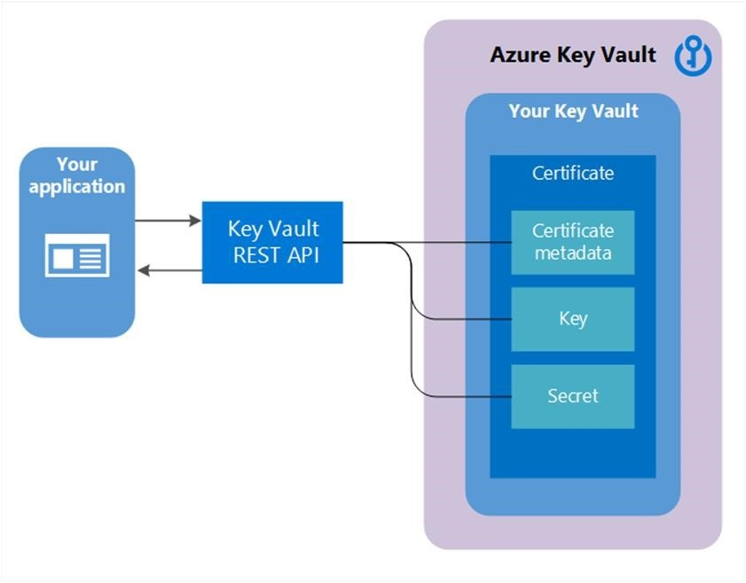

In Azure, a *certificate* is a digital document that binds a public key with an identity, such as a person or organization, and it allows for more secure communication and authentication in the Azure ecosystem. Certificates are essential for securing data and connections, authenticating services, and managing the encryption of data in transit.

Azure Key Vault certificate support allows for the following behaviors:

- Import an existing certificate.
- Implement secure storage and management of X.509 certificates without interacting with private key material.
- Create a policy that directs Azure Key Vault to manage the life cycle of a certificate.
- Provide contact information for notifications about the life cycle events of expiration and renewal.
- Support automatic renewal with selected issuers: Key Vault partner X.509 certificate providers and certification authorities (CAs).

## Authentication by using certificates

When an Azure Key Vault certificate is created, an associated key and secret with the same name are also generated. The Key Vault key facilitates key operations, while the secret allows for retrieval of the certificate value. Additionally, the certificate includes public X.509 metadata. Each certificate's identifier and version mirror those of keys and secrets, allowing access to specific versions of the key and secret that are linked to the certificate in the Key Vault certificate response.

>[!div class="mx-imgBorder"]
>

The following sections describe the common cloud scenarios that use digital certificates to secure communications.

### Website authentication and encryption

Websites use TLS certificates to verify their identity and secure communications. Typically, public sites use certificates from public certificate authorities, while organizations often use private certificate authorities for internal sites. Certificates must be renewed when expired or compromised, which requires careful management, especially for large web presences.

### Service authentication

Distributed applications and microservices use certificates for mutual authentication, but managing these certificates can be challenging when they're handled by decentralized teams.

### Infrastructure authentication

Client certificates authenticate servers and network devices in corporate networks. Organizations that use Microsoft Entra ID or Kerberos need to manage these certificates effectively.

### Other certificate scenarios

Device certificates authenticate end-user devices, while code-signing certificates verify software publishers in development environments, therefore enhancing application security.

## Platform-managed certificates vs. customer-managed certificates

In Azure, when you're deploying applications or services that require secure communication over the internet, encryption for data-in-transit is typically achieved by using digital certificates. These certificates can be managed by the platform (Azure) or by your organization. Understanding the differences between platform-managed certificates and customer-managed certificates is crucial for optimizing security and ensuring compliance with organizational policies.

### Platform-managed certificates

Platform-managed certificates are automatically provisioned and managed by Azure. They're associated with the default host name that's assigned to Azure resources during their creation.

For Azure PaaS services that don't use custom domain names, platform-managed certificates are the default method for encrypting data in transit. Azure handles the life cycle of these certificates, including issuance, renewal, and revocation, which reduces your organization's administrative overhead. With this capability, you can deploy services quickly without the need to configure or manage certificates manually, allowing for faster development and deployment cycles.

When you're using custom domain names for your Azure resources (such as a specific web application), you can't rely solely on platform-managed certificates. The reason is because platform-managed certificates are tied to the default Azure-assigned host name and can't be used for custom domains.

### Customer-managed certificates

Customer-managed certificates are those that you can create, upload, and manage in your Azure environment. These certificates provide flexibility and control over the encryption process.

Organizations must configure their own certificates when deploying services with custom domain names. This step allows for a personalized certificate authority (CA) and adherence to specific compliance requirements. It also allows you to dictate the certificate life cycle, including issuing, renewing, and revoking certificates based on your organization's security policies and compliance needs.

While customer-managed certificates offer greater control, they also require more administrative effort to manage, including ensuring timely renewals and handling issues that might arise with the certificates.

Choosing between platform-managed and customer-managed certificates depends on your specific use case. For services that use default host names, platform-managed certificates are a convenient option because they provide automatic management. However, when custom domains are involved, customer-managed certificates become necessary to ensure secure communications that are tailored to your organization's requirements.

## Certificate life cycle

Certificate life cycle management in the cloud involves automating the creation, deployment, renewal, and revocation of digital certificates. This management also includes monitoring expiration and integrating with certificate authorities to ensure more secure communications, data protection, and compliance across applications and services.

### Create certificates with Azure Key Vault

You can apply several Azure Key Vault functionalities to create and manage certificates seamlessly, ensuring that Azure applications can use these certificates for various security purposes. Certificate creation options include:

- **Self-signed certificates** - You can generate self-signed certificates directly in Azure Key Vault for internal applications or testing environments where a public certificate isn't required.
- **Certificate issuance from Trusted Authorities** - Azure Key Vault facilitates the request of certificates from integrated certificate authorities. By using this feature, you can ensure that your organization's applications use certificates that are issued by trusted sources, enhancing the security and integrity of their communications.

**Policy management**

Azure Key Vault allows you to define specific policies for their certificates. Policies can dictate whether a certificate is [exportable or nonexportable](/azure/key-vault/certificates/about-certificates#exportable-or-non-exportable-key). [Access policies](/azure/key-vault/general/assign-access-policy) specify which users, groups, or applications can perform actions on vault objects, while Azure RBAC (role-based access control) provides centralized, role-based permissions. [Network access policies](/azure/key-vault/general/network-security) restrict vault access to specific IPs or virtual networks, and [key rotation policies](/azure/key-vault/keys/how-to-configure-key-rotation) automate key renewal for security and compliance. Other policies include soft-delete and purge protection to prevent accidental deletion and certificate management policies for automated certificate renewal and life cycle management. These features help ensure more secure and controlled access to sensitive information in Azure Key Vault. For more information, see [Azure Policy built-in definitions for Key Vault](/azure/key-vault/policy-reference).

### Create certificates on-premises and manage them in Azure

For organizations that rely on on-premises certificate authorities, Azure Key Vault provides mechanisms to integrate these existing infrastructures with cloud services.

- **Issue certificates from On-Premises CAs** - Organizations can issue certificates from their on-premises CA and then import them into Azure Key Vault. This process ensures that these certificates are used by various Azure services without compromising security or operational integrity.
- **Import certificates** - Azure Key Vault helps organizations more securely import certificates in formats like PEM or PFX from existing certificate authorities. This approach allows for continued use of preexisting certificates in a more secure Azure environment by using Azure's robust security features for secure storage and management.

### Create and manage certificates on-premises with partner solutions

Organizations with established enterprise-grade certificate management systems might want to integrate their on-premises solutions with Azure Key Vault to streamline operations and enhance security.

Many external certificate authority and management solutions can connect with Azure Key Vault. By using the Azure REST API and managed identities, organizations can automate certificate requests, revocations, and renewals, therefore ensuring a seamless integration of on-premises and cloud-based certificate management.

By integrating these external solutions with Azure Key Vault, organizations can maintain compliance with industry regulations while benefitting from Azure's more secure environment. This integration allows for the improvement of visibility and control over security assets.

## Decentralized and automated management

Decentralized and automated management in Azure allows organizations to distribute the issuance and management of certificates to application and infrastructure teams, enhancing scalability and efficiency. By using solutions like Azure Key Vault, organizations can standardize key management practices while allowing teams to autonomously handle their own certificate needs, which reduces reliance on a centralized operations team.

### Managed certificates

Managed certificates streamline the process of obtaining and maintaining SSL/TLS certificates for public-facing websites that are hosted on an Azure PaaS offering, such as Microsoft Azure App Service and Microsoft Azure Front Door. These services allow organizations to create, manage, and rotate certificates that are sourced from integrated public certificate authorities, thus ensuring secure connections without requiring extensive manual intervention.

### Automate certificate issuance in CI/CD pipelines

In modern Azure DevOps practices, automating certificate issuance in Continuous Integration/Continuous Deployment (CI/CD) pipelines enhances operational efficiency and agility. By allowing application teams to provision their own certificates by using native Azure services, such as Microsoft Azure DNS, Azure App Service, and Azure Key Vault, organizations can delegate certain certificate management responsibilities. That approach accelerates development processes and reduces bottlenecks in certificate issuance.

### Manage endpoint certificates

Endpoint certificates play a crucial role in an infrastructure as a service (IaaS) environment, where they're used to authenticate servers and services. Organizations can efficiently manage these certificates through the same configuration management or automation tools that are used for virtual machine configurations, ensuring consistency and security across their infrastructure.
