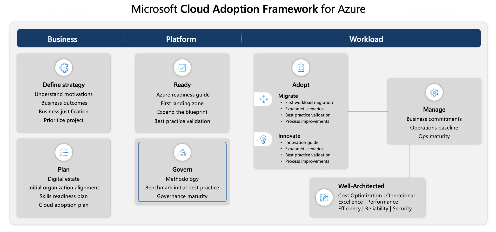
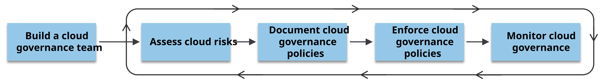
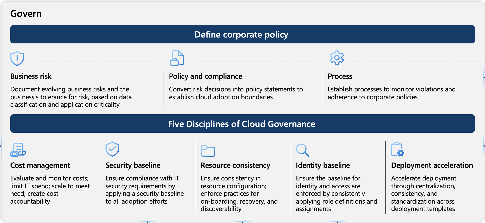

The Microsoft Cloud Adoption Framework for Azure offers comprehensive technical guidance for Microsoft Azure. This end-to-end framework helps cloud architects, IT experts, and business leaders reach their cloud adoption objectives. Cloud Adoption Framework includes best practices, documentation, and tools that Microsoft employees, partners, and customers contribute to formulate and implement effective business and technology strategies for the cloud. For more information, see [Microsoft Cloud Adoption Framework for Azure documentation - Cloud Adoption Framework | Microsoft Learn](/azure/cloud-adoption-framework/overview).

The following diagram provides high-level information about different methodologies that are included in Microsoft Cloud Adoption Framework for Azure for each phase of your cloud adoption life cycle. Within the framework, Microsoft Azure Policy plays a significant role in the governance framework to help govern your cloud environment and workloads.

>[!div class="mx-imgBorder"]
>

Cloud governance refers to the management of cloud usage in your organization. The Cloud Adoption Framework - Govern methodology offers a systematic framework for setting up and improving cloud governance in Azure. This guidance applies to organizations across various industries and it addresses crucial areas, such as regulatory compliance, security, operations, cost management, data, resource management, and AI. It's essential for defining and maintaining efficient cloud use.

Comprehensive cloud governance oversees all aspects of cloud use, minimizes various risks (such as compliance, security, resource management, and data-related concerns), and optimizes cloud operations throughout the organization. It ensures that cloud activities are consistent with the overall cloud strategy, facilitating the achievement of business objectives with reduced obstacles.

## Steps for cloud governance

Cloud governance is a continuous process. It requires ongoing monitoring, evaluation, and adjustments to adapt to evolving technologies, risks, and compliance requirements. The Cloud Adoption Framework - Govern methodology divides cloud governance into five steps.

>[!div class="mx-imgBorder"]
>

1. **Build a governance team** - Establish a dedicated cloud governance team that's responsible for defining, maintaining, and reporting on the progress of cloud governance policies.
1. **Assess cloud risks** - Conduct a thorough risk assessment that's unique to your organization, addressing all risk categories, including regulatory compliance, security, operations, costs, data management, resource management, and AI-related risks.
1. **Document cloud governance policies** - Clearly document cloud governance policies that dictate acceptable cloud usage and outline the rules and guidelines that mitigate identified risks.
1. **Enforce cloud governance policies** - Implement a systematic approach to ensure compliance with cloud governance policies. Use automated tools alongside manual oversight to enforce compliance. These tools help set guardrails, monitor configurations, and ensure adherence to policies.
1. **Monitor cloud governance** - Regularly monitor cloud usage and the governance teams to ensure ongoing compliance with the established cloud governance policies.

You should complete all five steps to establish cloud governance and regularly iterate on steps 2-5 to maintain cloud governance over time.

## Considerations for defining a cloud governance policy

The key considerations when defining a corporate cloud governance policy are as follows:

- **Business risk** – You must document the evolving business risks and the business's tolerance for risk based on data classification and application criticality.
- **Policy and compliance** – You must convert risk decisions into policy statements to establish cloud adoption boundaries efficiently.
- **Process** – You must establish processes to monitor violations and adherence to corporate policies.

>[!div class="mx-imgBorder"]
>

The five core disciplines of cloud governance are as follows:

- **Cost management** – Evaluates and monitors costs, including controlling IT expenditures to establish well-defined cost management. It also includes adjusting resources according to demand. It's crucial to exercise control over cloud expenditure to derive greater value from your investments.
- **Security baseline** – Ensures compliance with IT security requirements by applying a security baseline to all adoption efforts.
- **Resource consistency** – Ensures consistency in resource configuration and enforcing practices for onboarding, recovery, and discoverability.
- **Identity baseline** – Ensures that the baseline for identity and access is enforced by consistently applying role definitions and assignments.
- **Deployment acceleration** – Accelerates the deployment of policies through centralization, consistency, and standardization across deployment templates.

Adopting these measures simplifies the compliance process and also enhances the security and efficiency of your cloud environment.

## Cloud governance with Azure Policy

Azure's primary governance tool is [Azure Policy](/azure/governance/policy/overview). Azure Policy facilitates the governance of all resources, including current and forthcoming resources. It helps to enforce organizational standards and to assess compliance at scale by establishing guardrails across various resources.

Azure Policy allows for centralized management, allowing you to track compliance status and investigate changes leading to noncompliance. You can consolidate all compliance data into a singular repository, which simplifies auditing processes for effective cloud compliance and resource governance. The compliance dashboard offered by Azure Policy presents an aggregated view of the environment's overall state, with the ability to examine details at each resource and each policy level.

Azure Policy ensures consistent adherence to compliance standards and prevents misconfigurations. It also helps bring your resources to compliance through bulk remediation for existing resources and automatic remediation for new resources. Additionally, embedding Azure Policy directly into the Azure platform can significantly reduce the need for external approval processes, thus boosting developer productivity.

Some useful governance actions that you can enforce with Azure Policy include:

- Ensure that your team deploys Azure resources only to allowed regions.
- Enforce geo-replication rules to comply with your data residency requirements.
- Allow only certain virtual machine sizes for your cloud environment.
- Enforce the consistent application of taxonomic tags across resources.
- Recommend system updates on your servers.
- Allow multifactor authentication for all subscription accounts.
- Require resources to send diagnostic logs to an Azure Monitor Logs workspace.

Azure Policy evaluates your resources and highlights resources that aren't compliant with the policies that you create. Azure Policy can also prevent noncompliant resources from being created. Azure Policy comes with built-in policy and initiative definitions for Storage, Networking, Compute, Security Center, and Monitoring. For example, if you define a policy that only allows a certain size for the virtual machines (VMs) to be used in your environment, that policy is invoked when you create a new VM and whenever you resize existing VMs. Azure Policy also evaluates and monitors all current VMs in your environment, including VMs that were created before the policy was created.

In some cases, Azure Policy can automatically remediate noncompliant resources and configurations to ensure the integrity of the state of the resources. For example, if all resources in a specific resource group need to have the *AppName* tag with a value of *SpecialOrders*, Azure Policy can automatically apply that tag if it's missing. However, you maintain full control over your environment. If there's a particular resource that you don't want Azure Policy to automatically update, you can mark that resource as an exception, and the policy won't automatically update it.

Azure Policy also integrates with Azure DevOps by applying any continuous integration and delivery pipeline policies that pertain to the predeployment and post-deployment phases of your applications.

The objective when designing an Azure Policy should be to strike a balance between control and stability in one area with speed and results in the other. The main reason to maintain balance is to ensure that the environment remains highly manageable so that you can implement necessary levels of control to ensure governance without hindering operational efficiency or productivity. In establishing and enforcing these controls, you must take care that your speed to achieve efficiency isn't affected. Hence, achieving this balance between control and stability with speed and results, often requires thoughtful compromise, and it's necessary to carefully evaluate the potential impact before introducing new policies.

For more information, see [Microsoft Cloud Adoption Framework for Azure - Cloud Adoption Framework | Microsoft Learn](/azure/cloud-adoption-framework/).
