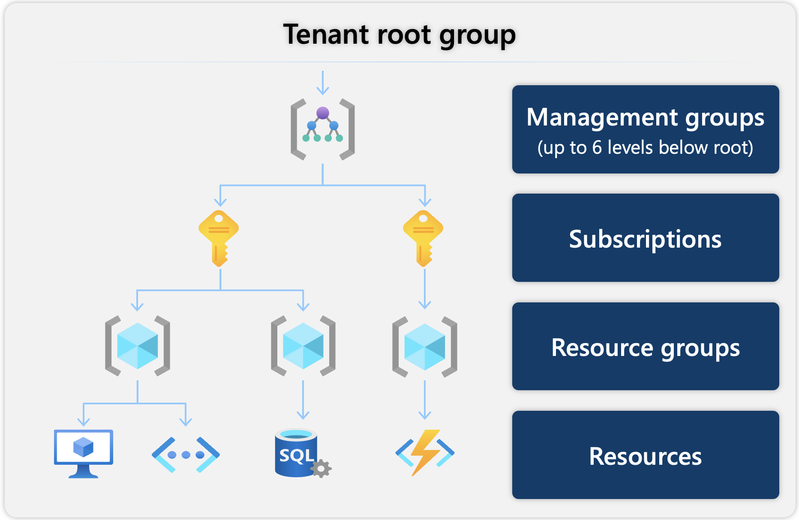
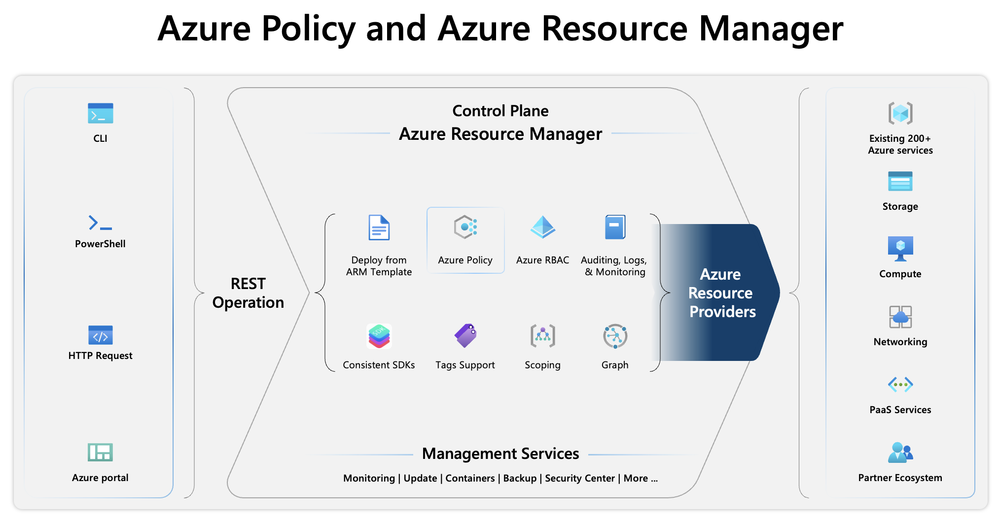
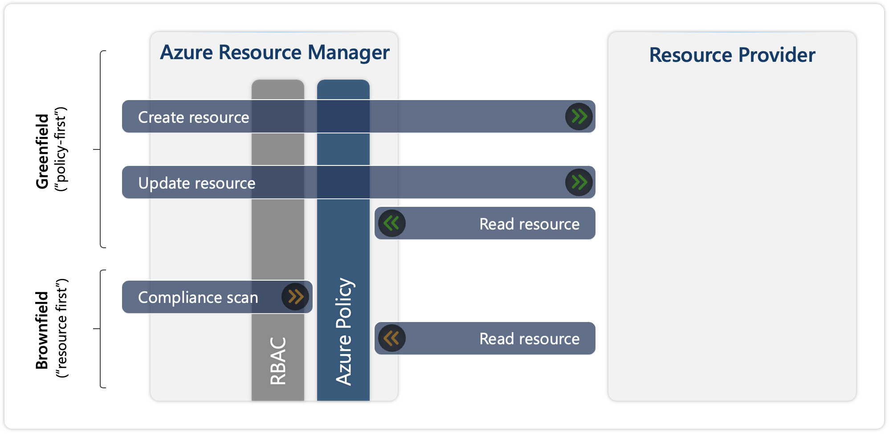

Governance provides mechanisms and processes to maintain control over your applications and resources in Azure. It involves planning your policy in Azure Policy and setting strategic priorities. While designing your policy, you must organize your cloud-based resources to secure, manage, and track costs that are related to your workloads.

## Hierarchy for governance

Azure provides four levels of management to establish proper governance: Management groups, Subscriptions, Resource groups, and Resources. You can build a flexible structure of management groups and subscriptions to organize your resources into a hierarchy for unified policy and access management. The following diagram shows an example of creating a hierarchy for governance by using management groups.

>[!div class="mx-imgBorder"]
>

The Azure structure starts with the tenant root group at the top, followed by a hierarchy of management groups, which can extend to six levels beneath the root. The definition of each level in the management hierarchy and relationship between these levels is as follows:

| Concept | Description |
| :----- | :----- |
| **Resource** | A resource is the basic building block of Azure, and it includes instances of services that you create, provision, deploy, and so on. Virtual machines (VMs), virtual networks, databases, AI services, and so on, are considered resources in Azure. |
| **Resource groups** | Resource groups are groupings of resources. When you create a resource, you must place it into a resource group. While a resource group can contain many resources, a single resource can only be in one resource group at a time.     When you apply an action to a resource group, that action applies to all resources in the resource group. If you delete a resource group, all resources are deleted. If you grant or deny access to a resource group, all resources in the resource group are also granted or denied access. |
| **Subscriptions** | In Azure, subscriptions are a unit of management, billing, and scale. Similar to how resource groups are a way of logically organizing resources, subscriptions allow you to logically organize your resource groups and facilitate billing. Each subscription has limits or quotas on the number of resources that you can create and use. Organizations can use subscriptions to manage costs and the resources that users, teams, and projects create.     Using Azure requires an Azure subscription. An Azure subscription provides you with authenticated and authorized access to Azure products and services. It also allows you to provision resources. An Azure subscription links to an Azure account, which is an identity in Microsoft Entra ID or in a directory that Microsoft Entra ID trusts. |
| **Management groups** | Azure management groups provide a level of scope above subscriptions. If you have many subscriptions, you might need a way to efficiently manage access, policies, and compliance for those subscriptions. You organize subscriptions into containers called management groups and then apply governance conditions to the management groups.     Management groups give you enterprise-grade management at a large scale, no matter what type of subscriptions you might have. Management groups can be nested. |

You can apply management settings at any of these levels of scope. The level that you select determines how widely the setting is applied. Lower levels inherit settings from higher levels. For example, when you apply a policy to the subscription, the policy is applied to all resource groups and resources in that subscription. When you apply a policy on the resource group, that policy is applied to that resource group and all its resources. However, another resource group won't have that policy assignment. All subscriptions within a management group automatically inherit the conditions that are applied to the management group.

## Introduction to Azure Resource Manager

Azure Resource Manager is the deployment and management service for Azure. It provides a management layer that allows you to create, update, and delete resources in your Azure account.

Azure operations are classified into two main types: control plane and data plane. The control plane helps you manage resources in your subscription, while the data plane allows you to access the capabilities provided by instances of specific resource types.

### Control plane

Azure Policy operates in the control plane to enforce rules and compliance on your resources. Azure Resource Manager manages all control plane operations in Azure and includes the different components that are centralized between the different services. Azure Policy is integrated with Azure Resource Manager.

>[!div class="mx-imgBorder"]
>

Azure Resource Manager manages essential functions, such as template-based deployments, role-based access control (RBAC), auditing, monitoring, and tagging, which provides a unified management experience for Azure resources after deployment. For example, consider a scenario where you have a storage account. With Azure Resource Manager, you can create the storage account and enforce a policy that mandates encryption for all storage accounts.

When you send a control plane request through any of the Azure APIs, tools, or SDKs, Azure Resource Manager receives the request. All capabilities that are available in the portal are also available through PowerShell, Azure CLI, REST APIs, and client SDKs. These tools use the same API to process requests, ensuring uniform results and capabilities. The Resource Manager authenticates and authorizes the request before forwarding it to the appropriate Azure resource provider that completes the operation.

### Data plane

The data plane is where the actual data operations occur, and Azure Policy ensures that the resources you interact with in the data plane are compliant with your policies. Data plane operations involve direct interaction with the data stored in a resource. Continuing with the previous example, you engage with the storage account to upload or download files. This interaction is handled directly by the data plane of the storage account rather than being managed by Azure Resource Manager.

Data plane operations aren't limited to REST API. Requests are made directly to the data endpoints of services (for example, accessing data in Microsoft Azure Storage, querying an SQL database, or reading secrets from Microsoft Azure Key Vault). Each Azure service handles these requests internally, bypassing Azure Resource Manager, and directly managing the data through its resource provider. Service-specific access controls, such as RBAC or access control lists (ACLs), often manage data plane permissions. The service responds with the data or result of the data operation, ensuring that the requester has the correct permissions.

Azure Policy allows individual Azure services to implement an Azure Policy extension, enhancing policy behavior and integration with specific resource providers. Azure Policy currently supports data plane operations through the following resource provider modes:

- **Microsoft.Kubernetes.Data** - Used for managing Kubernetes clusters and components such as pods, containers, and ingresses.
- **Microsoft.KeyVault.Data** - Used for managing vaults and certificates in Azure Key Vault.
- **Microsoft.Network.Data** - Used for managing Microsoft Azure Virtual Network Manager custom membership policies by using Azure Policy.
- **Microsoft.ManagedHSM.Data** - Used for managing Azure Key Vault Managed HSM keys by using Azure Policy.
- **Microsoft.DataFactory.Data** - Used for using Azure Policy to deny Microsoft Azure Data Factory outbound traffic domain names.
- **Microsoft.MachineLearningServices.v2.Data** - Used for managing Microsoft Azure Machine Learning model deployments. This Resource Provider mode reports compliance for newly created and updated components.

For more information, see [Resource Provider Modes](/azure/governance/policy/concepts/definition-structure-basics#resource-provider-modes).

## Operation flows of Azure Resource Manager

Azure Resource Manager includes two scenarios for handling Azure requests: **Greenfield** and **Brownfield**. As you deploy resources, Azure Resource Manager understands when to create new resources and when to update existing resources.

>[!div class="mx-imgBorder"]
>

**Greenfield** refers to a scenario where an Azure Policy (policy-first) exists, and when you're creating or updating an Azure resource.

For example, you're creating a new resource by calling an HTTPS REST API into Azure Resource Manager, that is, targeting a specific resource provider. In Azure Resource Manager, the request goes through different layers, including role-based access control (RBAC) and Azure Policy. These layers are only two of the many other layers, but it's important to understand that Azure Policy comes after RBAC. If you don't have permissions to run a given operation, then Azure Policy isn't considered or called because it would fail on the RBAC stage. If you have permissions, the request goes through Azure Policy and is evaluated against any policy. For resource updates, you send only the changes (delta) in the request payload in the existing resource. Azure Policy requires full visibility of the current state of the resource. Azure Policy merges the delta that you're sending by reading the current state. Then, the target state is obtained as a result of the merger, and that's what gets evaluated against your policies.

**Brownfield** is the scenario where the resources exist already (resource-first), and you're assigning a new Azure Policy to those resources.

In this case, policy evaluation happens through a compliance scan, which runs automatically every 24 hours, or it can be manually triggered. The duration of the scan is unpredictable, but after it's completed, the compliance state of existing resources is updated. To perform this evaluation, Azure Policy reads all existing resources in the scope. You can create an Azure policy that prohibits resources from being created outside of a certain region, such as West Europe. Existing resources outside this region aren't deleted but are flagged as noncompliant after the policy is applied, and future attempts to create resources outside West Europe fail.
