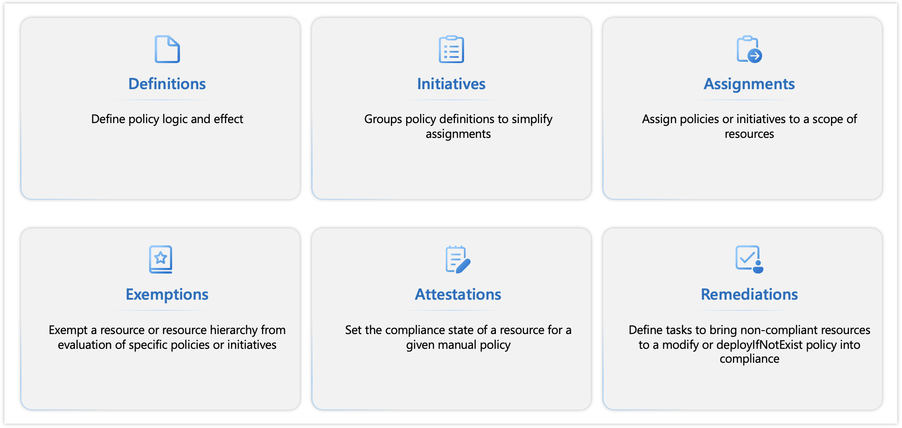

Azure Policy enforces organizational standards and assesses compliance at scale. It evaluates Azure resources and actions by comparing their properties to business rules, providing an aggregated view of the environment's overall state. This policy allows for detailed analysis down to each resource and policy level with granularity. Six policy resources are available in Azure, and multiple different concepts apply to these Azure policy resources.

>[!div class="mx-imgBorder"]
>

## Definitions

Azure Policy definitions describe resource compliance conditions and the effect to take if a condition is met. Several settings determine which resources are evaluated by any Azure Policy. You explore these settings in the next unit, **Azure Policy definitions**. The primary concept to which these settings can be applied is scope.

Scope in Azure Policy is the same as the levels of hierarchy for governance in Azure. Four levels of management scope are under the root tenant: the management groups, subscriptions, resource groups, and resources. The definition might be saved in a management group or a subscription. The definition location determines the scope to which the initiative or policy can be assigned. An assignment also has several properties that set a scope. The use of these properties determines which resource for Azure Policy to evaluate and which resources count toward compliance

You can apply management settings at any of these levels of scope. The level that you select determines how widely the setting is applied. Lower levels inherit settings from higher levels. For more information, see [Scope in Azure Policy](/azure/governance/policy/concepts/scope).

## Initiatives

Azure Policy initiatives, also known as a policy set, allow you to group several policy definitions to simplify assignments and management because you work with the initiatives as a single item. Initiatives offer a streamlined and automated approach to governance, allowing organizations to manage and monitor compliance at scale. The initiative definition contains all policy definitions to help track your compliance state for a larger goal, such as organizational compliance goals or compliance with regulatory frameworks. For example, multiple tagging policy definitions can be grouped into a single initiative, and rather than assigning each policy individually, you can apply the initiative to Azure resources. A JSON can be used to create a policy initiative definition. For more information, see [Azure Policy initiative definition structure](/azure/governance/policy/concepts/initiative-definition-structure).

For more information about Azure Policy built-ins and patterns, see [Azure Policy samples](/azure/governance/policy/samples/).

**Built-in policy** is a type of policy definition that's generated by Azure Resource Providers and is available by default. A group of such policy definitions is known as a **built-in initiative**. Azure built-in policy initiatives are a powerful tool set that enables centralized control across Azure resources and enforcement of specific configurations. These initiatives comprise a collection of policy definitions and support compliance with various regulatory frameworks, industry standards, and security best practices.

For a list of built-in policies and initiatives, see [Policies](/azure/governance/policy/samples/built-in-policies) and [Initiatives](/azure/governance/policy/samples/built-in-initiatives).

**Custom policy** is a type of policy definition that's written by a policy user when no built-in policy maps to your requirements. A group of such policy definitions is known as a **custom initiative**. Azure Policy custom initiatives help you to tailor a set of policies specifically to your organization's unique requirements, giving you control to enforce the standards and rules that best fit your environment. Microsoft for Sovereignty makes several custom policy initiatives and compliance mappings accessible through the [industry-policy-portfolio](https://github.com/Azure/industry-policy-portfolio) repository on GitHub.

Microsoft for Sovereignty initiatives and compliance mappings, which expand on the Azure built-in initiatives, help you automate policy enforcement and foster a robust governance framework that reduces the risk of noncompliance. Further, the initiatives also strengthen data protection measures. Organizations can use the large suite of available regulatory compliance built-in initiatives while we continue to expand on other frameworks. These initiatives are available as Azure built-in and custom policy initiatives.

For more information, see [Microsoft for Sovereignty policy portfolio](/industry/sovereignty/policy-portfolio-baseline).

## Assignments

Policy assignments define which resources are evaluated by a policy definition or initiative. Policy assignments can be done in the portal, an API call, or through the command line interface.

Policy and initiative definitions are deployed to a definition location (management group or subscription). This location determines the scope to which the initiative or policy can be assigned. The location should be the resource container shared by all resources that you want to use the policy definition on. For more information, see [Definition location](/azure/governance/policy/concepts/scope#definition-location).

Policies and initiatives are assigned to a specific scope (management group, subscription, or resource group). While doing so, you can define several optional aspects, including the resource scope and policy definition.

- Optional *resource selectors* to allow gradual rollout based on resource location or type.
- Optional *overrides* to change the effect of a policy definition without modifying the underlying definition.
- *enforcementMode* can be disabled to support "what-if" scenarios without changing the definition, which is equivalent to changing the definition to an audit effect mode, but a way to do it at assignment level. For example, if the policy has *Deny* effects, that denial isn't effective, but you can still view the result of the compliance evaluation of that policy.
- Optional *excluded scopes* to exclude inner containers or resources from the assignment scope.
- *Noncompliance messages* can be defined.
- *Parameters* can be assigned values.
- If you have a policy with the *deployIfNotExists* effect type, a *managed identity* can be assigned (system-assigned or user-assigned) to turn on remediation actions. An assignment has several properties that set a scope. The use of these properties determines which resource for Azure Policy to evaluate and which resources count toward compliance. These properties map to the following concepts:
  - **Inclusion** - For more information, see [Azure Policy assignment structure](/azure/governance/policy/concepts/assignment-structure).
  - **Exclusion** - For more information, see [Azure Policy assignment structure excluded scopes](/azure/governance/policy/concepts/assignment-structure#excluded-scopes).

## Exemptions

Use the Policy exemptions feature to *exempt* a resource hierarchy or an individual resource from evaluation of initiatives or definitions. Resources that are *exempt* count toward overall compliance but can't be evaluated or have a temporary waiver. They're created as a child object on the resource hierarchy, or the individual resource granted the exemption.

Policy exemptions aren't created during assignment time, but after, and the effect is still the same as an excluded scope. Two exemption categories exist and are used to group exemptions:

- **Mitigated** - The exemption is granted because the policy intent is met through another method.
- **Waiver** - The exemption is granted because the noncompliance state of the resource is temporarily accepted.

For more information about policy exemption, see [Azure Policy exemption structure](/azure/governance/policy/concepts/exemption-structure).

## Attestations

Policy attestations are used by Azure Policy to set compliance states of resources or scopes targeted by [manual policies](/azure/governance/policy/concepts/effect-manual). Each applicable resource requires one attestation for each manual policy assignment. For ease of management, manual policies should be designed to target the scope that defines the boundary of resources whose compliance state needs to be attested.

For more information, see [Azure Policy attestation structure](/azure/governance/policy/concepts/attestation-structure).

## Remediations

The policy remediation task feature is used to bring resources into compliance based on a definition and assignment. Resources that are noncompliant to a *modify* or *deployIfNotExists* definition assignment can be brought into compliance by using a remediation task. Resources that are newly created or updated that are applicable to a *deployIfNotExists* or *modify* definition assignment are automatically remediated.

For more information, see [Azure Policy remediation task structure](/azure/governance/policy/concepts/remediation-structure).
