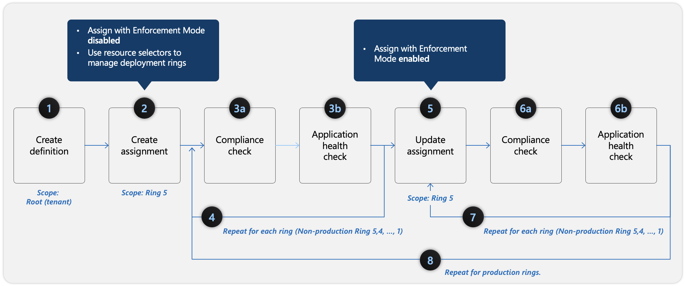
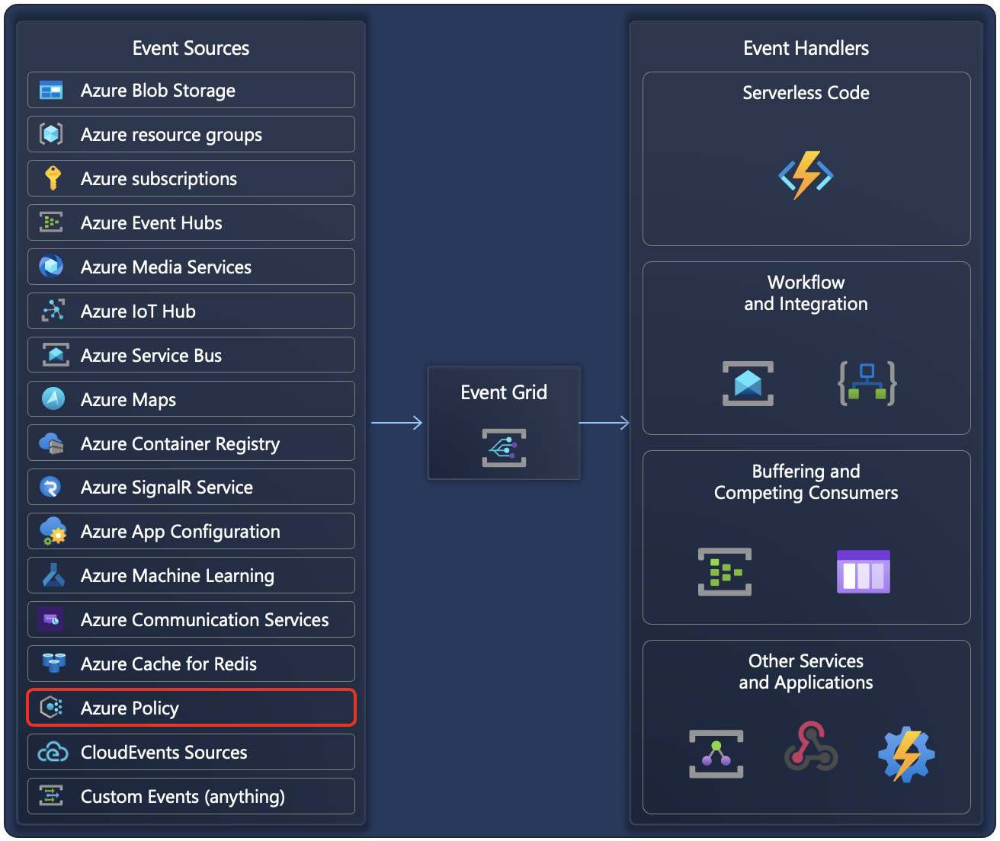

A significant benefit of Azure Policy is the insight and controls that it provides over resources in a subscription or management group of subscriptions. This control can be used to prevent resources from being created in the wrong location, enforce common and consistent tag usage, or audit existing resources for appropriate configurations and settings. Before you review compliance data and react to it, you need to understand the evaluation triggers, timings, and the resource compliance states.

## Evaluation triggers

Evaluations of assigned policies and initiatives happen as the result of various events:

- A policy or initiative is newly assigned to a scope
- A policy or initiative already assigned to a scope is updated
- A resource is deployed to or updated in a scope with an assignment through Azure Resource Manager, REST API, or a supported SDK
- A subscription (resource type Microsoft.Resources/subscriptions) is created or moved in a management group hierarchy with an assigned policy definition that targets the subscription resource type
- A policy exemption is created, updated, or deleted
- Standard compliance evaluation cycle
- The machine configuration resource provider is updated with compliance details by a managed resource
- On-demand scan

For more information, see [Evaluation triggers](/azure/governance/policy/how-to/get-compliance-data#evaluation-triggers).

## Evaluation timing

When you're working with policy assignments in Azure, you need to understand the behavior and timing of compliance scans, especially in Brownfield scenarios, where new policies are applied to existing resources. Compliance scans through Azure policies are triggered by various methods:

- **Automatic full scan** - A full compliance scan is triggered automatically every 24 hours.
- **Manual scan for Brownfield scenarios** - In cases where a new policy is applied to existing resources (Brownfield scenarios), you can manually trigger a compliance scan by running *az policy state trigger-scan*.

When you assign a new policy, a delay can occur in the policy taking effect, which can be up to 30 minutes. The Azure Resource Manager cache holds session data, and it can take time for the policy to propagate in the same session. To bypass the caching delay, you can sign out and sign back in to refresh the Azure Resource Manager cache, which ensures that the new policy is applied immediately to the defined scope.

After the scan starts, several factors influence how long it takes for a compliance scan to complete:

- **Policy definitions** - The size and complexity of the policy definitions can increase scan time.
- **Number of policies** - The more policies applied, the longer the scan might take.
- **Scope size** - The size of the resource scope assigned to the policy also plays a role.
- **System load** - Compliance scans are a low-priority operation, meaning that if the system is busy with more critical tasks, the scan might take longer. The system prioritizes interactive and high-importance operations, so scans might take several minutes, or tens of minutes, even in smaller environments.
- **Synchronous scan (Low-Priority Execution)** - Because compliance scans are synchronous and assigned a low priority in Azure's system, they're delayed if the system is busy. This scan can significantly extend the time it takes for the scan to complete, even for smaller scopes or policies.

This understanding of the compliance scan process and potential delays allows you to better manage the application and avoid unnecessary waiting, especially in environments with complex or extensive policy definitions.

## Resource compliance states

When initiative or policy definitions are assigned, Azure Policy determines which resources are applicable. Then, it evaluates those resources that aren't excluded or exempted. Evaluation provides one of the compliance states to each resource based on conditions in the policy rule and each resource's adherence to those requirements.

- **Non-compliant**
- **Compliant**
- **Error** (for template or evaluation error)
- **Conflicting** (two or more policy assignments in the same scope with contradicting rules, such as two policies appending the same tag with different values)
- **Protected** (resource covered under an assignment with a *denyAction* effect)
- **Exempted Unknown** (default state for definitions with a *manual* effect)

When multiple resources or policies have varying compliance states, the overall compliance state is assessed individually for each resource and for each policy assignment. Azure Policy ranks each compliance state so that one wins over another in this situation. The rank order of the states is as given in the previous list of compliance states.

The compliance percentage is determined by dividing **Compliant**, **Exempt**, and **Unknown** resources by total resources. Total resources include resources with **Compliant**, **Non-compliant**, **Unknown**, **Exempt**, **Conflicting**, and **Error** states.

For more information on when the policies return these states for any particular resource, see [Azure Policy compliance states](/azure/governance/policy/concepts/compliance-states).

## Enforcement mode

*enforcementMode* is a property of a policy assignment that lets you deactivate the enforcement of certain policy effects. This mode allows you to test the policy's outcome on existing resources without initiating the policy effect or triggering entries in the [Azure Activity log](/azure/azure-monitor/essentials/platform-logs-overview). The *enforcementMode* can be changed to Enabled after the policy is thoroughly tested.

This scenario is commonly referred to as *What If* and aligns to safe deployment practices. The *enforcementMode* is different from the *disabled* effect. The *disabled* effect prevents resource evaluation from happening at all while *enforcementMode* lets the evaluation happen without the effect taking place.

The following table describes this property's values.

| Mode | JSON value | Type | Remediate manually | Activity log entry | Description |
| :----- | :----- | :----- | :----- | :----- | :----- |
| Enabled | Default | string | Yes | Yes | The policy effect is enforced during resource creation or update. |
| Disabled | DoNotEnforce | string | Yes | No | The policy effect isn't enforced during resource creation or update. |

If *enforcementMode* isn't specified in a policy or initiative definition, the value *Default* is used. Remediation tasks can be started for *deployIfNotExists* policies, even when *enforcementMode* is set to *DoNotEnforce*.

## Policy enforcement and safe deployment best practices

Without the appropriate knowledge of best practices and proper testing, applying a set of policy to an existing environment that's running production workloads can result in unintended behaviors of policy resources. Treating policy as code (keeping your policy definitions in source control, and whenever a change is made, testing and validating that change) allows you to automate testing and make sure that no manual error factor happens. The best practices framework focuses on minimizing the impact of policy changes while ensuring compliance, and it includes two aspects:

- **First aspect** - Start from Assignments of new policies with *enforcementMode* Disabled. When assigning policies that include deny or modify actions, beginning with *enforcementMode* Disabled allows you to view the compliance state and evaluate policy outcomes without triggering actions or denying operations. This "what-if" scenario minimizes impact and helps identify issues in the new policies or changes without disrupting the environment.

- **Second aspect** - Deploy policies in deployment rings. To control potential negative impacts, policies should be deployed gradually in smaller subsets and then in bigger sets. You can start with test and development environments and then move to production by applying the policy to a small subset first. This strategy helps in testing the policy thoroughly. Gradually expanding the scope (through deployment rings) can cover the full production environment.

The following diagram shows how to apply the safe deployment best practices framework for Azure Policy assignments.

>[!div class="mx-imgBorder"]
>

The following steps correspond with the outlined steps in the preceding screenshot:

1. **Create definition** - Begin by defining the policy definition with the scope as root (tenant).
1. **Create assignment** - Define deployment rings (1 to 5) by using resource selectors. Assign the policy to a specific scope (such as a resource group, subscription, or management group) in Ring 5. Assign with *enforcementMode* Disabled to evaluate compliance without enforcing changes.
1. a) **Compliance check** - Verify that the policy is being applied correctly and that the desired compliance state is achieved for the resources in Ring 5.

   b) **Application health check** - Assess the impact of the policy for the resources in Ring 5. Ensure that no unexpected side effects exist.
1. **Repeat for each ring (Non-production)** - Repeat step 3 for all nonproduction environment rings.
1. **Update assignment (Optional)** - If necessary, adjust the policy definition or assignment based on the evaluation of resources of the nonproduction environment and then reassign it to the resources in Ring 5 with the *enforcementMode* Enabled.
1. a) **Compliance check** - Reevaluate compliance after making changes (same as step 3a).

   b) **Application health check** - Again, verify that the policy isn't causing issues (same as step 3b).
1. **Repeat for each ring (Non-production)** - Repeat step 6 for all nonproduction environment rings.
1. **Repeat for production rings** - After the policy is validated in a nonproduction environment, gradually deploy it to production environments, starting with a smaller subset (ring) and expanding the scope over time.

For more detailed steps on the safe deployment of Azure Policy assignments with different effects, see [Safe deployment of Azure Policy assignments](/azure/governance/policy/how-to/policy-safe-deployment-practices#steps-for-safe-deployment-of-azure-policy-assignments-with-deny-or-append-effects).

## Reacting to policy state changes

Azure Policy events allow applications to react to state changes. This integration is done without the need for complicated code or expensive and inefficient polling services. Events from Azure Policy (Event Source) are pushed through Microsoft Azure Event Grid to Event Handlers.

>[!div class="mx-imgBorder"]
>

Azure Event Grid provides reliable delivery services to your applications through rich retry policies and dead-letter delivery. Event Grid takes care of the proper routing, filtering, and multicasting of the events to destinations through Event Grid subscriptions. For more information, see [Azure Event Grid](/azure/event-grid/).

An Event Handler is the place where the event is sent. Several services, such as Microsoft Azure Functions, Microsoft Azure Logic Apps, or your own custom HTTP listener, can be configured to handle events. You can also use any webhook for handling events.

For more information, see [Event handlers in Azure Event Grid](/azure/event-grid/event-handlers), [Reacting to Azure Policy state change events](/azure/governance/policy/concepts/event-overview?tabs=event-grid-event-schema), and the [Route policy state change events to Event Grid with Azure CLI](/azure/governance/policy/tutorials/route-state-change-events) tutorial.
