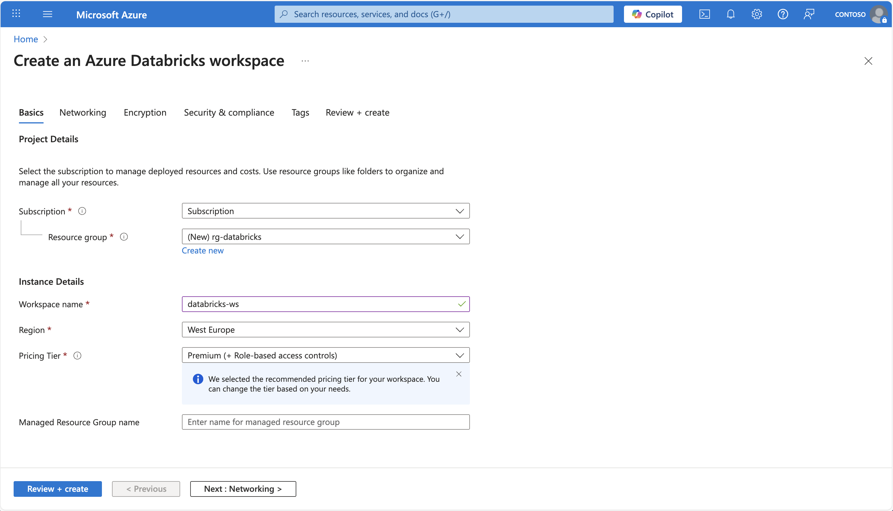
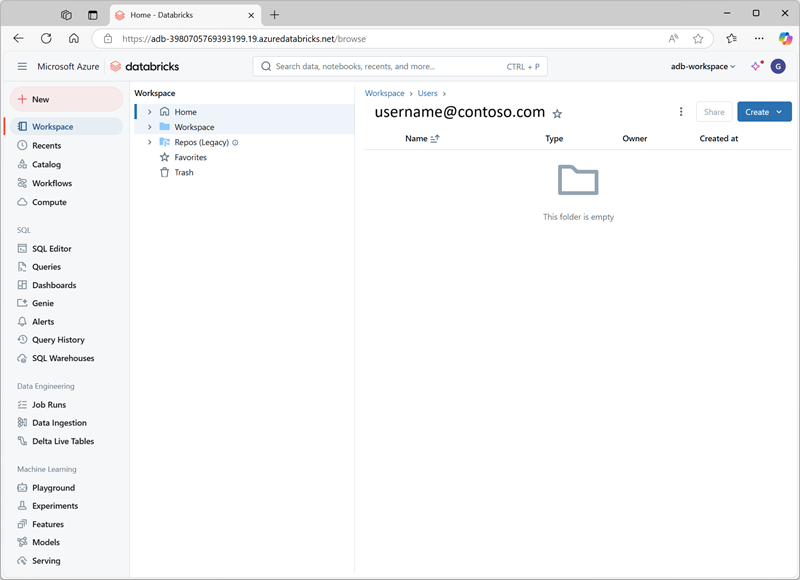
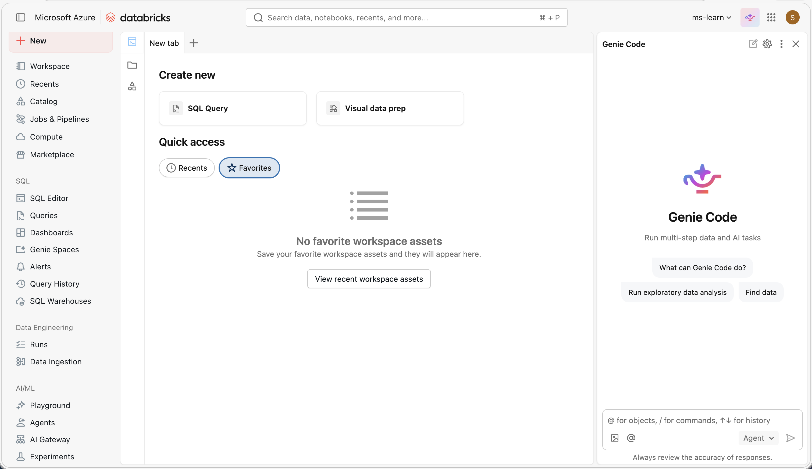

>[!VIDEO https://learn-video.azurefd.net/vod/player?id=d4fcf5c1-5d99-439c-8bba-157f93385e15]

To use Azure Databricks, you must create an Azure Databricks workspace in your Azure subscription. A workspace is an Azure Databricks deployment in a cloud service account. It provides a unified environment for working with Azure Databricks assets for a specified set of users.

You can create an Azure Databricks workspace by:

- Using the Azure portal user interface.
- Using an Azure Resource Manager (ARM), Bicep or Terraform template.
- Using the New-AzDatabricksWorkspace Azure PowerShell cmdlet.
- Using the az databricks workspace create Azure command line interface (CLI) command.

When you create a workspace, you must specify:

- A **workspace name**.
- Select an available **region**. For available regions, see [Azure services available by region](https://azure.microsoft.com/explore/global-infrastructure).
- A **pricing tier**:
  - **Premium** - Role-based access controls, Unity Catalog, SQL, Mosaic AI, serverless compute, Genie Code, and other enterprise-level features.
  - **Trial** - A 14-day free trial of a Premium-level workspace

  > [!NOTE]
  > The Standard tier is no longer available for new workspaces as of April 1, 2026. All new workspaces are created on the Premium tier.

- **Workspace type**:
  - **Serverless** - Pre-configured with serverless compute and default storage. Azure Databricks recommends a serverless workspace for the simplest quick start.
  - **Hybrid** (also called Classic) - Provisions compute and storage in your Azure subscription.
- **Managed Resource Group name** (optional): an automatically created resource group where Azure provisions and manages the infrastructure resources needed for your Databricks workspace.

> [!TIP]
> A **Free Edition** is available for students, educators, and anyone learning or experimenting with data and AI. It has no time limit and requires no payment, though it has daily usage limits and no access to classic compute. See [Sign up for Azure Databricks](/azure/databricks/getting-started/free-trial-vs-free-edition) for a comparison.



To create an Azure Databricks workspace using the Azure CLI, use the [az databricks workspace](/cli/azure/databricks/workspace) command:

```
az databricks workspace create \
    --resource-group myresourcegroup \
    --name mydatabricksws \
    --location westus2 \
    --sku premium
```

The equivalent [New-AzDatabricksWorkspace](/powershell/module/az.databricks/new-azdatabricksworkspace) PowerShell cmdlet:

```
New-AzDatabricksWorkspace -Name mydatabricksws -ResourceGroupName myresourcegroup -Location westus2 -ManagedResourceGroupName databricks-group -Sku premium
```

## Navigating the Azure Databricks workspace UI

After you provision an Azure Databricks workspace, you can use the workspace UI to work with data and compute resources. The workspace UI is a web-based user interface where you can create and manage workspace resources, such as Spark clusters, and use notebooks and queries to work with data in files and tables.



The homepage provides shortcuts to common tasks and workspace objects to help you get started. It includes **Ask Genie**, where you can ask data questions, search for workspace objects, or start a Genie Code conversation, and sections that show suggested, favorited, and popular objects.

The sidebar shows common Databricks categories (Workspace, Recents, Catalog, Jobs & Pipelines, Compute, Discover, Marketplace). It then breaks out by product area:

- **SQL**: SQL Editor, Queries, Dashboards, Genie Agents, Alerts, Query History, SQL Warehouses
- **Data Engineering**: Runs, Data Ingestion
- **AI/ML**: Playground, Agents, AI Gateway, Experiments, Features, Models, Serving

Select **+ New** to:

- **Create workspace objects** such as notebooks, queries, repos, dashboards, alerts, jobs, pipelines, experiments, models, and serving endpoints.
- **Create compute resources** such as clusters, SQL warehouses, and ML endpoints.

Use the top bar to **search** for workspace objects such as notebooks, queries, dashboards, alerts, files, folders, libraries, tables registered in Unity Catalog, jobs, and repos in a single place. You can also access recently viewed objects in the search bar. 

The workspace is available in **multiple languages.** To change the workspace language, select your username in the top navigation bar, select **Settings** and go to the **Preferences** tab.

## Get help from Genie Code

>[!VIDEO https://learn-video.azurefd.net/vod/player?id=06416086-5e53-47c0-8804-8387d1973871]

**Genie Code** (formerly Databricks Assistant) is an AI-powered pair programmer and support tool that helps you work more efficiently in Databricks by generating, explaining, and fixing code or queries directly in notebooks, dashboards, and files.



It can assist with a wide range of tasks, including identifying and correcting errors, creating data visualizations, diagnosing job issues, and filtering or analyzing data using natural language prompts. Genie Code can surface relevant guidance from the Azure Databricks documentation.

Genie Code also runs in **Agent mode**, which plans solutions, retrieves relevant assets, runs code, uses cell outputs to improve results, and fixes errors across multi-step data tasks. Genie Code asks for your approval before it uses tools such as running code or editing a notebook.

By using Unity Catalog metadata, it personalizes its responses based on your organization’s data assets—tables, columns, and descriptions—making it easier to explore and work with your data.