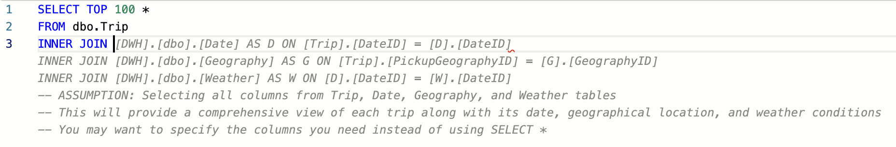
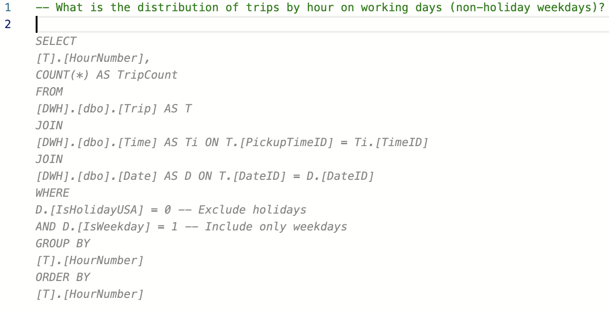

Copilot in Fabric for Data Warehouse provides context-based T-SQL code suggestions directly in the query editor. It uses your warehouse schema and query context to offer inline completions, from finishing a line to generating larger code blocks. It can help you write SQL, reduce repetitive typing, and catch some errors. Whether you're new to SQL or experienced, Copilot can assist with routine code so you can focus on design and optimization tasks.

## Prerequisites
To get started, ensure your administrator has enabled the Copilot tenant switch and that your capacity is in a supported region. Paid SKUs (F2 or higher, or P1 or higher) are required, as trial SKUs aren't supported. If your tenant or capacity is outside the US or France, Copilot is disabled by default unless your Fabric tenant admin enables the tenant setting that allows data sent to Azure OpenAI to be processed outside your capacity's geographic region.

Next, make sure you have a warehouse created in your Fabric workspace. This module uses the [**sample warehouse**](/fabric/data-warehouse/create-warehouse-sample) provided by Microsoft. 

## How to use Copilot code completion

Before you start, verify that the **Show Copilot completions** setting is enabled. In your warehouse **Settings**, select the **Copilot** pane and confirm the option is turned on. You can also check the status bar at the bottom of the query editor — it shows whether completions are active at a glance.

With completions enabled, start typing your query in the SQL editor, and Copilot provides real-time suggestions as dimmed ghost text. You can accept a suggestion by pressing `Tab` or dismiss it by continuing to type. If you prefer to accept only part of a suggestion, use the `Ctrl+Right` shortcut (`Cmd+Right` on macOS) to accept the next word. Copilot also offers alternative suggestions for the same input, which you can preview by hovering over the suggestion and selecting the best fit.

> [!div class="mx-imgBorder"]
> 

To guide Copilot, you can leave comments in your query using `--`. For example, writing `-- What is the distribution of trips by hour on working days (non-holiday weekdays)?` prompts Copilot to generate a corresponding query. This approach helps you write clear and accurate comments while also using Copilot to create efficient SQL code.

> [!div class="mx-imgBorder"]
> 

Copilot can provide different suggestions for the same input. You can hover over the suggestion to preview the other options.
