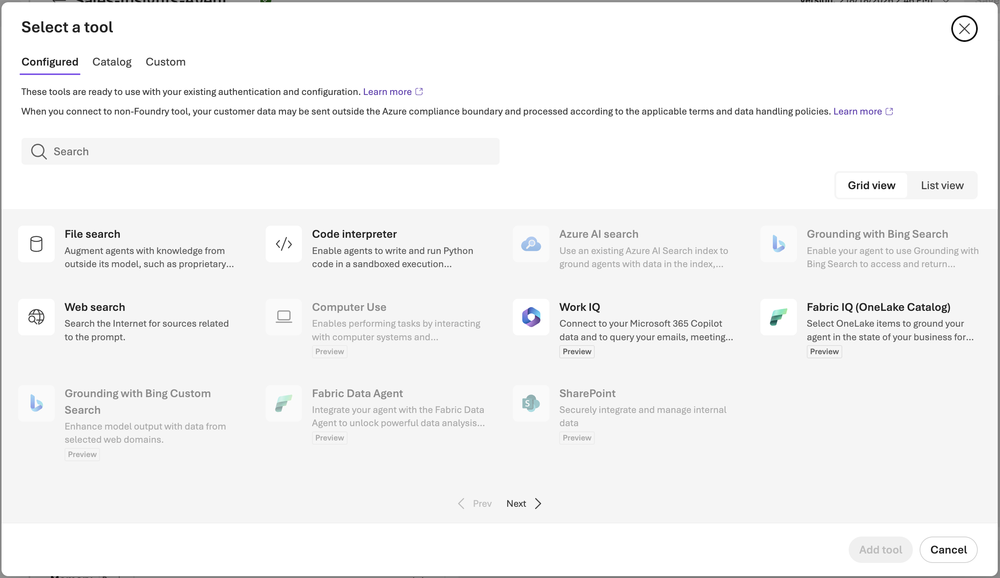
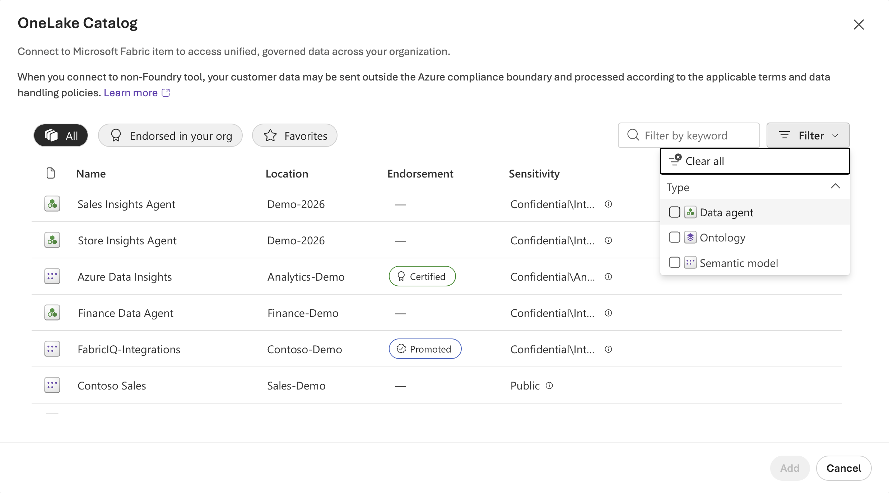

Connect a Microsoft Foundry agent to your published Microsoft Fabric data agents through **Fabric IQ (OneLake Catalog)**. This integration lets your Foundry agent answer natural language questions using enterprise data in Fabric.

## Connect through Fabric IQ

Fabric IQ exposes each selected data agent as a **Model Context Protocol (MCP)** endpoint. MCP is a standard for how an agent calls a tool. Your Foundry agent uses its instructions to decide which data agent to call, then uses the returned answer to respond to you.

With this integration, you:

- Select published data agents that you have access to by name from the OneLake Catalog.
- Connect multiple data agents to one Foundry agent, such as separate agents for sales and customer support.
- Guide tool selection by naming each data agent and describing the questions it should answer.

> [!NOTE]
> The Fabric IQ integration with Microsoft Foundry is currently in preview.

## Prepare access and permissions

With your Fabric data agent configured, check these requirements for the Foundry integration:

- Your workspace is in a [region that supports the full Fabric stack](/fabric/admin/region-availability).
- Your Foundry project has a deployed model.
- Your Fabric and Foundry agents are in the same tenant, and you sign in to both services with the same account.

Microsoft Foundry uses Azure role-based access control (RBAC). In an existing project, the required role depends on your task:

| Task | Required role |
|---|---|
| Build and test a Foundry agent | **Foundry User** |
| Create the connection to Fabric IQ | **Foundry Project Manager** |

Assign **Foundry User** to your account, the agent's runtime identity, and any user identity that participates in the sign-in flow. The Fabric data agent connection uses **delegated user authentication**, also called identity passthrough: queries run as the signed-in user, and Fabric applies that user's data permissions.

> [!IMPORTANT]
> Responses returned by Fabric data agents can leave Fabric's compliance boundary or geographic region. Microsoft Foundry processes and stores those responses according to its applicable terms and data handling policies.

## Add data agents in the Foundry portal

1. Sign in to the [Microsoft Foundry portal](https://ai.azure.com/), select your project, and select **Build**. Open an existing agent, or select **New agent** > **Build an agent** to create one. On its **Playground** tab, select your deployed model.
1. In the **Tools** section, select **Add**, and then select **Browse all tools**.
1. On the **Configured** tab, select **Fabric IQ (OneLake Catalog)**, and then select **Add tool**.

   

1. In the OneLake Catalog, select **Filter**. Under **Type**, select **Data agent**. Only published data agents that you have access to appear.

   

1. Select your data agent, and then select **Add**. It appears in **Tools** as **Fabric IQ** with the data agent's name. To add another data agent, repeat the catalog selection process.
1. In **Instructions**, name each connected data agent and describe when to use it. For example, if you connected sales and support data agents:

   > Use the Sales Insights Agent for questions about revenue, orders, and products. Use the Support Insights Agent for questions about support tickets. If a question needs both, call both and combine their answers.

1. Select **Save**, then send representative questions in the playground. Check that each question invokes the intended data agent and returns only authorized data. If you connected multiple data agents, also test a question that needs more than one. Revise the instructions, save, and retest if tool selection is incorrect.

If a data agent is missing from the catalog, confirm that it's published, shared with your account, and in the same tenant. For detailed setup guidance, see [Add Fabric data agents to a Foundry agent with Fabric IQ](/fabric/data-science/data-agent-foundry-fabric-iq).

## Connect through code

To connect an application through code, use Fabric IQ with the data agent's MCP endpoint and a Fabric IQ project connection resource ID. See [Connect agents to Microsoft Fabric with Fabric IQ](/azure/foundry/agents/how-to/tools/fabric-iq) for SDK and REST examples.