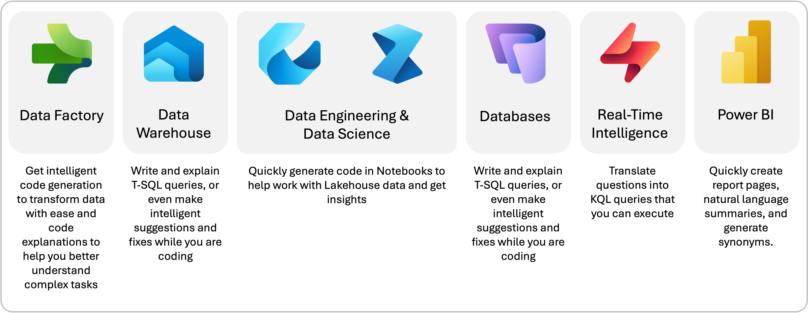

Let's first understand the context of Microsoft Fabric and its components.

## What is Microsoft Fabric?

Microsoft Fabric is a Software-as-a-Service (SaaS) analytics platform that unifies core data and AI workloads—including data engineering, data integration, data warehousing, data science, real-time intelligence, and business intelligence—into a single, cohesive experience. By delivering these capabilities as a managed SaaS offering, Fabric reduces infrastructure and integration overhead, streamlines collaboration, and helps users focus on turning data into actionable insights.

## What is Copilot in Fabric?

Copilot in Fabric is an AI-based assistant that supports common tasks across Microsoft Fabric. It uses generative AI to help users transform and analyze data, generate insights, and create visualizations and reports.

Copilot in Fabric provides code suggestions, can automate routine processes, and enables natural language interactions. This helps reduce the learning curve for new users and supports moving from raw data to insights.

The next sections describe Copilot experiences in Data Factory, data engineering and data science, Data Warehouse, Power BI, Real-Time Intelligence, and SQL database, along with Fabric data agents. Unlike the preconfigured Copilot experiences, Fabric data agents are configurable items that you tailor with your own instructions and examples. Each component addresses specific use cases within Microsoft Fabric.

> [!div class="mx-imgBorder"]
> 

## Who can use Copilot in Fabric?

Copilot in Microsoft Fabric is intended for a range of users across the organization. It facilitates interaction with data and items in Fabric for:

- **Enterprise developers**: Technical professionals who create and manage complex data solutions and analytics infrastructure
- **Self-service users**: Business analysts and data professionals who work with data but may not have extensive technical backgrounds
- **Business users**: End users who consume reports, dashboards, and insights to make data-driven decisions

Copilot is intended to augment user capabilities rather than replace them. It can assist users across different skill levels and roles.

## Prerequisites for using Copilot in Fabric

To use Copilot in Microsoft Fabric, your organization must meet specific requirements related to capacity and licensing. Copilot in Fabric requires one of the following supported SKUs (Stock Keeping Units):

- **Fabric capacities**: F2 or higher SKU
- **Power BI Premium capacities**: P1 or higher SKU

In addition, Copilot must be enabled by your Fabric administrators at the level of the tenant. It's enabled by default for tenants with paid Fabric capacities, but administrators can disable Copilot if your organization isn't ready to adopt it.

> [!NOTE]
> Copilot isn't available on trial SKUs, as it requires access to the Azure OpenAI Service that powers the AI capabilities.